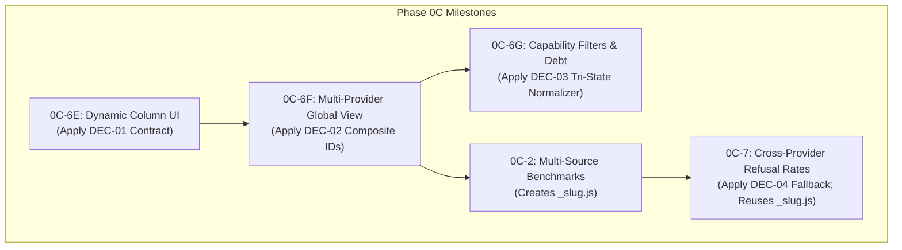

# PREPARATION REPORT: VERIFICATION OF ARGON'S FOUR ARCHITECTURAL DECISIONS (DEC-01 THROUGH DEC-04)

**Report File:** `~/storage/downloads/Sync/PREPARATION_REPORT_ARGON_4_DECISIONS.md`  
**Target Repositories:**  
- Application Repository: `~/Top_Models/`  
- Planning Repository: `~/storage/downloads/Sync/` (`anonymous5-coder/sync` on `main`)  
**Investigation Mode:** Read-Only Verification (No code changes, no builds, no commits, no pushes)  
**Date of Audit:** October 21, 2026  
**Auditor:** agy-termux (Executor)  

---

## 1. Executive Summary

This report delivers a read-only, evidence-grounded verification of the four architectural decisions (`DEC-01` through `DEC-04`) originally recorded in `execution_readiness.md` and referenced across the Top_Models master roadmap. 

The audit evaluated whether the historical recommendations (which uniformly favored Option A) reflect genuine open owner choices, are already settled by canonical forward specifications (`MASTER_PLAN.md`), or require technical correction against live application source code (`~/Top_Models/`).

### Key Findings Summary:
1. **DEC-01 (Dynamic Column Indexing & Expansion State — Milestone 0C-6E):**  
   **Status: GENUINE OPEN ARCHITECTURAL DECISION (BLOCKS 0C-6E).**  
   Live code in `index.html` hardcodes numeric indices `0..5` across 14 functions and loops. `MASTER_PLAN.md` Spec 2.1 prescribes `expanded: { modelId, colKey }` (string key) but leaves `rankedColumnsDynamic` ambiguous ("Map or array"). If an array is used without an index resolver, string lookups throw `TypeError: col.findIndex is not a function`. Option A (ordered array with explicit `getColumnIndex(colKey)` resolver) is strongly recommended over Option B (Object/Map conversion) because Option A minimizes code churn and regression risk.
2. **DEC-02 (Global View Identity & Deduplication Policy — Milestone 0C-6F):**  
   **Status: ALREADY CANONICALLY SETTLED — NO NEW OWNER DECISION REQUIRED.**  
   `MASTER_PLAN.md` Part 2, Spec 2.2 explicitly prescribes Option A (Multi-Endpoint Listing with Badges, composite model IDs `<providerId>:<modelId>`, distinct rows, and provider pill badges). Deduplicating by model slug (Option B) would discard provider-specific rate limits (Groq 30 RPM vs. SambaNova 20 RPM), latencies, and pricing.
3. **DEC-03 (Capability Tri-State Behavior on Unknown Data — Milestone 0C-6G):**  
   **Status: TECHNICAL CORRECTION REQUIRED (BLOCKS 0C-6G).**  
   Live code inspection confirmed a dual defect: `adapters/_normalize.js` lines 30–31 coercively converts `null` to `0` for `has_files` and `has_tools`, violating Project Rule 4 ("DO NOT invent fake metrics: Missing data must remain null"). Furthermore, `adapters/_filter.js` hardcodes checks for `free` and `is_chat` and does not evaluate dynamically. To avoid false negatives (e.g. Gemini and SambaNova models being treated as having no tools), `_normalize.js` must preserve `null`. Filter predicates must treat `null` as unknown (passing `any`, but excluded from strict `require` and strict `exclude`).
4. **DEC-04 (Refusal Estimation Fallback Strategy & Scope — Milestone 0C-7):**  
   **Status: ALREADY CANONICALLY SETTLED — NO NEW OWNER DECISION REQUIRED.**  
   `MASTER_PLAN.md` Part 2, Spec 2.5 explicitly prescribes Option A (query `openrouter/free` if `api_key_openrouter` is configured; otherwise automatically fall back to `./refusal_rates.json` bundled baseline with an informative UI message). Milestone 0C-7 strictly depends on Milestone 0C-2 (`adapters/_slug.js`). `sync-www.js` already includes `refusal_rates.json`.

---

## 2. Observed Baseline

### 2.1 Application Repository Baseline (`~/Top_Models/`)
- **Current Branch:** `main`
- **HEAD Commit:** `a31f09d` (`chore: synchronize web build with core.js changes`)
- **Preceding Commit:** `942bb06` (`fix: resolve core.js and dynamic column registration issues`)
- **Working Tree:** Clean (verified via `git status --porcelain`).
- **Core Version Reference:** `./core.js?v=0I` in `index.html` (line 452).
- **Service Worker Cache:** `matrix-cache-v11` in `sw.js` (line 3).
- **Baseline Match Result:** **VERIFIED MATCH.** The live application source code strictly reflects the completed Milestone 0C-6D baseline. All 9 Group A provider adapters are present and operational.

### 2.2 Planning Repository Baseline (`~/storage/downloads/Sync/`)
- **Current Branch:** `main`
- **HEAD Commit:** `eee3d50` (`docs: reconcile and refine planning documents across repository`)
- **Remote:** Synchronized with `origin/main` (`anonymous5-coder/sync`).
- **Working Tree:** Clean.

### 2.3 Files Inspected
- `index.html` (lines 450–475, 690–790, 840–1000, 1060–1155)
- `core.js` (lines 1–87)
- `adapters/_normalize.js` (lines 1–38)
- `adapters/_filter.js` (lines 1–50)
- `adapters/_registry.js` (lines 1–155)
- `adapters/_pipeline.js` (lines 1–45)
- `adapters/gemini/index.js`, `adapters/sambanova/index.js`, `adapters/groq/index.js`, `adapters/openrouter/index.js`, `adapters/modelscope/index.js`
- `refusal_rates.json` (lines 1–13)
- `sync-www.js` (lines 1–35)
- `sw.js` (lines 1–25)
- `MASTER_PLAN.md` (Specs 2.1, 2.2, 2.3, 2.4, 2.5)
- `codebase_1.md` and `execution_readiness.md`

---

## 3. DEC-01 — Dynamic Column Indexing & Expansion State Architecture

**Target Milestone:** Milestone 0C-6E (Dynamic Column UI — `KG_column`).

### 3.1 Live Code Evidence
1. **Current Expansion State:**  
   In `index.html` (line 463):
   ```javascript
   expanded: { modelId: null, colIndex: null }
   ```
   `colIndex` is strictly an integer (`0..5`).
2. **Current Ranked Columns Structure:**  
   In `index.html` (line 462) and `core.js` (line 80):
   ```javascript
   rankedColumns: [[], [], [], [], [], []]
   ```
   A fixed array of 6 arrays corresponding to:
   - Index 0: Context Window (`context_length`)
   - Index 1: Thinking / Intelligence (`intelligence_index`)
   - Index 2: Coding (`coding_index`)
   - Index 3: Agentic (`agentic_index`)
   - Index 4: Uptime (`uptime`)
   - Index 5: Refusal Rate (`refusal_rate`)
3. **Hardcoded Numeric Positional Dependencies (14 Locations):**
   - `getPrimaryVal(model, colIndex)` in `index.html:842–854`: explicit `switch(colIndex)` on cases `0` through `5`.
   - `renderTable()` in `index.html:899`: `for(let c = 0; c < 6; c++)`.
   - `renderTable()` cell rendering in `index.html:912`: `data-col="${c}"`.
   - `renderTable()` modality pill rendering in `index.html:936`: `if (c === 0 && model.raw_modalities)`.
   - `toggleExtend(modelIndex, colIndex)` in `index.html:973–983`: binds `expanded = { modelId: model.id, colIndex }`.
   - `#table-body` click delegation in `index.html:985–993`: `const c = parseInt(btn.dataset.col, 10); toggleExtend(r, c);`.
   - Re-ranking loops (all iterate `for(let c = 0; c < 6; c++)`):
     - Initial fetch: `index.html:696–698`
     - Filter change: `index.html:723–725`
     - Provider switch: `index.html:784–786`
     - Manual refresh: `index.html:1068–1070`
     - Refusal rates refresh: `index.html:1131–1133`
     - Core refusal function: `core.js:81–83`
4. **Concrete Failure Path (Key-to-Index Mismatch):**  
   `MASTER_PLAN.md` Spec 2.1 (lines 280–310) prescribes that expansion state store `{ modelId, colKey }` where `colKey` is a string (e.g. `'context'`, `'thinking'`).  
   In `index.html:861–865`:
   ```javascript
   if (isExpanded) {
       const col = appState.rankedColumns[c];
       const rankInCol = col.findIndex(m => m.id === model.id);
   ```
   If `appState.expanded` uses string keys while `appState.rankedColumns` remains a numeric array, or if code attempts `appState.rankedColumns[appState.expanded.colKey]`, the property lookup returns `undefined`. Calling `.findIndex()` throws a fatal runtime exception:
   `TypeError: col.findIndex is not a function`.

### 3.2 Specification Alignment & Remaining Ambiguity
`MASTER_PLAN.md` Part 2, Spec 2.1 (line 335) defines the state update as:
`appState.rankedColumnsDynamic: Map<string, Array> or Array of ranked arrays`.
The specification explicitly leaves open whether `rankedColumns` should be stored as an Array or a Map/Object.

### 3.3 Option Comparison

| Dimension | Option A: Array-Aligned + `getColumnIndex(colKey)` Resolver | Option B: Keyed Map / Object (`appState.rankedColumns[colKey]`) |
| :--- | :--- | :--- |
| **Data Structure** | `appState.rankedColumnsDynamic: Array<Array<Model>>` aligned 1:1 with `activeColumns`. | `appState.rankedColumnsDynamic: Object<string, Array<Model>>`. |
| **Expansion State** | `{ modelId: string, colKey: string }`. | `{ modelId: string, colKey: string }`. |
| **Lookup Bridge** | `function getColumnIndex(colKey) { return activeColumns.findIndex(c => c.id === colKey); }` | Direct key access `rankedColumns[colKey]`. |
| **Code Churn in `index.html`** | **Very Low.** Loops continue iterating `c = 0; c < activeColumns.length; c++`. Event delegation continues using `btn.dataset.col = c`. | **High.** All 6 re-ranking loops, table header rendering, cell loops, and event handlers must be rewritten to map object entries. |
| **Sorting Engine Interop** | Seamlessly maps to `sortModelsForColumn(models, activeColumns[c])`. | Requires adapter wrapper around sorting engine. |
| **Hidden Column Handling** | If an expanded column is toggled off in the column selector popover, `getColumnIndex(colKey)` returns `-1`, cleanly clearing or collapsing the expansion without crashing. | Key remains in Map; requires manual cleanup logic on column toggle. |
| **Regression Risk** | Minimal. Preserves proven array-indexing conventions. | Moderate to High. Broad surface area touching rendering and sorting. |

### 3.4 Verdict and Owner Action
- **Decision Status:** **GENUINE OPEN ARCHITECTURAL DECISION.**
- **Recommendation:** **Option A.** Option A provides complete dynamic column support while preserving structural stability and avoiding broad DOM refactoring in `index.html`.
- **Execution Blocker:** **YES (Blocks Milestone 0C-6E).** The execution prompt for 0C-6E must incorporate the agreed contract.

---

## 4. DEC-02 — Global View Model Identity & Deduplication Policy

**Target Milestone:** Milestone 0C-6F (Multi-Provider Home Page & Global View).

### 4.1 Live Code Evidence
1. **Global View Status in Live Source:**  
   Global View does not yet exist. In `adapters/_registry.js:14–154`, 13 providers are registered; no entry for `id: 'all'` exists. In `index.html:461`, `activeProvider` defaults to `'openrouter'`.
2. **Current Model Identity & Storage:**  
   Models are normalized by provider adapters into `createNormalizedModel({ id, name, ... })` where `id` is provider-local (e.g. `llama-3.3-70b-versatile` on Groq, `Meta-Llama-3.3-70B-Instruct` on SambaNova).  
   Each provider's models are cached separately in `localStorage` under `cached_richModels_<providerId>` (`adapters/_pipeline.js:27, 33`).
3. **Collision Risk:**  
   Identical open-weight models across providers share similar or identical slugs. If aggregated into a single flat list without namespacing, `m.id` collisions would break row selection, expansion state (`appState.expanded.modelId`), and bookmarking.
4. **Data Loss from Merging:**  
   Merging identical model weights into a single canonical row would discard critical provider differentials:
   - Rate Limits: Groq offers 30 RPM; SambaNova offers 20 RPM; OpenRouter offers variable tier limits.
   - Latency & TTFT: Groq LPU latency differs substantially from SambaNova SN40L or cloud hosting.
   - Context Windows: Context limits and pricing vary across providers for the same model weights.

### 4.2 Specification Alignment
`MASTER_PLAN.md` Part 2, Spec 2.2 lines 433 and 459–474 already unambiguously prescribes Option A:
- **Composite IDs:** `id: `${providerId}:${m.id}`` (Spec 2.2 line 433).
- **Provider Identity:** Normalized models in Global View must preserve `_providerId` and `_providerName`.
- **Provider Pill Badges:** Rendered in every cell (`<span class="provider-pill ${m._providerId}">${m._providerName}</span>`).
- **Collision Test:** User verification test 3 (Spec 2.2 line 543) explicitly requires that expanding an open-weight model from one provider expands ONLY that specific provider's row.

### 4.3 Verdict and Owner Action
- **Decision Status:** **ALREADY CANONICALLY SETTLED — NO NEW OWNER DECISION REQUIRED.**
- **Reasoning:** `MASTER_PLAN.md` Part 2, Spec 2.2 already specifies Option A in exhaustive detail. Option B (deduplication/merging) directly violates explicit Spec 2.2 invariants.
- **Execution Blocker:** **NO.** Milestone 0C-6F will implement the existing Spec 2.2 requirements without needing a new owner decision.

---

## 5. DEC-03 — Capability Filter Tri-State Behavior on Unknown Data

**Target Milestone:** Milestone 0C-6G (Advanced Capability & Modality Filters).

### 5.1 Live Code Evidence
1. **Coercive Normalization Defect:**  
   In `adapters/_normalize.js` (lines 30–31):
   ```javascript
   has_files: has_files ? 1 : 0,
   has_tools: has_tools ? 1 : 0,
   ```
   When an adapter passes `has_tools: null` or `has_files: null`, the ternary converts `null` into `0`.
2. **Provider Adapter Debts Verified in Live Source:**
   - `adapters/gemini/index.js` (line 32): `const hasTools = null;`  
     *Result:* Coerced to `0` by `_normalize.js`, hiding Gemini 1.5 Pro/Flash from tool filters.
   - `adapters/sambanova/index.js` (lines 41–42): `has_files: null, has_tools: null`  
     *Result:* Coerced to `0`, hiding SambaNova models from vision and tool filters.
   - `adapters/modelscope/index.js` (line 39): `has_tools: null`  
     *Result:* Coerced to `0`.
   - `adapters/cohere/index.js` (lines 40–41): `has_files: isVision ? 1 : 0, has_tools: isTools ? 1 : 0`.
   - `adapters/groq/index.js` (lines 50–51): detects `tools` but lacks reasoning/structured output.
   - `adapters/openrouter/index.js` (lines 105, 138): dynamically detects tools from architecture/parameters.
3. **Filter Engine Hardcoding:**  
   In `adapters/_filter.js` (lines 33–50):  
   `applyModelFilters(models, filterState)` explicitly extracts only `freeDef` (`id === 'free'`) and `chatDef` (`id === 'is_chat'`). It does NOT dynamically iterate over `FILTER_DEFINITIONS`. Adding new filter definitions to `FILTER_DEFINITIONS` currently has zero effect on filtering unless `applyModelFilters` is updated.

### 5.2 Conflict with Project Directives
Coercing `null` to `0` violates **Project Directive Rule 4** (User Rules):  
> *"DO NOT invent fake metrics: Missing data must remain `null` so the table displays `-`."*

### 5.3 Tri-State Filter Semantics Comparison

| Filter Selection | Option A: True Tri-State (`null` preserved) | Option B: Strict Binary (`null` coerced to `0`) |
| :--- | :--- | :--- |
| **`any` (Default)** | `() => true` — Passes all models (`1`, `0`, and `null`). | `() => true` — Passes all models. |
| **`require`** | `m => m.has_tools === 1` — Passes verified tool-capable models. Models with `null` do not pass. | `m => m.has_tools === 1` — Models with `null` (coerced to `0`) do not pass. |
| **`exclude`** | `m => m.has_tools === 0` — Passes models verified to lack tools. **Models with `null` do not pass.** | `m => m.has_tools === 0` — **FALSE POSITIVE:** Unverified models with `null` (e.g. Gemini, SambaNova) appear as "No Tools (Text Only)". |
| **Table Display** | `1` displays checkmark; `0` displays `-` or cross; `null` displays `-` (unknown). | `1` displays checkmark; `0` displays cross; `null` never exists. |

### 5.4 Verdict and Owner Action
- **Decision Status:** **TECHNICAL CORRECTION REQUIRED (BLOCKS 0C-6G).**
- **Action Required:**
  1. In `adapters/_normalize.js`: Update lines 30–31 to preserve `null`:
     ```javascript
     has_files: (has_files === null || has_files === undefined) ? null : (has_files ? 1 : 0),
     has_tools: (has_tools === null || has_tools === undefined) ? null : (has_tools ? 1 : 0),
     ```
  2. In `adapters/_filter.js`: Implement dynamic iteration over all active `FILTER_DEFINITIONS`, applying predicates where `require` strictly requires `=== 1` and `exclude` strictly requires `=== 0`.
  3. In Group A adapters: Resolve metadata debt as specified in `MASTER_PLAN.md` Spec 2.3.
- **Owner Input:** The owner should confirm adoption of Option A (True Tri-State with `null` pass-through).

---

## 6. DEC-04 — Refusal Estimation Fallback Strategy & Scope

**Target Milestone:** Milestone 0C-7 (Cross-Provider Refusal Rates).

### 6.1 Live Code Evidence
1. **Single-Provider Lock-In:**  
   In `index.html` (lines 771–773):
   ```javascript
   if (refusalBtn) {
       refusalBtn.style.display = (p.id === 'openrouter') ? '' : 'none';
   }
   ```
   The refusal rates button is hidden for all non-OpenRouter providers.
   In `index.html` (line 1095):
   ```javascript
   if (appState.activeProvider !== 'openrouter') return;
   ```
   The click handler strictly aborts if the active provider is not OpenRouter.
2. **Hardcoded OpenRouter Key & Model:**  
   In `core.js` (lines 22–49):
   - `refreshRefusalRates(apiKey, parsedModels, storageAdapter)` strictly throws `Error("API Key is required.")` if `apiKey` is empty.
   - It directly queries `https://openrouter.ai/api/v1/chat/completions` using `model: "openrouter/free"`.
3. **Bundled Baseline Dataset (`refusal_rates.json`):**  
   - File exists at `~/Top_Models/refusal_rates.json` (13 lines, 442 bytes).
   - Contains OpenRouter model identifiers (`meta-llama/llama-3-8b-instruct:free`, `google/gemma-2-9b-it:free`, etc.) with a `"default": 5.0` fallback.
   - Provenance: Generated via historical LLM estimation from `openrouter/free` on 2026-10-02, not empirical lab benchmarks.
4. **Build & Cache Sync Status:**  
   - `sync-www.js` (lines 26–29): **Already includes `refusal_rates.json` conditionally.** No build script modifications are needed.
   - `sw.js`: Does not yet precache `refusal_rates.json`.

### 6.2 Specification Alignment
`MASTER_PLAN.md` Part 2, Spec 2.5 (lines 818–829) already explicitly prescribes Option A:
1. When user taps `Refresh Refusal Rates` on any provider or Global View:
2. Check `api_key_openrouter`.
3. If OpenRouter key is present: Submit canonical slugs to `openrouter/free` for live LLM estimation.
4. If OpenRouter key is absent: Load bundled baseline from `./refusal_rates.json`, hydrate matching canonical slugs, and display status:  
   `"Applied bundled baseline refusal rates (OpenRouter key not configured for live LLM estimation)."`
5. Re-rank Column 5 using ascending sentinel `+999999` (lowest refusal rate at top, nulls at bottom).

### 6.3 Verdict and Owner Action
- **Decision Status:** **ALREADY CANONICALLY SETTLED — NO NEW OWNER DECISION REQUIRED.**
- **Reasoning:** Option A is already the exact specification in `MASTER_PLAN.md` Spec 2.5. Milestone 0C-7 is strictly sequenced after Milestone 0C-2 (which creates `adapters/_slug.js`).
- **Execution Blocker:** **NO.** No new owner decision is required prior to Milestone 0C-7 preparation.

---

## 7. Cross-Decision Dependencies and Contradictions

### 7.1 Sequence and Inter-Dependency Graph



### 7.2 Key Architectural Intersections
1. **DEC-01 & DEC-02:** When Global View (`0C-6F`) pools models with composite IDs (`<providerId>:<modelId>`), `appState.expanded` must resolve expansion state using both the composite model ID and the column key (`colKey`). Adopting Option A for DEC-01 ensures expansion reconciliation operates reliably in Global View.
2. **DEC-02 & DEC-04:** Cross-provider refusal estimation (`0C-7`) requires canonical model slug normalization across providers (`adapters/_slug.js`, created in `0C-2`). Global View model rows retain distinct provider deployments while sharing canonical refusal estimates.
3. **DEC-03 & Normalization Architecture (`0D-1`):** Fixing the coercive `null` conversion in `_normalize.js` during `0C-6G` prevents carrying corrupt boolean data into the Layer 1 lossless normalization architecture in Milestone `0D-1`.

---

## 8. Owner Decision Agenda

| Decision ID | Target Milestone | Question for Owner | Options | Recommendation | Status |
| :---: | :---: | :--- | :--- | :---: | :---: |
| **DEC-01** | **0C-6E** | How should `appState.rankedColumns` and `appState.expanded` bridge string column keys to array indices? | **A:** Array-aligned `rankedColumns` with `getColumnIndex(colKey)` resolver.<br>**B:** Keyed Map/Object `rankedColumns[colKey]`. | **Option A** | **GENUINE OWNER DECISION REQUIRED** (Blocks 0C-6E). |
| **DEC-02** | **0C-6F** | Should identical models across providers appear as separate rows or be deduplicated? | **A:** Separate rows with provider badges & composite IDs.<br>**B:** Deduplicate by canonical slug. | **Option A** | **NO NEW DECISION REQUIRED** (Already specified in Spec 2.2). |
| **DEC-03** | **0C-6G** | How should capability filters treat `null` (unknown) capability data? | **A:** True Tri-State (preserve `null`; strict `require`/`exclude`).<br>**B:** Strict Binary (treat `null` as `0`). | **Option A** | **TECHNICAL CORRECTION CONFIRMED** (Preserve `null` per Rule 4). |
| **DEC-04** | **0C-7** | How should refusal estimation respond when no OpenRouter key is present? | **A:** Hybrid fallback to bundled `./refusal_rates.json`.<br>**B:** Strict prompt requiring OpenRouter key. | **Option A** | **NO NEW DECISION REQUIRED** (Already specified in Spec 2.5). |

---

## 9. Verification and Integrity

### 9.1 Verification Checks Executed
1. **Working Tree and Git Status:** Verified clean working trees in both `~/Top_Models/` (commit `a31f09d`) and `~/storage/downloads/Sync/` (commit `eee3d50`).
2. **Static Analysis & Grep Probes:**
   - Evaluated all 14 numeric column indexing call sites in `index.html` and `core.js`.
   - Verified provider registry contents and lack of `all` provider entry in `adapters/_registry.js`.
   - Verified `has_tools` and `has_files` coercion in `adapters/_normalize.js`.
   - Verified `null` assignment in `adapters/gemini/index.js`, `adapters/sambanova/index.js`, and `adapters/modelscope/index.js`.
   - Verified filter engine logic in `adapters/_filter.js`.
   - Verified refusal rates refresh logic in `core.js:22–86` and UI handlers in `index.html:770–773, 1093–1151`.
   - Verified `refusal_rates.json` content and conditional copy in `sync-www.js`.

### 9.2 Scope Integrity Statement
- **Application Source Code:** Unmodified (`~/Top_Models/` remained strictly read-only).
- **Existing Planning Documents:** Unmodified (`MASTER_PLAN.md`, `codebase_1.md`, `execution_readiness.md`, `PREPARATION_PROMPT_TEMPLATE.md` remained strictly untouched).
- **Git State:** No commits, branch switches, or pushes were performed.
- **Build & Execution:** No builds (`npm run build:web`), package installations, or live API calls were performed.
- **Single Created File:** Exactly one file was created: `~/storage/downloads/Sync/PREPARATION_REPORT_ARGON_4_DECISIONS.md`.

---

## 10. Next Step

1. **Review in ChatGPT:**  
   The operator should upload or copy this preparation report into ChatGPT for owner review.
2. **Specific Action Needed:**  
   - Formal owner approval of **DEC-01 Option A** (Array-aligned `rankedColumns` with `getColumnIndex(colKey)` resolver).
   - Confirmation of **DEC-03 Option A** (True Tri-State preserving `null`).
   - Note that **DEC-02** and **DEC-04** are already canonically specified in `MASTER_PLAN.md` and require no new architectural divergence.
3. **Stage 2 Gate:**  
   Implementation of Milestone 0C-6E remains strictly prohibited until the owner reviews this report in ChatGPT and issues an explicit, finalized Milestone 0C-6E Execution Prompt.
