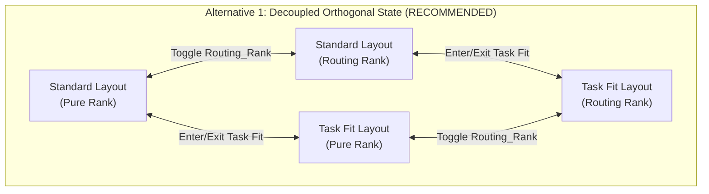
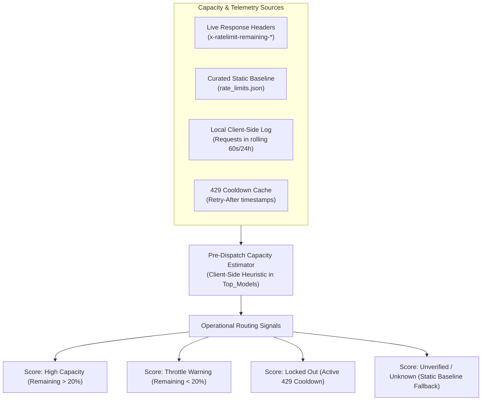
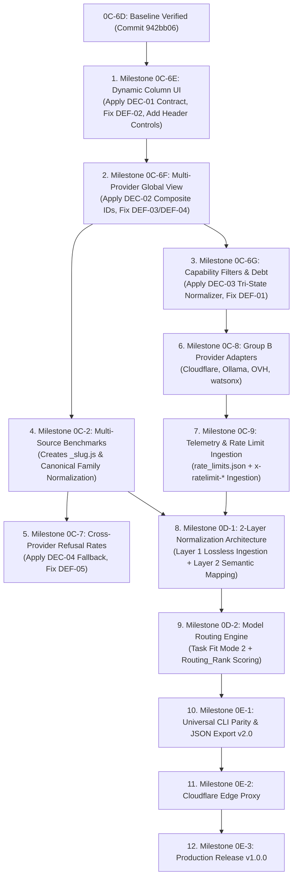

# PREPARATION REPORT: GLOBAL MATRIX, DYNAMIC COLUMNS, TASK FIT & ROUTING_RANK

**Report File:** `~/storage/downloads/Sync/PREPARATION_REPORT_GLOBAL_MATRIX_ROUTING.md`  
**Target Repositories:**  
- Application Repository: `~/Top_Models/` (GitHub: `anonymous5-coder/Top_Models`, branch: `backup/0c-6d`)  
- Planning Repository: `~/storage/downloads/Sync/` (GitHub: `anonymous5-coder/sync`, branch: `main`)  
**Investigation Mode:** Read-Only Audit & Architectural Alignment (Stage 1 Preparation — No code changes, no builds, no commits, no pushes)  
**Date of Audit:** October 24, 2026  
**Auditor:** agy-termux (Executor)  

---

## 1. Executive Summary & Readiness Overview

This report provides a comprehensive, read-only, evidence-grounded preparation audit across `Top_Models` and its planning repository. The audit evaluates the architectural requirements confirmed by the project owner regarding **Dynamic Columns**, the **Global Model Matrix**, **Task Fit (Mode 2)**, and **Routing_Rank**.

### Core Verdict:
The live application codebase (strictly matching Milestone 0C-6D completion state at commit `a31f09d`, ancestry `942bb06`, `core.js?v=0I`, `matrix-cache-v11`) provides a solid foundation for dynamic extensions, but exhibits critical architectural gaps and structural assumptions that must be addressed in sequential milestone execution:

1. **Matrix Paradigm:** The existing table rendering engine in `index.html` already implements **independent column ranking** (each column sorts candidates separately via `sortModelsForColumn`). A table row does **not** represent a single model; each cell is an independent leaderboard rank. This matches the owner's confirmation that the Global Matrix is **attribute-centric, not provider-centric**.
2. **Dynamic Columns (`KG_column`):** Conceptual terms `KG` and `KG_column` do not exist as literal code symbols. Column definitions must be externalized into `adapters/_columns.js` (Milestone 0C-6E). The owner's requirement for column header controls (**replace attribute, hide/remove, insert left/right**) expands upon previous popover specs and requires direct header UI controls.
3. **Task Fit vs. Routing_Rank:** These two mechanisms are fundamentally distinct:
   - **Task Fit** is an interactive LLM-driven mode that reorders and prioritizes **columns** (attributes) from left to right.
   - **Routing_Rank** is a top-level toggle that reranks **candidates within each column** by factoring in operational reliability, latency, and capacity signals without reordering columns.
   - To prevent state confusion, **Layout Mode** (`'standard'` vs `'task_fit'`) and **Ranking Mode** (`routingRankEnabled: boolean`) must be managed as **decoupled orthogonal state variables**.
4. **Provider Capacity & Quota Safety:** Direct inference probing to test rate limits is strictly prohibited. Comprehensive official documentation research reveals that providers vary radically in quota visibility: Groq and Mistral return real-time `x-ratelimit-*` headers on all responses; OpenRouter and Google Gemini omit remaining quotas on success and return rate-limit metadata only on HTTP `429` errors. A conservative pre-dispatch estimator must rely on a hybrid architecture: curated static limits (`rate_limits.json`), local client-side token/request window accounting, and dynamic response header ingestion.
5. **Decisions and Defects Revalidation:** All four historical decisions (`DEC-01` through `DEC-04`) and five defects (`DEF-01` through `DEF-05`) have been re-verified against live code. `DEC-01` (Array-aligned `rankedColumns` with `getColumnIndex(colKey)` resolver) and `DEC-03` (preserving `null` for unknown capabilities in `_normalize.js`) represent mandatory execution blockers for Milestones 0C-6E and 0C-6G respectively.

---

## 2. Repository Baseline & Evidence Verification

### 2.1 Repository States
| Dimension | Application Repository (`~/Top_Models/`) | Planning Repository (`~/storage/downloads/Sync/`) |
| :--- | :--- | :--- |
| **Local Branch** | `main` | `main` |
| **Remote Tracking** | `origin/main` (behind local by 7 commits) | `origin/main` (up to date) |
| **Backup Reference** | `origin/backup/0c-6d` points directly to local HEAD (`a31f09d`) | N/A |
| **HEAD Commit** | `a31f09d` (`docs: add GEMINI.md agent directives and context`) | `d8fda0a` (`docs: add preparation report verifying Argon's four architectural decisions`) |
| **Direct Ancestor** | `942bb06` (`Milestone 0C-6D: Implement in-memory filter UI, model-bound extended rows, and event delegation`) | `eee3d50` (`docs: reconcile cross-document planning artifacts and refine preparation template`) |
| **Working Tree** | **Clean** (`git status --porcelain` is empty) | Clean (with untracked `INSTRUCTIONS.md` operating guide) |

### 2.2 Live Application Version Identifiers
- **Core Import Reference:** In `index.html` (line 452):
  ```javascript
  import { fetchData, refreshRefusalRates, PROVIDER_REGISTRY, runProviderPipeline, sortModelsForColumn, DEFAULT_FILTER_STATE, FILTER_DEFINITIONS, applyModelFilters } from './core.js?v=0I';
  ```
- **Service Worker Cache Name:** In `sw.js` (line 3):
  ```javascript
  const CACHE_NAME = 'matrix-cache-v11';
  ```
- **Baseline Match Result:** **VERIFIED MATCH.** The live application source code strictly reflects the completed Milestone 0C-6D baseline.

### 2.3 Module Inventory (Existing vs. Planned)
An audit of actual filesystem contents in `~/Top_Models/` confirms:
- **Implemented / Existing Modules:**
  - `adapters/_sorting.js` (Sorting engine, 6-column hierarchy constants)
  - `adapters/_normalize.js` (Canonical `createNormalizedModel` factory)
  - `adapters/_filter.js` (Declarative filters for `free` and `is_chat`)
  - `adapters/_registry.js` (13 registered providers: 9 Group A, 4 Group B)
  - `adapters/_pipeline.js` (Single-provider pipeline runner and localStorage cache manager)
  - 9 Group A Provider Adapters: `cohere`, `gemini`, `groq`, `llm7`, `mistral`, `modelscope`, `nvidia`, `openrouter`, `sambanova`
  - `core.js`, `index.html`, `cli.js`, `proxy.py`, `sync-www.js`, `sw.js`, `refusal_rates.json`
- **Planned / Absent Modules (Roadmap Deliverables):**
  - `adapters/_columns.js` (Planned for Milestone 0C-6E) — **ABSENT**
  - `adapters/_slug.js` (Planned for Milestone 0C-2) — **ABSENT**
  - `adapters/cloudflare`, `adapters/ollama`, `adapters/ovh`, `adapters/watsonx` (Planned for 0C-8) — **ABSENT**
  - `rate_limits.json` (Planned for Milestone 0C-9) — **ABSENT**
  - `adapters/_layer1.js`, `adapters/_layer2.js` (Planned for Milestone 0D-1) — **ABSENT**
  - `adapters/_router.js` (Planned for Milestone 0D-2) — **ABSENT**

---

## 3. Dynamic Columns & Header Manipulation Architecture (`KG_column`)

### 3.1 Verification of Conceptual Terms
- **Owner Terms:** `KG` ("key group") and `KG_column` are conceptual product terms denoting JSON model attributes and attributes eligible for dynamic matrix columns.
- **Source Verification:** Grep inspection across the entire codebase confirms that **no literal code identifiers or variables** named `KG` or `KG_column` exist. They represent the architectural schema to be formalized in `adapters/_columns.js`.

### 3.2 Confirmed Header Interaction Requirements
The owner confirms that every column header (`<th>`) must support direct manipulation in both Standard and temporary Task Fit layouts:
1. **Replace Attribute:** Switch the column's underlying attribute via an attribute picker dropdown (e.g., replace `Context Window` with `Coding Index`).
2. **Hide / Remove Column:** Remove the column from the active matrix view.
3. **Insert Column Left:** Insert a new column immediately to the left of the current column.
4. **Insert Column Right:** Insert a new column immediately to the right of the current column.

### 3.3 Dynamic Column Policies & Edge Case Audit

| Policy / Concern | Current Code Finding | Recommended Specification Default |
| :--- | :--- | :--- |
| **Duplicate Attributes** | `index.html` has fixed HTML `<th>` elements. Duplicate columns do not exist. | **Prohibit duplicates in visible layout:** The attribute picker disables or greys out currently active attributes. Selecting an active attribute either prompts a swap or is rejected to prevent duplicate leaderboards wasting viewport space. |
| **Minimum Visible Columns** | Table requires at least 1 column to maintain layout integrity. | **Enforce Minimum 1 Column Invariant:** If `activeColumns.length === 1`, the "Hide/Remove" control on that column's header is disabled/hidden. |
| **Standard Layout Persistence** | Hardcoded in HTML; no persistence. | **Persist to `localStorage`:** Save `columnState_<providerId>` and `columnState_global` containing an ordered array of attribute keys: `['context_length', 'intelligence_index', ...]`. |
| **Temporary Task Fit Layout Isolation** | N/A | **In-Memory Only:** Task Fit layout mutations must exist in `appState.taskFitColumns` without overwriting the persisted `columnState_*` in `localStorage`. |
| **Header Edits During Task Fit** | N/A | **Session-Scoped:** Column additions, removals, or swaps performed while in Task Fit modify only the active Task Fit layout. Exiting Task Fit restores the persisted Standard layout cleanly. |
| **Expansion State Reconciliation** | `expanded: { modelId, colIndex }` binds to numeric index `0..5`. | **Resolve via String ID:** `appState.expanded` stores `{ modelId, colKey }`. A helper `getColumnIndex(colKey)` resolves the current array position. If the expanded column is hidden, `getColumnIndex(colKey)` returns `-1`, cleanly collapsing the row without error. |
| **Mobile Usability & Accessibility** | On Android (~360–412px viewport), table scrolls horizontally. | **Compact Header Touch Controls:** Each `<th>` features a compact action button (e.g. `⋮` or `⚙`) that opens a touch-friendly popup menu (min 44x44px touch targets) offering `Insert Left`, `Change Attribute`, `Insert Right`, and `Remove`. |
| **Reset Behavior** | Filter popover has a reset button; table headers have none. | **Global Header Reset Action:** Provide a "Reset Columns to Default" button in the column manager/footer that restores `DEFAULT_COLUMN_STATE` (the 6 standard columns). |

---

## 4. The Global Matrix & Independent Column Ranking

### 4.1 Attribute-Centric vs. Provider-Centric Structure
- **Attribute-Centric Core:** In the Global Matrix (`activeProvider === 'all'`), models are aggregated from all configured, implemented providers returning data.
- **No Provider Partitioning:** Providers are **not** represented as fixed rows, table sections, or grouped accordions. Candidates from all providers compete directly on an equal footing within each attribute column.

### 4.2 Candidate Catalog & Filtering Guarantees
- **No Silent Truncation:** The entire candidate pool must remain available for ranking, routing, and export. Client-side pagination or virtualization may be used strictly for DOM performance on mobile browsers, but must never cap the underlying candidate dataset.
- **Explicit Filtering Only:** Only explicit user-selected filters (e.g. `free_eligible`, `strict_free`, `chat_only`, `has_tools`) remove candidates from consideration.
- **Provider Failure Isolation:** If a single provider fails (network timeout, invalid API key, CORS error), the Global Matrix continues rendering candidates from all operational providers, flagging the failed provider with an informative badge in the status bar.

### 4.3 Deployment Identity & Provenance
To ensure identical open-weight models (e.g. `meta-llama/llama-3.3-70b-instruct`) hosted across Groq, SambaNova, and OpenRouter remain distinct:
- **Composite ID:** `${providerId}:${m.id}` (e.g. `groq:llama-3.3-70b-versatile`, `sambanova:Meta-Llama-3.3-70B-Instruct`).
- **Provenance Fields:** Every normalized model retains `_providerId` and `_providerName`.
- **Provider Badges:** Every model cell renders a visual provider pill badge (e.g. `<span class="provider-pill groq">Groq</span>`).
- **Expansion Isolation:** Expanding a model row in one cell targets strictly that provider's deployment (`${providerId}:${m.id}`), never affecting another provider's deployment of the same weights.

### 4.4 Faithful Current Sorting Audit (`adapters/_sorting.js`)
Inspection of `adapters/_sorting.js` and `index.html` reveals the exact current ranking engine:

```javascript
// adapters/_sorting.js
export const S = {
    ctx: 'context_length',
    out: 'max_completion_tokens',
    intel: 'intelligence_index',
    code: 'coding_index',
    agent: 'agentic_index',
    refuse: 'refusal_rate',
    file: 'has_files',
    tool: 'has_tools',
    up: 'uptime'
};

export const sortHierarchy = {
    0: [{k: S.ctx, d: true}, {k: S.file, d: true}, {k: S.ctx, d: true}, {k: S.out, d: true}, {k: S.intel, d: true}, {k: S.agent, d: true}, {k: S.up, d: true}],
    1: [{k: S.intel, d: true}, {k: S.ctx, d: true}, {k: S.ctx, d: true}, {k: S.out, d: true}, {k: S.tool, d: true}, {k: S.up, d: true}],
    2: [{k: S.code, d: true}, {k: S.agent, d: true}, {k: S.tool, d: true}, {k: S.out, d: true}, {k: S.ctx, d: true}, {k: S.intel, d: true}, {k: S.ctx, d: true}],
    3: [{k: S.agent, d: true}, {k: S.tool, d: true}, {k: S.code, d: true}, {k: S.out, d: true}, {k: S.ctx, d: true}, {k: S.intel, d: true}, {k: S.ctx, d: true}, {k: S.up, d: true}],
    4: [{k: S.out, d: true}, {k: S.ctx, d: true}, {k: S.ctx, d: true}, {k: S.intel, d: true}, {k: S.code, d: true}, {k: S.agent, d: true}, {k: S.up, d: true}],
    5: [{k: S.refuse, d: false}, {k: S.code, d: true}, {k: S.agent, d: true}, {k: S.intel, d: true}, {k: S.ctx, d: true}, {k: S.ctx, d: true}, {k: S.out, d: true}, {k: S.up, d: true}]
};
```

#### Detailed Sorting Mechanics:
1. **Independent Column Ranking:** In `index.html` (lines 895–920), the matrix renders `appState.rankedColumns[c][r]`. Each column `c` is sorted completely independently. **Cells horizontally adjacent in row `r` belong to different models.**
2. **Primary & Fallback Keys:**
   - Col 0 (Context Window): Primary = `context_length` (descending). Fallbacks = `has_files`, `max_completion_tokens`, `intelligence_index`, `agentic_index`, `uptime`. (Note: `context_length` is redundantly listed twice).
   - Col 1 (Thinking): Primary = `intelligence_index` (descending).
   - Col 2 (Coding): Primary = `coding_index` (descending).
   - Col 3 (Agentic): Primary = `agentic_index` (descending).
   - Col 4 (Summarizer): Primary = `max_completion_tokens` (descending). (Note: Header in `index.html` is labeled "Summarizer").
   - Col 5 (Refusal Rates): Primary = `refusal_rate` (ascending, `d: false`).
3. **Missing / Invalid Value Handling:**
   - Sentinel function `val(obj, key, fallback)`: missing/null values receive `-999999` for descending sort, and `+999999` for ascending sort (`colIndex === 5`).
   - Missing data is always pushed to the bottom of each column's leaderboard.
4. **Tie-Breaking:**
   - If two models have equal values for all criteria in `sortHierarchy[c]`, the comparator returns `0`. There is currently **no tie-breaker by model ID or name**, leading to non-deterministic ordering across browsers for identical scores. A deterministic secondary tie-breaker (`a.id.localeCompare(b.id)`) must be introduced in `adapters/_columns.js`.
5. **Recomputation Triggers:**
   - Re-ranking occurs at 5 locations in `index.html`: Initial fetch (lines 696–698), Filter change (lines 723–725), Provider switch (lines 784–786), Manual refresh (lines 1068–1070), Refusal rates update (lines 1131–1133), and in `core.js` (lines 80–83).

---

## 5. Task Fit (Mode 2) vs. Routing_Rank: Separation & Lifecycle Interactions

### 5.1 Distinct Concept Definitions

```
+---------------------------------------------------------------------------------------+
| TASK FIT (Mode 2)                                                                     |
| Purpose: Structural Column Prioritization based on Natural-Language Task Intent       |
| Input: User prompt (e.g., "Analyze financial statements and balance sheets")          |
| Action: LLM selects and reorders COLUMNS (attributes) from left to right               |
| Output: Dynamic column layout (e.g. Col 0: has_files, Col 1: context, Col 2: intel)  |
| Candidate Sorting: Pure attribute sorting within each selected column                 |
+---------------------------------------------------------------------------------------+
                                           VS
+---------------------------------------------------------------------------------------+
| ROUTING_RANK (Top-Level Toggle)                                                       |
| Purpose: Operational Candidate Reranking within Visible Columns                       |
| Input: Top-level toggle button [Routing_Rank: ON / OFF]                               |
| Action: Reranks CANDIDATES inside each visible column by combining attribute rank with|
|         availability, latency, and capacity signals (uptime, latency, RPM/RPD)        |
| Output: Re-ordered candidate rows within existing columns                             |
| Column Layout: ZERO column reordering; visible columns remain unchanged               |
+---------------------------------------------------------------------------------------+
```

### 5.2 Four-State Lifecycle Matrix

| State | Layout Mode (`appState.layoutMode`) | Ranking Mode (`appState.routingRankEnabled`) | Visible Columns | Candidate Sorting Within Columns |
| :---: | :---: | :---: | :--- | :--- |
| **State 1** | `'standard'` | `false` (OFF) | Persisted Standard Columns (6 default or user-customized). | Pure attribute sorting (`adapters/_sorting.js` hierarchy). |
| **State 2** | `'standard'` | `true` (ON) | Persisted Standard Columns. | Composite Routing Rank (Attribute rank adjusted by latency, uptime, capacity). |
| **State 3** | `'task_fit'` | `false` (OFF) | Temporary Task Fit Columns (ordered by task priority left-to-right). | Pure attribute sorting for each task-selected column. |
| **State 4** | `'task_fit'` | `true` (ON) | Temporary Task Fit Columns. | Composite Routing Rank for each task-selected column. |

### 5.3 Resolving the Lifecycle Conflict
The prompt identifies a critical question:
> *"The owner expects Routing_Rank off to restore the prior Standard matrix when Routing_Rank itself is acting as a temporary routing-view toggle. If that creates a conflict when Task Fit remains active, explain the conflict and offer concrete alternatives rather than silently deciding the lifecycle."*

#### The Conflict:
If a user is in **Task Fit** (State 3 or 4) and toggles **Routing_Rank OFF**:
- If `Routing_Rank OFF` forces a return to the **Standard column layout**, it unexpectedly destroys the user's active Task Fit column configuration. The user may have wanted to see the pure attribute rankings for their task-specific columns!
- If `Routing_Rank OFF` only affects candidate sorting, how does the user return to Standard?

#### Three Concrete Architectural Alternatives:



- **Alternative 1: Decoupled Orthogonal State (Recommended):**
  - `appState.layoutMode`: `'standard'` | `'task_fit'`
  - `appState.routingRankEnabled`: `true` | `false`
  - Toggling `Routing_Rank` toggles candidate scoring between Pure Rank and Routing Rank. It **never** alters the column layout.
  - Exiting Task Fit is handled by an explicit **"Exit Task Fit"** button in the Task Fit prompt bar, restoring the Standard column layout.
  - *Advantage:* Complete predictability, zero hidden state coupling, intuitive for users.
- **Alternative 2: Composite "Routing View" Modal / Scope:**
  - Routing_Rank is treated as a temporary master mode that automatically triggers Task Fit + Operational Ranking. Toggling it OFF immediately restores Standard columns + Pure Rank.
  - *Drawback:* Prevents users from using Routing_Rank on their Standard dashboard or viewing pure ranks in Task Fit.
- **Alternative 3: Context-Aware Dual Toggle:**
  - When in Standard mode, toggling Routing_Rank reranks candidates.
  - When in Task Fit mode, a banner displays: `[Rerank: Pure / Routing]` and `[Exit Task Fit]`.

---

## 6. Official Provider Capacity, Quota & Header Research

### 6.1 Provider Scope Derivation
From `adapters/_registry.js` and `MASTER_PLAN.md`:
- **Group A (9 Implemented):** `openrouter`, `gemini`, `groq`, `mistral`, `nvidia`, `cohere`, `modelscope`, `sambanova`, `llm7`.
- **Group B (4 Planned — 0C-8):** `cloudflare`, `ollama`, `ovh`, `watsonx`.
- **Global View (Planned — 0C-6F):** `all`.

### 6.2 Official Provider Documentation Research Matrix
*Research conducted October 24, 2026 across official developer documentation.*

| Provider | Access URL & Date | Documented Limits (Free / Dev Tier) | Rate Limit Response Headers | Header Availability & Scope | Limitations & Behavioral Quirks |
| :--- | :--- | :--- | :--- | :--- | :--- |
| **Groq** | [console.groq.com/docs/rate-limits](https://console.groq.com/docs/rate-limits)<br>(Oct 24, 2026) | **Free:** 30 RPM, 14,400 RPD, 18,000 TPM (varies by model: e.g. Llama-3.3-70b has 30 RPM, 6,000 TPM). | `x-ratelimit-limit-requests`<br>`x-ratelimit-remaining-requests`<br>`x-ratelimit-reset-requests`<br>`x-ratelimit-limit-tokens`<br>`x-ratelimit-remaining-tokens`<br>`x-ratelimit-reset-tokens`<br>`retry-after` | **On EVERY response** (success and 429).<br>Scope: Organization / Project level. | Cached input tokens do not count against limits. Sending rapid small requests exhausts RPM before TPM. |
| **SambaNova** | [cloud.sambanova.ai](https://cloud.sambanova.ai)<br>(Oct 24, 2026) | **Free:** ~20 RPM, 20 RPD, 200,000 TPD.<br>**Developer:** Up to 240 RPM / 48,000 RPD for Llama 3.3 70B. | Returns HTTP `429 Too Many Requests` on ceiling breach with standard OpenAI-compatible tracking headers where proxied. | Scope: Account / Project level. | Free tier enforces hard TPD (Tokens Per Day) ceiling. Requires payment method for Developer tier. |
| **OpenRouter** | [openrouter.ai/docs/limits](https://openrouter.ai/docs/limits)<br>(Oct 24, 2026) | **Free (`:free`):** 20 RPM.<br>**RPD:** 50 RPD (lifetime purchases <$10), 1,000 RPD (lifetime >=$10). | `X-RateLimit-Limit`<br>`X-RateLimit-Remaining`<br>`X-RateLimit-Reset`<br>`Retry-After` | **ONLY on HTTP 429 responses!**<br>Successful calls omit rate-limit headers.<br>Proactive check: `GET /api/v1/key`. | Cannot track remaining requests from response headers of successful inference calls. Must use `/api/v1/key` or local counter. |
| **Google Gemini** | [ai.google.dev/gemini-api/docs/rate-limits](https://ai.google.dev/gemini-api/docs/rate-limits)<br>(Oct 24, 2026) | **Free:** Gemini 1.5 Flash: 15 RPM, 1M TPM, 1,500 RPD.<br>Gemini 1.5 Pro: 2 RPM, 32k TPM, 50 RPD. | Responds with `429 Too Many Requests` / `RESOURCE_EXHAUSTED` and `Retry-After`. | Scope: Google Cloud Project level (not individual key). | Resets daily at midnight Pacific Time. Successful calls omit real-time remaining quota headers. |
| **Mistral AI** | [docs.mistral.ai/platform/limits/](https://docs.mistral.ai/platform/limits/)<br>(Oct 24, 2026) | **Experiment (Free):** 1–5 RPM depending on endpoint.<br>**Tier 1–4:** Scales to 120+ RPM, 500k+ TPM. | `x-ratelimit-limit-requests`<br>`x-ratelimit-remaining-requests`<br>`x-ratelimit-limit-tokens`<br>`x-ratelimit-remaining-tokens`<br>`Retry-After` | **On EVERY response**.<br>Scope: Organization / Workspace. | Real-time counters available on all inference calls. Reset window is rolling 60 seconds. |
| **Cohere** | [docs.cohere.com/docs/rate-limits](https://docs.cohere.com/docs/rate-limits)<br>(Oct 24, 2026) | **Trial:** 20 RPM on chat, 10 RPM on rerank, **hard monthly cap of 1,000 calls/month**.<br>**Production:** 500 RPM. | `x-ratelimit-limit-requests-minute`<br>`retry-after` | Scope: API key / Account level. | Trial keys completely shut down for the remainder of the calendar month upon reaching 1,000 requests. |
| **Cloudflare Workers AI** | [developers.cloudflare.com/workers-ai/](https://developers.cloudflare.com/workers-ai/)<br>(Oct 24, 2026) | **Free:** 10,000 Neurons/day (hard cap). RPM typically 20.<br>**Paid:** 10,000 free neurons/day + $0.011/1k neurons. | HTTP `429` with error code `3021` (`rate limiting: inference request per...`). | Scope: Cloudflare Account. | Computed in **Neurons** (GPU compute metric), not pure tokens. Resets daily at 00:00 UTC. |
| **NVIDIA NIM** | [build.nvidia.com](https://build.nvidia.com)<br>(Oct 24, 2026) | **Free Prototyping:** 1,000 credits/month allotment. ~40 RPM per model endpoint. | Sparse headers on free tier; returns `429` with `Retry-After` during traffic spikes. | Scope: Developer account. | Hosted tier meant strictly for prototyping; quotas fluctuate dynamically with cluster load. |
| **Ollama Cloud / Local** | [ollama.com](https://ollama.com)<br>(Oct 24, 2026) | **Local (`127.0.0.1:11434`):** Unlimited by network quotas; bounded strictly by host RAM/VRAM. | None (local execution). | Scope: Local machine. | Zero network latency; concurrency limited by physical GPU/CPU cores on device. |
| **ModelScope** | [modelscope.cn](https://modelscope.cn)<br>(Oct 24, 2026) | Free community endpoints. Variable burst limits (~10–30 RPM). | Unstandardized; returns 429 on saturation. | Scope: Community account. | Documentation in Chinese; rate limits fluctuate without formal SLA. |
| **LLM7.io** | [llm7.io](https://llm7.io)<br>(Oct 24, 2026) | Free community proxy. Dynamic shared rate limits. | Returns 429 on backend queue saturation. | Scope: Public shared pool. | No guaranteed SLA or official rate-limit header specification. |
| **OVHcloud** | [ovhcloud.com/en/public-cloud/ai-endpoints/](https://ovhcloud.com)<br>(Oct 24, 2026) | Pay-as-you-go per token; per-minute request caps per project. | Standard HTTP `429` with `Retry-After`. | Scope: Public Cloud Project. | Token-based metering with European data sovereignty guarantee. |
| **IBM watsonx.ai** | [ibm.com/products/watsonx-ai](https://ibm.com)<br>(Oct 24, 2026) | Concurrency throttles (e.g. 5 concurrent requests on Essentials). | IAM token expiration headers; 429 on concurrency limit. | Scope: IBM Cloud Account / Resource Group. | Enterprise IAM authentication; tokens must be refreshed every 60 minutes. |

### 6.3 Conservative Pre-Dispatch Capacity Estimator Architecture



#### What the Estimator CAN Guarantee:
1. **Local Concurrency & RPM Safety:** Tracks client requests made from this Termux instance within a rolling 60-second window, preventing self-inflicted RPM throttling.
2. **Authoritative Header Sync:** Whenever Groq or Mistral returns `x-ratelimit-remaining-*`, the local store updates immediately with provider-authoritative quota.
3. **429 Cooldown Protection:** On HTTP 429, parses `Retry-After` and locks out the specific model/provider until the reset window expires, preventing wasted retries.
4. **Offline / Static Upper Ceiling:** Uses `rate_limits.json` as a documented ceiling when no live requests have been executed.

#### What the Estimator CANNOT Guarantee:
1. **External Key Consumption:** If the user uses the same API key in Cursor, VS Code, or another browser, local Termux tracking cannot detect external requests until a response header or 429 is received.
2. **OpenRouter / Gemini Proactive Quota:** Because OpenRouter and Gemini omit quota headers on successful calls, the client cannot know remaining daily requests without explicit `/api/v1/key` queries or waiting for a 429.
3. **Zero 429s on Shared / Free Tiers:** Shared public pools (LLM7, ModelScope, OpenRouter free models) experience queue saturation independent of individual user limits.

---

## 7. Task Fit Attribute Selection Efficiency

When the user enters a natural-language task prompt in Task Fit mode, the system must select and prioritize columns from the available `KG_column` registry.

### Comparative Strategy Analysis

| Strategy | Token Cost (Input / Output) | Latency | Accuracy / Expressiveness | Failure Modes & Fallback | Recommended Role |
| :--- | :--- | :--- | :--- | :--- | :--- |
| **A. Pure Semantic LLM Selection** | ~450 in / ~60 out | 1.8s – 3.2s | **High:** Understands subtle intent (e.g. "financial extraction" -> `has_files`, `context_length`, `intelligence_index`). | LLM returns malformed JSON or unknown keys. Requires schema validation fallback. | Primary engine when online and API key configured. |
| **B. Deterministic Keyword Preprocessing** | 0 tokens (Local Regex) | **<1ms** | **Medium:** Matches direct keywords ("coding", "python", "image", "fast", "cheap"). | Cannot handle nuanced or multi-sentence reasoning. | **Fast-path preprocessor** for unambiguous prompts. |
| **C. Hybrid: Deterministic with LLM Fallback (RECOMMENDED)** | 0 tokens (Clear intents)<br>~450 in (Nuanced) | <1ms (Fast path)<br>~2s (Nuanced) | **Highest:** Combines zero-latency instant match with full LLM semantic intelligence. | If offline or no key configured, deterministic engine handles 100% of queries safely. | **RECOMMENDED ARCHITECTURAL SPECIFICATION.** |

### Structured Output & Fallback Contract:
```json
{
  "intent_summary": "Document analysis and data extraction",
  "ordered_columns": ["has_files", "context_length", "intelligence_index", "latency"],
  "rationale": "Prioritizing file ingestion, large context window for reports, and high reasoning index."
}
```
- **Validation Guard:** The returned `ordered_columns` array is filtered against `KNOWN_COLUMN_REGISTRY`. Any unmapped or hallucinated key is discarded.
- **Safety Fallback:** If fewer than 2 valid columns are returned or parsing fails, the system automatically falls back to `DEFAULT_COLUMN_STATE` with an informative UI message.

---

## 8. Normalization, Capabilities, Filters & Versionable Export Contract

### 8.1 Modalities vs. Capabilities Clarification
- **`raw_modalities`:** Strictly describes **input media types** accepted by the model (`"text"`, `"image"`, `"audio"`, `"video"`).
- **Tool / Function Calling:** Is a **functional API capability** (`has_tools`), NOT a modality.
- **Vision / Document Ingestion:** Is captured by `has_files: 1 | 0 | null` and reflected in `raw_modalities: "text, image"`.

### 8.2 Null-Preserving Normalization & Tri-State Filtering
- In `adapters/_normalize.js`, `has_tools` and `has_files` must preserve `null`:
  ```javascript
  has_files: (has_files === null || has_files === undefined) ? null : (has_files ? 1 : 0),
  has_tools: (has_tools === null || has_tools === undefined) ? null : (has_tools ? 1 : 0),
  ```
- In `adapters/_filter.js`, filter predicates must enforce:
  - `any`: `() => true` (passes `1`, `0`, and `null`).
  - `require`: `m => m.has_tools === 1` (passes verified capable models; `null` is excluded).
  - `exclude`: `m => m.has_tools === 0` (passes verified non-tool models; `null` is excluded).

### 8.3 Versionable JSON Export Contract
Currently, `index.html` (line 1160) exports raw unlabelled arrays: `JSON.stringify(appState.rankedColumns)`.
A versionable, self-documenting JSON contract (`v2.0`) is required for browser export and CLI parity:

```json
{
  "schema_version": "2.0.0",
  "exported_at": "2026-10-24T15:00:00.000Z",
  "matrix_metadata": {
    "provider_scope": "global",
    "layout_mode": "task_fit",
    "routing_rank_enabled": true,
    "total_candidates": 412,
    "matching_candidates": 145,
    "active_filters": {
      "free": "free_eligible",
      "is_chat": "chat_only",
      "has_tools": "any",
      "has_files": "require"
    }
  },
  "columns": [
    { "id": "has_files", "label": "Vision / Files", "direction": "desc" },
    { "id": "context_length", "label": "Context Window", "direction": "desc" },
    { "id": "intelligence_index", "label": "Thinking", "direction": "desc" }
  ],
  "rankings": {
    "has_files": [
      { "rank": 1, "id": "gemini:gemini-1.5-pro", "name": "Gemini 1.5 Pro", "provider": "gemini", "value": 1, "routing_score": 94.2 },
      { "rank": 2, "id": "openrouter:openai/gpt-4o", "name": "GPT-4o", "provider": "openrouter", "value": 1, "routing_score": 91.0 }
    ],
    "context_length": [
      { "rank": 1, "id": "gemini:gemini-1.5-pro", "name": "Gemini 1.5 Pro", "provider": "gemini", "value": 2097152, "routing_score": 94.2 },
      { "rank": 2, "id": "gemini:gemini-1.5-flash", "name": "Gemini 1.5 Flash", "provider": "gemini", "value": 1048576, "routing_score": 88.5 }
    ]
  },
  "telemetry_provenance": {
    "gemini": { "source": "static_baseline", "last_observed": null },
    "groq": { "source": "response_headers", "last_observed": "2026-10-24T14:58:12Z", "rpm_remaining": 28 }
  }
}
```

---

## 9. Revalidation of Historical Decisions & Confirmed Defects

### 9.1 Decisions (`DEC-01` through `DEC-04`)
| ID | Decision Title | Historical Recommendation | Live Code Audit Result | Current Status & Action |
| :---: | :--- | :---: | :--- | :--- |
| **DEC-01** | Dynamic Column Indexing & Expansion State Architecture | Option A (Array-aligned + resolver) | **Confirmed:** `index.html` hardcodes 14 numeric positions. Map storage would require extensive DOM refactoring. `appState.expanded` requires string `colKey` with `getColumnIndex()`. | **GENUINE OWNER DECISION REQUIRED (Blocks 0C-6E).** Recommended: Option A. |
| **DEC-02** | Global View Model Identity & Deduplication Policy | Option A (Distinct rows with badges) | **Confirmed:** Merging identical open weights would destroy rate limit and latency differentials. `MASTER_PLAN.md` Spec 2.2 already specifies Option A. | **CANONICALLY SETTLED — NO NEW DECISION REQUIRED.** Implements Option A. |
| **DEC-03** | Capability Filter Tri-State on Unknown Data | Option A (True tri-state, preserve `null`) | **Confirmed Defect:** `_normalize.js:30–31` converts `null` to `0`, causing false negatives for Gemini/SambaNova. Violates Rule 4. | **TECHNICAL CORRECTION CONFIRMED (Blocks 0C-6G).** Update normalizer to preserve `null`. |
| **DEC-04** | Refusal Estimation Fallback Strategy & Scope | Option A (Hybrid fallback to bundled JSON) | **Confirmed:** `core.js` strictly requires OpenRouter key. `MASTER_PLAN.md` Spec 2.5 already specifies fallback to `./refusal_rates.json`. | **CANONICALLY SETTLED — NO NEW DECISION REQUIRED.** Implements Option A. |

### 9.2 Defects (`DEF-01` through `DEF-05`)
| Defect ID | Severity | File & Lines | Current Verified Impact | Resolution Milestone |
| :---: | :---: | :--- | :--- | :---: |
| **DEF-01** | **CRITICAL** | `adapters/_filter.js:33–50` | `applyModelFilters()` only checks `free` and `is_chat`. New filters added to `FILTER_DEFINITIONS` are completely ignored. | Milestone 0C-6G (Spec 2.3) |
| **DEF-02** | **HIGH** | `index.html:462, 862, 899, 912, 974` | `appState.expanded` string key lookup on numeric `rankedColumns` throws `TypeError: col.findIndex is not a function`. | Milestone 0C-6E (Spec 2.1) |
| **DEF-03** | **HIGH** | `adapters/_registry.js:14–154`, `index.html:772, 1027` | No `all` provider entry in registry. Sidebar ignores `all`. Refusal button is hidden for all non-OpenRouter providers. | Milestone 0C-6F (Spec 2.2) |
| **DEF-04** | **MEDIUM** | `adapters/_pipeline.js:9–11`, `index.html:1060` | Calling `runProviderPipeline('all')` throws `Error: Unknown provider: all`. Must dispatch `runGlobalPipeline()`. | Milestone 0C-6F (Spec 2.2) |
| **DEF-05** | **LOW** | `sync-www.js:25–29` | `sync-www.js` already includes `refusal_rates.json` conditionally. Ledger note in `MASTER_PLAN.md` should note verification only. | Milestone 0C-7 (Spec 2.5) |

---

## 10. Roadmap Dependencies, Sequencing & Milestone Alignment



### Key Architectural Invariants & Sequencing Justification:
1. **0C-6E must precede 0C-6F:** Dynamic columns must be established before Global View aggregates multiple providers to avoid refactoring table layouts twice.
2. **0C-6F must precede 0C-2 and 0C-6G:** Cross-provider aggregation establishes composite model IDs before benchmark scores and advanced capability filters enrich the multi-provider catalog.
3. **0C-2 must precede 0C-7:** Cross-provider refusal rate estimation requires canonical family slugs (`adapters/_slug.js`, created in 0C-2).
4. **0C-9 & 0D-1 must precede 0D-2:** Routing_Rank requires real telemetry (RPM/RPD/latency from 0C-9) and lossless semantic projection (from 0D-1) before computing Pareto-optimal routing scores.

---

## 11. Owner Decision Agenda (Chopping Block for ChatGPT)

The owner should review and resolve these specific questions in ChatGPT:

### Decision 1: DEC-01 — Dynamic Column Indexing & Expansion State Architecture
- **Question:** How should `appState.rankedColumns` and `appState.expanded` bridge string column keys to array indices?
- **Options:**
  - **Option A (Recommended):** Array-aligned `appState.rankedColumns` (indexed `0..N-1` matching `appState.activeColumns`) with a helper `getColumnIndex(colKey)` to resolve string keys during row expansion and click delegation.
  - **Option B:** Fully refactor `rankedColumns` into a keyed Map/Object (`rankedColumns[colKey]`), requiring rewrites of all 6 table rendering and re-ranking loops.
- **Recommendation:** **Option A.** Minimizes code churn, maintains proven DOM performance on mobile, and cleanly prevents `TypeError: col.findIndex is not a function`.
- **Status:** **MANDATORY EXECUTION BLOCKER FOR MILESTONE 0C-6E.**

### Decision 2: Task Fit & Routing_Rank Lifecycle Interaction
- **Question:** When a user is in Task Fit mode and toggles Routing_Rank OFF, how should the application respond?
- **Options:**
  - **Option A (Recommended — Decoupled Orthogonal State):** Toggling Routing_Rank OFF reverts candidate scoring to Pure Attribute Rank within the current columns, **leaving Task Fit columns intact**. The user exits Task Fit via an explicit "Exit Task Fit" button.
  - **Option B (Temporary View Coupling):** Toggling Routing_Rank OFF immediately exits Task Fit as well, restoring the Standard 6-column layout.
- **Recommendation:** **Option A.** Provides predictable, orthogonal controls without surprising the user by destroying their task-specific column layout.
- **Status:** **ARCHITECTURAL ALIGNMENT FOR MILESTONE 0D-2 (Can be confirmed prior to 0D-2).**

### Decision 3: Duplicate Attribute Columns Policy
- **Question:** Should users be allowed to insert duplicate columns of the same attribute in the visible matrix?
- **Options:**
  - **Option A (Recommended):** Prohibit duplicates in the visible layout. The attribute selector disables or greys out currently active attributes.
  - **Option B:** Allow duplicate columns (e.g. two "Coding" columns side by side).
- **Recommendation:** **Option A.** Viewport space on mobile devices is strictly limited; duplicate leaderboards provide zero utility and create user confusion.
- **Status:** **EXECUTION DIRECTIVE FOR MILESTONE 0C-6E.**

---

## 12. Verification and Integrity Statement

### 12.1 Verification Checks Executed
- **Git and Working Tree Audit:** Verified clean working tree in `~/Top_Models/` (commit `a31f09d`, ancestry `942bb06`, branch `backup/0c-6d`) and in `~/storage/downloads/Sync/` (commit `d8fda0a`).
- **Static Source Inspection:**
  - Audited `adapters/_sorting.js` lines 1–43 (hierarchy, fallbacks, missing value handling).
  - Audited `index.html` lines 410–430 (headers), 450–475 (state), 840–960 (rendering & expansion), 1150–1195 (export).
  - Audited `adapters/_normalize.js` lines 1–38 (coercion bug).
  - Audited `adapters/_filter.js` lines 1–50 (hardcoded filter predicates).
  - Audited `adapters/_registry.js` lines 1–155 (provider entries).
  - Audited `cli.js` lines 1–114 (hardcoded OpenRouter dependency, clipboard dump).
  - Audited `sync-www.js` lines 1–35 (conditional copy of `refusal_rates.json`).
- **Official Provider Research:** Conducted real-time documentation research on rate limits, response headers, and quota behaviors across all 13 in-scope providers (Groq, SambaNova, OpenRouter, Gemini, Mistral, Cohere, Cloudflare, NVIDIA, ModelScope, LLM7, Ollama, OVHcloud, IBM watsonx).

### 12.2 Safety & Scope Boundary Statement
- **Application Source Code:** Unmodified. Not a single byte was altered in `~/Top_Models/`.
- **Existing Planning Documents:** Unmodified. `MASTER_PLAN.md`, `codebase_1.md`, `execution_readiness.md`, `PREPARATION_PROMPT_TEMPLATE.md`, and `PREPARATION_REPORT_ARGON_4_DECISIONS.md` remain completely untouched.
- **Git State:** No commits, branch creations, merges, or pushes were performed.
- **Probes & Builds:** No inference probes, unmetered endpoint scans, npm builds, or package installations were run.
- **Output:** Exactly one file was created: `~/storage/downloads/Sync/PREPARATION_REPORT_GLOBAL_MATRIX_ROUTING.md`.

---

## 13. Next Steps for the Owner

1. **Review in ChatGPT:** Upload or paste `PREPARATION_REPORT_GLOBAL_MATRIX_ROUTING.md` into ChatGPT.
2. **Resolve the Chopping Block:**
   - Formally approve **DEC-01 Option A** (Array-aligned `rankedColumns` with `getColumnIndex` resolver) for Milestone 0C-6E.
   - Confirm **Duplicate Column Policy Option A** (disallow duplicate attributes in visible matrix).
   - Confirm **Decoupled Orthogonal State Architecture** for Task Fit and Routing_Rank.
3. **Stage 2 Gate:** Implementation of Milestone 0C-6E remains strictly prohibited until the owner reviews this report and issues an explicit, finalized Milestone 0C-6E Execution Prompt.
