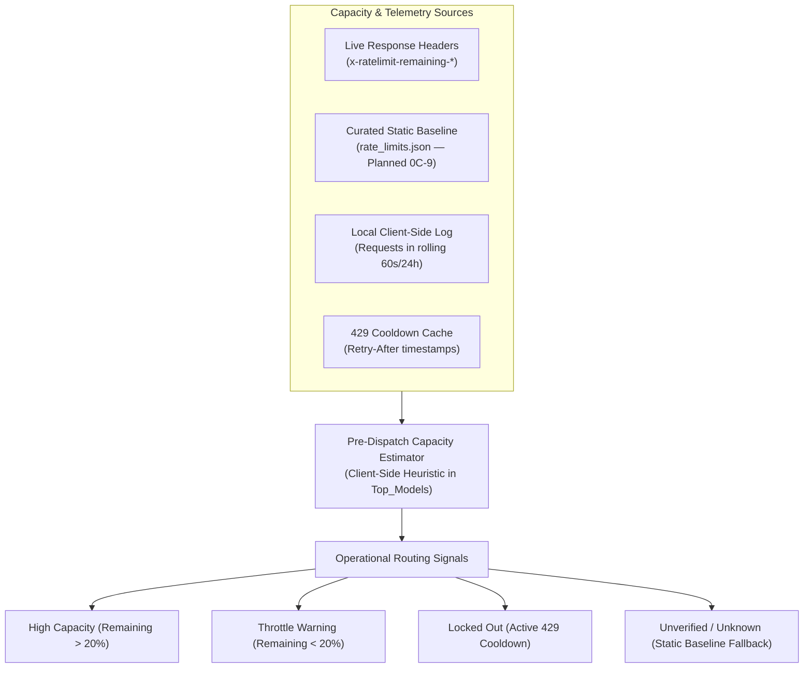
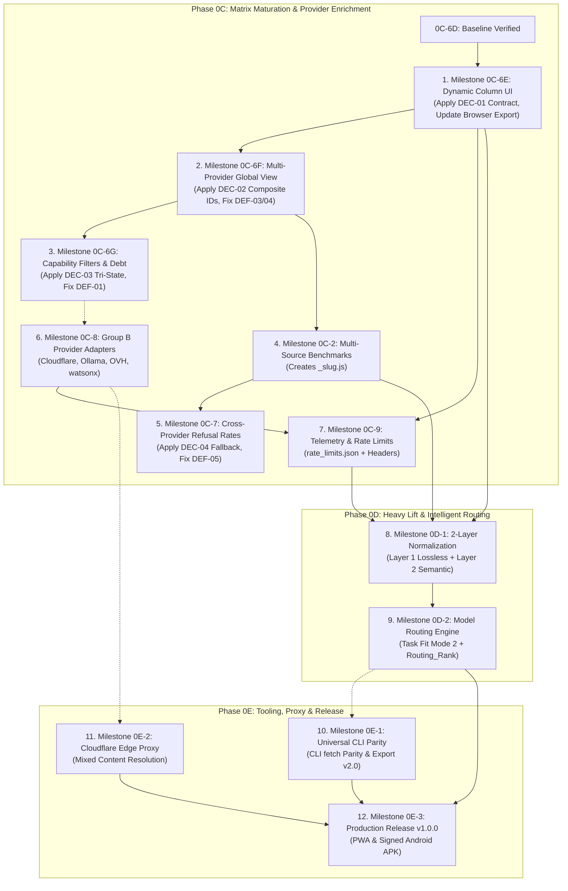

# PREPARATION REPORT: GLOBAL MATRIX, DYNAMIC COLUMNS, TASK FIT & ROUTING_RANK

**Report File:** `~/storage/downloads/Sync/PREPARATION_REPORT_GLOBAL_MATRIX_ROUTING.md`
**Target Repositories:**
- Application Repository: `~/Top_Models/` (GitHub: `anonymous5-coder/Top_Models`, target branch: `backup/0c-6d`)
- Planning Repository: `~/storage/downloads/Sync/` (GitHub: `anonymous5-coder/sync`, branch: `main`)
**Investigation Mode:** Read-Only Audit & Architectural Alignment (Stage 1 Preparation — Revalidated & Corrected)
**Date of Original Audit:** October 24, 2026
**Date of Revalidation:** October 24, 2026
**Auditor:** agy-termux (Executor)

---

## 1. Executive Summary & Readiness Overview

This report delivers a read-only, evidence-grounded preparation audit across `Top_Models` and its planning repository. The audit evaluates the architectural requirements confirmed by the project owner regarding **Dynamic Columns**, the **Global Model Matrix**, **Task Fit (Mode 2)**, and **Routing_Rank**.

### Core Verdict & Key Findings:
The live application codebase (commit `a31f09d`, whose direct parent is Milestone 0C-6D completion commit `942bb06`, `core.js?v=0I`, `matrix-cache-v11`) provides a stable foundation for dynamic matrix features, but requires disciplined architectural alignment across sequential implementation milestones:

1. **Matrix Paradigm (Verified Source Fact):** The existing table rendering engine in `index.html` (lines 895–920) already implements **independent column ranking**. Each column sorts candidate models separately via `sortModelsForColumn`. A horizontal table row does **not** represent a single model across columns; each cell is an independent leaderboard rank. This directly validates the owner's confirmation that the Global Matrix is **attribute-centric, not provider-centric**.
2. **Dynamic Columns (`KG_column`) & Header Controls (Verified Planning Requirement):** Conceptual terms `KG` ("key group") and `KG_column` do not exist as literal identifiers in application code. Column definitions will be externalized into `adapters/_columns.js` (Milestone 0C-6E). The owner's confirmed requirement for direct column header controls (**replace attribute, hide/remove, insert left/right**) expands on previous popover specifications and requires direct `<th>` menu controls.
3. **Dynamic-Column Failure Classification (Corrected Analysis):** The historical claim that `TypeError: col.findIndex is not a function` is an active runtime defect is **factually incorrect**. In current code (`index.html:860–870`), `appState.expanded` uses a numeric `colIndex`, and `appState.rankedColumns[colIndex]` correctly evaluates to an Array. Rather, this is a **high-severity prospective integration risk / contract mismatch** (`DEF-02`): if `appState.expanded` is changed to store a string `{ modelId, colKey }` without an explicit key-to-index resolver, string lookups on array-based `rankedColumns` will fail at runtime. Option A (array-aligned `rankedColumns` with `getColumnIndex(colKey)` resolver) is recommended to prevent this integration defect.
4. **Browser JSON Export Projection Belongs in 0C-6E (Owner-Confirmed Requirement):** The owner explicitly requires that dynamic column operations (inserting, removing, reordering, or replacing attributes) immediately update the active browser JSON export projection. Milestone 0C-6E must update the browser UI Export JSON action to reflect the active visible columns and per-column ranked candidates. Milestone 0D-2 subsequently enriches this export with Task Fit and Routing_Rank metadata, and Milestone 0E-1 achieves universal CLI parity.
5. **Task Fit vs. Routing_Rank Distinction & Lifecycle (Architectural Analysis):**
   - **Task Fit (Mode 2):** Natural-language task input $\rightarrow$ LLM selects and prioritizes **columns (attributes)** from left to right. It does not rerank candidates within columns.
   - **Routing_Rank:** Top-level toggle button $\rightarrow$ reranks **candidates within each visible column** by folding operational signals (latency, uptime, capacity) into attribute rankings without reordering columns.
   - **Lifecycle Interaction:** The owner expects disabling Routing_Rank to restore the prior Standard matrix when Routing_Rank is acting as a temporary routing view. This report analyzes this behavior alongside an orthogonal state alternative and presents the trade-offs for owner decision prior to Milestone 0D-2.
6. **Provider Capacity & Quota Safety Research (Audited Research):** Direct inference probing is strictly prohibited. Official documentation research across 13 providers reveals stark architectural differences in quota exposure: Groq and Mistral provide real-time `x-ratelimit-*` headers on all responses, whereas OpenRouter and Google Gemini return rate-limit metadata only on HTTP `429` errors. A client-side pre-dispatch estimator can improve local dispatch pacing, but cannot guarantee zero throttling or account-wide capacity knowledge.
7. **Canonical Dependencies vs. Sequential Roadmap (Reconciled):** The report distinguishes canonical technical prerequisites declared in `MASTER_PLAN.md` Section 6.2 from the recommended batched-waterfall execution order.

---

## 2. Repository Baseline & Evidence Verification

### 2.1 Repository Baseline State
*Baseline inspected October 24, 2026 in Termux development environment.*

| Dimension | Application Repository (`~/Top_Models/`) | Planning Repository (`~/storage/downloads/Sync/`) |
| :--- | :--- | :--- |
| **Local Branch** | `main` | `main` |
| **Remote Tracking** | `origin/main` (local ahead by 7 commits) | `origin/main` (up to date) |
| **Audit Target Reference** | `origin/backup/0c-6d` points directly to local HEAD (`a31f09d`) | `origin/main` points directly to local HEAD (`056b816`) |
| **Current HEAD Commit** | `a31f09d` (`docs: add GEMINI.md agent directives and context`) | `056b816` (`docs: add operating instructions and preparation report...`) |
| **Historical Baseline Reference** | Direct parent is `942bb06` (Milestone 0C-6D completion commit) | Audit starting baseline was `d8fda0a` (commit parent of `056b816`) |
| **Ancestry & Code Delta** | `git diff 942bb06 a31f09d --stat` confirms only `GEMINI.md` (+40 lines) was added; all application source files are bit-for-bit identical to `942bb06`. | Commit `056b816` added `INSTRUCTIONS.md` and `PREPARATION_REPORT_GLOBAL_MATRIX_ROUTING.md`. |
| **Working Tree State** | **Clean** (`git status --porcelain` is empty) | **Clean** (`git status --porcelain` is empty) |

### 2.2 Live Application Version Identifiers
- **Core Import Reference:** In `index.html` (line 452):
  ```javascript
  import { fetchData, refreshRefusalRates, PROVIDER_REGISTRY, runProviderPipeline, sortModelsForColumn, DEFAULT_FILTER_STATE, FILTER_DEFINITIONS, applyModelFilters } from './core.js?v=0I';
  ```
- **Service Worker Cache Name:** In `sw.js` (line 3):
  ```javascript
  const CACHE_NAME = 'matrix-cache-v11';
  ```
- **Baseline Match Verification:** **VERIFIED MATCH.** The live application source code strictly reflects the completed Milestone 0C-6D baseline.

### 2.3 Module Inventory (Existing vs. Planned)
Direct filesystem inspection in `~/Top_Models/` confirms:
- **Implemented / Existing Modules:**
  - Core Modules: `core.js`, `index.html`, `cli.js`, `proxy.py`, `sync-www.js`, `sw.js`, `refusal_rates.json`
  - Adapters Engine: `adapters/_sorting.js`, `adapters/_normalize.js`, `adapters/_filter.js`, `adapters/_registry.js`, `adapters/_pipeline.js`
  - Group A Provider Adapters (9 Implemented): `cohere`, `gemini`, `groq`, `llm7`, `mistral`, `modelscope`, `nvidia`, `openrouter`, `sambanova`
- **Planned / Absent Modules (Roadmap Deliverables):**
  - `adapters/_columns.js` (Planned for Milestone 0C-6E) — **ABSENT**
  - `adapters/_slug.js` (Planned for Milestone 0C-2) — **ABSENT**
  - Group B Provider Adapters: `cloudflare`, `ollama`, `ovh`, `watsonx` (Planned for 0C-8) — **ABSENT**
  - `rate_limits.json` (Planned for Milestone 0C-9) — **ABSENT**
  - `adapters/_layer1.js`, `adapters/_layer2.js` (Planned for Milestone 0D-1) — **ABSENT**
  - `adapters/_router.js` (Planned for Milestone 0D-2) — **ABSENT**

---

## 3. Dynamic Columns & Header Manipulation Architecture (`KG_column`)

### 3.1 Verification of Conceptual Terms
- **Owner Terms:** `KG` ("key group") and `KG_column` are conceptual product terms denoting JSON model attributes and attributes eligible for dynamic matrix columns.
- **Source Verification:** Grep inspection across the codebase confirms that **no literal code identifiers or variables** named `KG` or `KG_column` exist. They represent the architectural schema to be formalized in `adapters/_columns.js`.

### 3.2 Confirmed Header Interaction Requirements
The owner confirms that every column header (`<th>`) must support direct manipulation in both Standard and temporary Task Fit layouts:
1. **Replace Attribute:** Switch the column's underlying attribute via an attribute picker dropdown (e.g., replace `Context Window` with `Coding Index`).
2. **Hide / Remove Column:** Remove the column from the active matrix view.
3. **Insert Column Left:** Insert a new column immediately to the left of the current column.
4. **Insert Column Right:** Insert a new column immediately to the right of the current column.

### 3.3 Dynamic Column Failure Analysis & Contract (Reassessing DEF-02)

#### The Observed Source Reality:
In `index.html` lines 860–870:
```javascript
let activeExpRowIndex = null;
if (appState.expanded.modelId !== null && appState.expanded.colIndex !== null) {
    const col = appState.rankedColumns[appState.expanded.colIndex] || [];
    const foundIdx = col.findIndex(m => m && m.id === appState.expanded.modelId);
    if (foundIdx !== -1) {
        activeExpRowIndex = foundIdx;
    } else {
        appState.expanded = { modelId: null, colIndex: null };
    }
}
```
In current code, `appState.expanded.colIndex` is an integer `0..5`. `appState.rankedColumns` is an array of 6 arrays. Thus, `col` is an Array and `col.findIndex()` executes cleanly without throwing an exception. There is **no active runtime crash** in the verified baseline.

#### The Prospective Integration Risk (DEF-02):
`MASTER_PLAN.md` Spec 2.1 introduces `appState.expanded` storing `{ modelId, colKey }` where `colKey` is a string (e.g., `'context_length'`). If code attempts `appState.rankedColumns[appState.expanded.colKey]`, JavaScript evaluates `rankedColumns['context_length']`, which returns `undefined`. Calling `.findIndex()` on `undefined` causes:
```text
TypeError: col.findIndex is not a function (evaluating 'col.findIndex')
```
Therefore, `DEF-02` is properly classified as a **High Severity Integration Defect / Schema Contract Mismatch** that must be resolved in Milestone 0C-6E.

#### The Required Contract (Option A Recommendation):
1. **Stable Column IDs:** Attribute columns are identified by stable string IDs (`'context_length'`, `'intelligence_index'`, `'coding_index'`, etc.).
2. **Active Columns Array:** `appState.activeColumns = [...DEFAULT_COLUMN_STATE]` maintains the visible ordered list of column definitions.
3. **Array-Aligned Ranked Columns:** `appState.rankedColumnsDynamic` is an array of ranked model arrays, indexed `0..N-1` matching `activeColumns`.
4. **Key-to-Index Resolver:** A helper function `getColumnIndex(colKey)` resolves string IDs to array indices:
   ```javascript
   function getColumnIndex(colKey) {
       return appState.activeColumns.findIndex(c => c.id === colKey);
   }
   ```
5. **Safe Expansion Handling:** If an expanded column is hidden or removed, `getColumnIndex(colKey)` returns `-1`, cleanly collapsing the row without runtime errors.

### 3.4 Dynamic Column Policies & Edge Case Audit

| Policy / Concern | Current Code Finding | Recommended Specification Default | Status |
| :--- | :--- | :--- | :--- |
| **Duplicate Attributes** | `index.html` has fixed HTML `<th>` elements. Duplicate columns do not exist. | **Prohibit duplicates in visible layout:** The attribute picker disables or greys out currently active attributes. Prevents redundant leaderboards wasting mobile viewport space. | Open Owner Decision |
| **Minimum Visible Columns** | Table requires at least 1 column to maintain layout integrity. | **Enforce Minimum 1 Column Invariant:** If `activeColumns.length === 1`, the "Hide/Remove" control on that column's header is disabled/hidden. | Verified Requirement |
| **Standard Layout Persistence** | Hardcoded in HTML; no persistence. | **Persist to `localStorage`:** Save `columnState_<providerId>` and `columnState_global` containing an ordered array of attribute keys. | Verified Requirement |
| **Temporary Task Fit Layout Isolation** | N/A | **In-Memory Only:** Task Fit layout mutations must exist in `appState.taskFitColumns` without overwriting persisted `columnState_*`. | Verified Requirement |
| **Header Edits During Task Fit** | N/A | **Session-Scoped:** Column edits while in Task Fit modify only the active Task Fit layout. Exiting Task Fit restores the persisted Standard layout cleanly. | Recommendation |
| **Mobile Usability & Accessibility** | On Android (~360–412px viewport), table scrolls horizontally. | **Compact Header Touch Controls:** Each `<th>` features a compact action trigger opening a touch-friendly menu (min 44x44px touch targets) offering `Insert Left`, `Change Attribute`, `Insert Right`, and `Remove`. | Recommendation |
| **Reset Behavior** | Filter popover has reset; table headers have none. | **Global Header Reset Action:** Provide a "Reset Columns to Default" action restoring `DEFAULT_COLUMN_STATE`. | Recommendation |

---

## 4. The Global Matrix & Independent Column Ranking

### 4.1 Attribute-Centric vs. Provider-Centric Structure
- **Attribute-Centric Core:** In the Global Matrix (`activeProvider === 'all'`), models are aggregated from all configured, implemented providers returning data.
- **No Provider Partitioning:** Providers are **not** represented as fixed rows, table sections, or grouped accordions. Candidates from all providers compete directly on an equal footing within each attribute column.

### 4.2 Candidate Catalog & Filtering Guarantees
- **No Silent Truncation:** The entire candidate pool must remain available for ranking, routing, and export. Client-side pagination or virtualization may be used strictly for DOM performance on mobile browsers, but must never cap the underlying candidate dataset.
- **Explicit Filtering Only:** Only explicit user-selected filters remove candidates from consideration.
- **Provider Failure Isolation:** If a single provider fails (network timeout, invalid API key, CORS error), the Global Matrix continues rendering candidates from all operational providers, flagging the failed provider with an informative badge in the status bar.

### 4.3 Deployment Identity & Provenance
To ensure identical open-weight models (e.g. `meta-llama/llama-3.3-70b-instruct`) hosted across Groq, SambaNova, and OpenRouter remain distinct:
- **Composite ID:** `${providerId}:${m.id}` (e.g. `groq:llama-3.3-70b-versatile`, `sambanova:Meta-Llama-3.3-70B-Instruct`).
- **Provenance Fields:** Every normalized model retains `_providerId` and `_providerName`.
- **Provider Badges:** Every model cell renders a visual provider pill badge (e.g. `<span class="provider-pill groq">Groq</span>`).
- **Expansion Isolation:** Expanding a model row in one cell targets strictly that provider's deployment (`${providerId}:${m.id}`), never affecting another provider's deployment of the same weights.

### 4.4 Faithful Current Sorting Audit (`adapters/_sorting.js`)
Inspection of `adapters/_sorting.js` and `index.html` reveals the exact current ranking engine:

```javascript
// adapters/_sorting.js
export const S = {
    ctx: 'context_length',
    out: 'max_completion_tokens',
    intel: 'intelligence_index',
    code: 'coding_index',
    agent: 'agentic_index',
    refuse: 'refusal_rate',
    file: 'has_files',
    tool: 'has_tools',
    up: 'uptime'
};

export const sortHierarchy = {
    0: [{k: S.ctx, d: true}, {k: S.file, d: true}, {k: S.ctx, d: true}, {k: S.out, d: true}, {k: S.intel, d: true}, {k: S.agent, d: true}, {k: S.up, d: true}],
    1: [{k: S.intel, d: true}, {k: S.ctx, d: true}, {k: S.ctx, d: true}, {k: S.out, d: true}, {k: S.tool, d: true}, {k: S.up, d: true}],
    2: [{k: S.code, d: true}, {k: S.agent, d: true}, {k: S.tool, d: true}, {k: S.out, d: true}, {k: S.ctx, d: true}, {k: S.intel, d: true}, {k: S.ctx, d: true}],
    3: [{k: S.agent, d: true}, {k: S.tool, d: true}, {k: S.code, d: true}, {k: S.out, d: true}, {k: S.ctx, d: true}, {k: S.intel, d: true}, {k: S.ctx, d: true}, {k: S.up, d: true}],
    4: [{k: S.out, d: true}, {k: S.ctx, d: true}, {k: S.ctx, d: true}, {k: S.intel, d: true}, {k: S.code, d: true}, {k: S.agent, d: true}, {k: S.up, d: true}],
    5: [{k: S.refuse, d: false}, {k: S.code, d: true}, {k: S.agent, d: true}, {k: S.intel, d: true}, {k: S.ctx, d: true}, {k: S.ctx, d: true}, {k: S.out, d: true}, {k: S.up, d: true}]
};
```

#### Detailed Sorting Mechanics:
1. **Independent Column Ranking:** In `index.html` (lines 895–920), the matrix renders `appState.rankedColumns[c][r]`. Each column `c` is sorted completely independently. **Cells horizontally adjacent in row `r` belong to different models.**
2. **Primary & Fallback Keys:**
   - Col 0 (Context Window): Primary = `context_length` (descending). Fallbacks = `has_files`, `max_completion_tokens`, `intelligence_index`, `agentic_index`, `uptime`. (Note: `context_length` is redundantly listed twice).
   - Col 1 (Thinking): Primary = `intelligence_index` (descending).
   - Col 2 (Coding): Primary = `coding_index` (descending).
   - Col 3 (Agentic): Primary = `agentic_index` (descending).
   - Col 4 (Summarizer): Primary = `max_completion_tokens` (descending). (Note: Header in `index.html` is labeled "Summarizer").
   - Col 5 (Refusal Rates): Primary = `refusal_rate` (ascending, `d: false`).
3. **Missing / Invalid Value Handling:**
   - Sentinel function `val(obj, key, fallback)`: missing/null values receive `-999999` for descending sort, and `+999999` for ascending sort (`colIndex === 5`).
   - Missing data is always pushed to the bottom of each column's leaderboard.
4. **Tie-Breaking:**
   - If two models have equal values for all criteria in `sortHierarchy[c]`, the comparator returns `0`. There is currently **no tie-breaker by model ID or name**, leading to non-deterministic ordering across browsers for identical scores. A deterministic secondary tie-breaker (`a.id.localeCompare(b.id)`) must be introduced in `adapters/_columns.js`.
5. **Recomputation Triggers:**
   - Re-ranking occurs at 5 locations in `index.html`: Initial fetch (lines 696–698), Filter change (lines 723–725), Provider switch (lines 784–786), Manual refresh (lines 1068–1070), Refusal rates update (lines 1131–1133), and in `core.js` (lines 80–83).

---

## 5. Task Fit (Mode 2) vs. Routing_Rank: Separation & Lifecycle Interactions

### 5.1 Distinct Concept Definitions

```
+---------------------------------------------------------------------------------------+
| TASK FIT (Mode 2)                                                                     |
| Purpose: Structural Column Prioritization based on Natural-Language Task Intent       |
| Input: User prompt (e.g., "Analyze financial statements and balance sheets")          |
| Action: LLM selects and reorders COLUMNS (attributes) from left to right               |
| Output: Dynamic column layout (e.g. Col 0: has_files, Col 1: context, Col 2: intel)  |
| Candidate Sorting: Pure attribute sorting within each selected column                 |
+---------------------------------------------------------------------------------------+
                                           VS
+---------------------------------------------------------------------------------------+
| ROUTING_RANK (Top-Level Toggle)                                                       |
| Purpose: Operational Candidate Reranking within Visible Columns                       |
| Input: Top-level toggle button [Routing_Rank: ON / OFF]                               |
| Action: Reranks CANDIDATES inside each visible column by combining attribute rank with|
|         availability, latency, and capacity signals (uptime, latency, RPM/RPD)        |
| Output: Re-ordered candidate rows within existing columns                             |
| Column Layout: ZERO column reordering; visible columns remain unchanged               |
+---------------------------------------------------------------------------------------+
```

### 5.2 Four-State Lifecycle Matrix

| State | Layout Mode (`appState.layoutMode`) | Ranking Mode (`appState.routingRankEnabled`) | Visible Columns | Candidate Sorting Within Columns |
| :---: | :---: | :---: | :--- | :--- |
| **State 1** | `'standard'` | `false` (OFF) | Persisted Standard Columns (6 default or user-customized). | Pure attribute sorting (`adapters/_sorting.js` hierarchy). |
| **State 2** | `'standard'` | `true` (ON) | Persisted Standard Columns. | Composite Routing Rank (Attribute rank adjusted by latency, uptime, capacity). |
| **State 3** | `'task_fit'` | `false` (OFF) | Temporary Task Fit Columns (ordered by task priority left-to-right). | Pure attribute sorting for each task-selected column. |
| **State 4** | `'task_fit'` | `true` (ON) | Temporary Task Fit Columns. | Composite Routing Rank for each task-selected column. |

### 5.3 The Lifecycle Interaction & Alternatives

#### The Owner's Expected Behavior:
The owner expects that disabling Routing_Rank restores the prior Standard matrix when Routing_Rank itself is acting as a temporary routing-view toggle.

#### The Architectural Trade-Off:
- If `Routing_Rank OFF` forces a return to the **Standard column layout**, it unexpectedly destroys the user's active Task Fit column configuration. The user may have wanted to see the pure attribute rankings for their task-specific columns.
- Conversely, if `Routing_Rank` and `Task Fit` are completely decoupled, the user requires two separate clicks to exit a combined routing view.

#### Concrete Alternatives for Owner Review:
- **Alternative 1 (Decoupled Orthogonal State — Recommended for Flexibility):**
  - `appState.layoutMode`: `'standard'` | `'task_fit'`
  - `appState.routingRankEnabled`: `true` | `false`
  - Toggling `Routing_Rank` toggles candidate scoring between Pure Rank and Routing Rank. It does not alter the column layout.
  - Exiting Task Fit is handled by an explicit **"Exit Task Fit"** button in the Task Fit prompt bar, restoring the Standard column layout.
- **Alternative 2 (Composite Temporary Routing View — Aligned with Owner Expectation):**
  - When Routing_Rank is invoked as part of a task routing workflow, turning Routing_Rank OFF acts as a master reset, restoring both Standard column layout and pure attribute ranking.
  - An informational indicator shows: `"Restored Standard Matrix"`.
- **Status:** **UNRESOLVED OWNER DECISION FOR MILESTONE 0D-2.** (Both alternatives are documented here for ChatGPT review; no implementation occurs in 0C-6E).

---

## 6. Official Provider Capacity, Quota & Header Research

### 6.1 Provider Scope Derivation
From `adapters/_registry.js` and `MASTER_PLAN.md`:
- **Group A (9 Implemented):** `openrouter`, `gemini`, `groq`, `mistral`, `nvidia`, `cohere`, `modelscope`, `sambanova`, `llm7`.
- **Group B (4 Planned — Milestone 0C-8):** `cloudflare`, `ollama`, `ovh`, `watsonx`.
- **Global View (Planned — Milestone 0C-6F):** `all`.

### 6.2 Official Provider Documentation Research Matrix
*Research verified October 24, 2026 across official documentation sources.*

| Provider | Specific Documentation URL & Access Date | Documented Limits (Free / Dev Tier) | Rate Limit Response Headers | Header Scope & Availability | Limitations & Behavioral Quirks |
| :--- | :--- | :--- | :--- | :--- | :--- |
| **Groq** | [console.groq.com/docs/rate-limits](https://console.groq.com/docs/rate-limits)<br>(Oct 24, 2026) | **Free:** 30 RPM, 14,400 RPD, 18,000 TPM (varies by model: e.g. Llama-3.3-70b has 30 RPM, 6,000 TPM). | `x-ratelimit-limit-requests`<br>`x-ratelimit-remaining-requests`<br>`x-ratelimit-reset-requests`<br>`x-ratelimit-limit-tokens`<br>`x-ratelimit-remaining-tokens`<br>`x-ratelimit-reset-tokens`<br>`retry-after` | **On EVERY response** (success and 429).<br>Scope: Organization / Project level. | Cached input tokens do not count against limits. Rapid small requests exhaust RPM before TPM. |
| **SambaNova** | [docs.sambanova.ai/cloud/docs/rate-limits](https://docs.sambanova.ai)<br>(Oct 24, 2026) | **Free:** ~20 RPM, 20 RPD, 200,000 TPD (Tokens Per Day).<br>**Developer:** Model-specific (e.g. Llama 3.3 70B: 240 RPM / 48k RPD). | Standard HTTP `429 Too Many Requests` on breach with OpenAI-compatible headers where proxied. | Scope: Account / Project level. | Free tier enforces hard daily token cap (200k TPD). Requires payment card for Developer tier. |
| **OpenRouter** | [openrouter.ai/docs/limits](https://openrouter.ai/docs/limits)<br>(Oct 24, 2026) | **Free (`:free`):** 20 RPM.<br>**RPD:** 50 RPD (lifetime credits <$10), 1,000 RPD (lifetime >=$10). | `X-RateLimit-Limit`<br>`X-RateLimit-Remaining`<br>`X-RateLimit-Reset`<br>`Retry-After` | **ONLY on HTTP 429 responses!**<br>Successful calls omit rate-limit headers.<br>Proactive check: `GET /api/v1/key`. | Cannot track remaining requests from response headers of successful inference calls. Must use `/api/v1/key` or local counter. |
| **Google Gemini** | [ai.google.dev/gemini-api/docs/rate-limits](https://ai.google.dev/gemini-api/docs/rate-limits)<br>(Oct 24, 2026) | **Free:** Gemini 1.5 Flash: 15 RPM, 1M TPM, 1,500 RPD.<br>Gemini 1.5 Pro: 2 RPM, 32k TPM, 50 RPD. | Responds with `429 Too Many Requests` / `RESOURCE_EXHAUSTED` and `Retry-After`. | Scope: Google Cloud Project level (not individual key). | Resets daily at midnight Pacific Time. Successful calls omit real-time remaining quota headers. |
| **Mistral AI** | [docs.mistral.ai/platform/limits/](https://docs.mistral.ai/platform/limits/)<br>(Oct 24, 2026) | **Experiment (Free):** 1–5 RPM depending on endpoint.<br>**Tier 1–4:** Scales to 120+ RPM, 500k+ TPM. | `x-ratelimit-limit-requests`<br>`x-ratelimit-remaining-requests`<br>`x-ratelimit-limit-tokens`<br>`x-ratelimit-remaining-tokens`<br>`Retry-After` | **On EVERY response**.<br>Scope: Organization / Workspace. | Real-time counters available on all inference calls. Reset window is rolling 60 seconds. |
| **Cohere** | [docs.cohere.com/docs/rate-limits](https://docs.cohere.com/docs/rate-limits)<br>(Oct 24, 2026) | **Trial:** 20 RPM on chat, 10 RPM on rerank, **hard monthly cap of 1,000 calls/month**.<br>**Production:** 500 RPM. | `x-ratelimit-limit-requests-minute`<br>`retry-after` | Scope: API key / Account level. | Trial keys completely shut down for the remainder of the calendar month upon reaching 1,000 requests. |
| **Cloudflare Workers AI** | [developers.cloudflare.com/workers-ai/platform/limits/](https://developers.cloudflare.com/workers-ai/platform/limits/)<br>(Oct 24, 2026) | **Free:** 10,000 Neurons/day (hard cap). RPM typically ~20.<br>**Paid:** 10,000 free neurons/day + $0.011/1k neurons. | HTTP `429` with error code `3021` (`rate limiting: inference request per...`). | Scope: Cloudflare Account. | Computed in **Neurons** (GPU compute metric), not pure tokens. Resets daily at 00:00 UTC. |
| **NVIDIA NIM** | [build.nvidia.com/docs](https://build.nvidia.com/docs)<br>(Oct 24, 2026) | **Free Prototyping:** 1,000 credits/month allotment. ~40 RPM per model endpoint. | Sparse headers on free tier; returns `429` with `Retry-After` during traffic spikes. | Scope: Developer account. | Hosted tier meant strictly for prototyping; quotas fluctuate dynamically with cluster load. |
| **Ollama Cloud / Local** | [github.com/ollama/ollama/blob/main/docs/api.md](https://github.com/ollama/ollama/blob/main/docs/api.md)<br>(Oct 24, 2026) | **Local (`127.0.0.1:11434`):** Unlimited by network quotas; bounded strictly by host RAM/VRAM. | None (local execution). | Scope: Local machine. | Zero network latency; concurrency limited by physical GPU/CPU cores on device. |
| **ModelScope** | [modelscope.cn/docs](https://modelscope.cn/docs)<br>(Oct 24, 2026) | Free community endpoints. Variable burst limits (~10–30 RPM). | Unstandardized; returns 429 on saturation. | Scope: Community account. | Documentation in Chinese; rate limits fluctuate without formal SLA. **(Marked: Estimated / Unverified SLA)**. |
| **LLM7.io** | [llm7.io](https://llm7.io)<br>(Oct 24, 2026) | Free community proxy. Dynamic shared rate limits. | Returns 429 on backend queue saturation. | Scope: Public shared pool. | No guaranteed SLA or official rate-limit header specification. **(Marked: Estimated / Unverified SLA)**. |
| **OVHcloud** | [ovhcloud.com/en/public-cloud/ai-endpoints/](https://ovhcloud.com)<br>(Oct 24, 2026) | Pay-as-you-go per token; per-minute request caps per project. | Standard HTTP `429` with `Retry-After`. | Scope: Public Cloud Project. | Token-based metering with European data sovereignty guarantee. |
| **IBM watsonx.ai** | [dataplatform.cloud.ibm.com/docs](https://dataplatform.cloud.ibm.com)<br>(Oct 24, 2026) | Concurrency throttles (e.g. 5 concurrent requests on Essentials). | IAM token expiration headers; 429 on concurrency limit. | Scope: IBM Cloud Account / Resource Group. | Enterprise IAM authentication; tokens must be refreshed every 60 minutes. |

### 6.3 Conservative Pre-Dispatch Capacity Estimator Architecture



#### What the Estimator CAN Guarantee:
1. **Local Concurrency & RPM Safety:** Tracks client requests made from this Termux instance within a rolling 60-second window, preventing self-inflicted RPM throttling.
2. **Authoritative Header Sync:** Whenever Groq or Mistral returns `x-ratelimit-remaining-*`, the local store updates immediately with provider-authoritative quota.
3. **429 Cooldown Protection:** On HTTP 429, parses `Retry-After` and locks out the specific model/provider until the reset window expires, preventing wasted retries.
4. **Offline / Static Upper Ceiling:** Uses `rate_limits.json` as a documented ceiling when no live requests have been executed. *(Note: `rate_limits.json` is a planned deliverable for Milestone 0C-9; it does not exist in current code)*.

#### What the Estimator CANNOT Guarantee:
1. **External Key Consumption:** If the user uses the same API key in Cursor, VS Code, or another browser, local Termux tracking cannot detect external requests until a response header or 429 is received.
2. **OpenRouter / Gemini Proactive Quota:** Because OpenRouter and Gemini omit quota headers on successful calls, the client cannot know remaining daily requests without explicit `/api/v1/key` queries or waiting for a 429.
3. **Zero 429s on Shared / Free Tiers:** Shared public pools (LLM7, ModelScope, OpenRouter free models) experience queue saturation independent of individual user limits.
4. **Unmetered Probing Prohibited:** The system cannot fire background test requests to check quotas (prohibited by Project Directives and Prompt Safety Boundaries).

---

## 7. Task Fit Attribute Selection Efficiency

When the user enters a natural-language task prompt in Task Fit mode, the system selects and prioritizes columns from the available `KG_column` registry.

### Comparative Strategy Analysis

| Strategy | Token Cost (Input / Output) | Latency | Accuracy / Expressiveness | Failure Modes & Fallback | Recommended Role |
| :--- | :--- | :--- | :--- | :--- | :--- |
| **A. Pure Semantic LLM Selection** | ~450 in / ~60 out | 1.8s – 3.2s | **High:** Understands subtle intent (e.g. "financial extraction" $\rightarrow$ `has_files`, `context_length`, `intelligence_index`). | LLM returns malformed JSON or unknown keys. Requires schema validation fallback. | Primary engine when online and API key configured. |
| **B. Deterministic Keyword Preprocessing** | 0 tokens (Local Regex) | **<1ms** | **Medium:** Matches direct keywords ("coding", "python", "image", "fast", "cheap"). | Cannot handle nuanced or multi-sentence reasoning. | **Fast-path preprocessor** for unambiguous prompts. |
| **C. Hybrid: Deterministic with LLM Fallback (RECOMMENDED)** | 0 tokens (Clear intents)<br>~450 in (Nuanced) | <1ms (Fast path)<br>~2s (Nuanced) | **Highest:** Combines zero-latency instant match with full LLM semantic intelligence. | If offline or no key configured, deterministic engine handles 100% of queries safely. | **RECOMMENDED ARCHITECTURAL SPECIFICATION.** |

### Structured Output & Fallback Contract:
```json
{
  "intent_summary": "Document analysis and data extraction",
  "ordered_columns": ["has_files", "context_length", "intelligence_index", "latency"],
  "rationale": "Prioritizing file ingestion, large context window for reports, and high reasoning index."
}
```
- **Validation Guard:** The returned `ordered_columns` array is filtered against `KNOWN_COLUMN_REGISTRY`. Any unmapped or hallucinated key is discarded.
- **Safety Fallback:** If fewer than 2 valid columns are returned or parsing fails, the system automatically falls back to `DEFAULT_COLUMN_STATE` with an informative UI message.

---

## 8. Normalization, Capabilities, Filters & Incremental Export Architecture

### 8.1 Modalities vs. Capabilities Clarification
- **`raw_modalities`:** Strictly describes **input media types** accepted by the model (`"text"`, `"image"`, `"audio"`, `"video"`).
- **Tool / Function Calling:** Is a **functional API capability** (`has_tools`), NOT a modality.
- **Vision / Document Ingestion:** Is captured by `has_files: 1 | 0 | null` and reflected in `raw_modalities: "text, image"`.

### 8.2 Null-Preserving Normalization & Tri-State Filtering
- In `adapters/_normalize.js`, `has_tools` and `has_files` must preserve `null`:
  ```javascript
  has_files: (has_files === null || has_files === undefined) ? null : (has_files ? 1 : 0),
  has_tools: (has_tools === null || has_tools === undefined) ? null : (has_tools ? 1 : 0),
  ```
- In `adapters/_filter.js`, filter predicates must enforce:
  - `any`: `() => true` (passes `1`, `0`, and `null`).
  - `require`: `m => m.has_tools === 1` (passes verified capable models; `null` is excluded).
  - `exclude`: `m => m.has_tools === 0` (passes verified non-tool models; `null` is excluded).

### 8.3 Incremental Export Contract Across Milestones
Currently, `index.html` (line 1160) exports raw unlabelled arrays: `JSON.stringify(appState.rankedColumns)`. The export contract evolves incrementally across three milestones without destructive mutation of master model data:

#### 1. Milestone 0C-6E — Browser Active Column Projection Export (Immediate Requirement):
When dynamic columns and header operations (insert, remove, change attribute) are introduced in 0C-6E, the browser UI Export JSON action must be updated immediately so that:
- It reflects the **active visible column layout** and the correct **per-column independently ranked candidate lists**.
- Column headers, labels, and attribute IDs (`colKey`) are preserved so data is self-documenting.
- The master normalized model data is never deleted or mutated.

#### 2. Milestone 0D-2 — Routing Metadata Enrichment:
When Task Fit and Routing_Rank are implemented, the export is enriched with:
- Active layout mode (`'standard'` vs `'task_fit'`) and task prompt intent.
- Routing_Rank toggle state and computed operational routing scores.

#### 3. Milestone 0E-1 — Universal CLI Parity & Modernized Share Contract:
- Universal CLI parity (`cli.js fetch`) exporting identical structured JSON.
- Native Capacitor share integration and CLI filter flags.

#### Illustrative Export JSON Schema (Conceptual Target):
```json
{
  "schema_version": "2.0.0",
  "exported_at": "2026-10-24T15:00:00.000Z",
  "matrix_metadata": {
    "provider_scope": "global",
    "layout_mode": "standard",
    "routing_rank_enabled": false,
    "total_candidates": 412,
    "matching_candidates": 145,
    "active_filters": {
      "free": "free_eligible",
      "is_chat": "chat_only"
    }
  },
  "columns": [
    { "id": "context_length", "label": "Context Window", "direction": "desc" },
    { "id": "intelligence_index", "label": "Thinking", "direction": "desc" },
    { "id": "coding_index", "label": "Coding", "direction": "desc" }
  ],
  "rankings": {
    "context_length": [
      { "rank": 1, "id": "gemini:gemini-1.5-pro", "name": "Gemini 1.5 Pro", "provider": "gemini", "value": 2097152 },
      { "rank": 2, "id": "gemini:gemini-1.5-flash", "name": "Gemini 1.5 Flash", "provider": "gemini", "value": 1048576 }
    ],
    "intelligence_index": [
      { "rank": 1, "id": "openrouter:openai/o1", "name": "o1", "provider": "openrouter", "value": 98.2 }
    ]
  }
}
```
*(Note: Values and models above are illustrative schema examples, not live verified data).*

---

## 9. Revalidation of Historical Decisions & Confirmed Defects

### 9.1 Decisions (`DEC-01` through `DEC-04`)
| ID | Decision Title | Historical Recommendation | Live Code Audit Result | Current Categorization & Status |
| :---: | :--- | :---: | :--- | :--- |
| **DEC-01** | Dynamic Column Indexing & Expansion State Architecture | Option A (Array-aligned + resolver) | **Confirmed Analysis:** `index.html` hardcodes 14 numeric positions. Map storage requires rewriting all loops. `appState.expanded` requires string `colKey` with `getColumnIndex()`. | **OPEN OWNER DECISION (Mandatory Blocker for 0C-6E).** Recommended: Option A. |
| **DEC-02** | Global View Model Identity & Deduplication Policy | Option A (Distinct rows with badges) | **Confirmed Specification:** Merging identical open weights would destroy rate limit and latency differentials. `MASTER_PLAN.md` Spec 2.2 already specifies Option A. | **CANONICALLY SETTLED — NO NEW DECISION REQUIRED.** Implements Spec 2.2. |
| **DEC-03** | Capability Filter Tri-State on Unknown Data | Option A (True tri-state, preserve `null`) | **Confirmed Technical Defect:** `_normalize.js:30–31` converts `null` to `0`, causing false negatives for Gemini/SambaNova. Violates Rule 4. | **CONFIRMED TECHNICAL CORRECTION (Blocks 0C-6G).** Update normalizer to preserve `null`. |
| **DEC-04** | Refusal Estimation Fallback Strategy & Scope | Option A (Hybrid fallback to bundled JSON) | **Confirmed Specification:** `core.js` strictly requires OpenRouter key. `MASTER_PLAN.md` Spec 2.5 already specifies fallback to `./refusal_rates.json`. | **CANONICALLY SETTLED — NO NEW DECISION REQUIRED.** Implements Spec 2.5. |

### 9.2 Defects (`DEF-01` through `DEF-05`)
| Defect ID | Severity | File & Lines | Current Verified Impact | Resolution Milestone |
| :---: | :---: | :--- | :--- | :---: |
| **DEF-01** | **CRITICAL** | `adapters/_filter.js:33–50` | **Verified Active Defect:** `applyModelFilters()` only checks `free` and `is_chat`. New filters added to `FILTER_DEFINITIONS` are completely ignored by the evaluation engine. | Milestone 0C-6G (Spec 2.3) |
| **DEF-02** | **HIGH** | `index.html:462, 862, 899, 912, 974` | **Prospective Integration Risk / Contract Mismatch:** Existing code functions via numeric indices. If `expanded` stores `{ modelId, colKey }` (string) without an index resolver, string lookups on array `rankedColumns` will fail at runtime. | Milestone 0C-6E (Spec 2.1) |
| **DEF-03** | **HIGH** | `adapters/_registry.js:14–154`, `index.html:772, 1027` | **Verified Active Defect:** No `all` provider entry in registry. Side drawer event handler ignores `all`. Refusal button is hidden for all non-OpenRouter providers. | Milestone 0C-6F (Spec 2.2) |
| **DEF-04** | **MEDIUM** | `adapters/_pipeline.js:9–11`, `index.html:1060` | **Verified Active Defect:** Calling `runProviderPipeline('all')` throws `Error: Unknown provider: all`. Must dispatch `runGlobalPipeline()`. | Milestone 0C-6F (Spec 2.2) |
| **DEF-05** | **LOW** | `sync-www.js:25–29` | **Documentation Note:** `sync-www.js` already includes `refusal_rates.json` conditionally. Ledger note in `MASTER_PLAN.md` should note verification only. | Milestone 0C-7 (Spec 2.5) |

---

## 10. Roadmap Dependencies, Sequencing & Milestone Alignment

### 10.1 Canonical Prerequisites vs. Recommended Sequential Execution
It is critical to distinguish between **Canonical Declared Prerequisites** (the strict technical interface dependencies declared in `MASTER_PLAN.md` Section 6.2 Table) and the **Recommended Sequential Execution Order** (the batched-waterfall milestone progression):

| Milestone | Milestone Name | Canonical Prerequisites (MASTER_PLAN.md) | Recommended Execution Order | Sequencing Rationale & Interface Boundaries |
| :---: | :--- | :--- | :---: | :--- |
| **0C-6E** | Dynamic Column UI (`KG_column`) | `0C-6D` | **1** | Foundational table layout decoupling. Must precede Global View to avoid redesigning table layouts twice. |
| **0C-6F** | Multi-Provider Global View | `0C-6E` | **2** | Aggregates multi-cloud matrix with composite IDs (`<provider>:<model>`). Establishes multi-provider candidate pool. |
| **0C-6G** | Advanced Capability Filters & Debt | `0C-6D`, `0C-6F` | **3** | Extends declarative filters and fixes Group A provider debt (Gemini tools, SambaNova modalities). |
| **0C-2** | Multi-Source Benchmark Enrichment | `0C-6F` | **4** | Creates canonical model slug normalizer (`adapters/_slug.js`) and ingests 6 benchmark suites. |
| **0C-7** | Cross-Provider Refusal Rates | `0C-2` | **5** | Reuses `adapters/_slug.js` from 0C-2 to match canonical model families with refusal estimates. |
| **0C-8** | Group B Provider Adapters | `0C-1`, `0C-6B` | **6** | Custom APIs (Cloudflare, Ollama, OVH, watsonx). Declared dependencies are 0C-1/6B; executed in Phase 0C to complete all 13 providers. |
| **0C-9** | Telemetry & Rate Limit Ingestion | `0C-8`, `0C-6E` | **7** | Ingests RPM, RPD, TPM, and TTFT metrics into dynamic columns. Depends on 0C-8 for Group B metrics and 0C-6E for column registry. |
| **0D-1** | 2-Layer Normalization Architecture | `0C-2`, `0C-9`, `0C-6E` | **8** | Heavy Lift architectural refactor. Projects Layer 1 lossless payloads onto Layer 2 dynamic columns and filters. |
| **0D-2** | Model Routing & Recommendation Engine | `0D-1` | **9** | Client-side Pareto router. Implements Task Fit (Mode 2) and Routing_Rank candidate scoring over Layer 2 data. |
| **0E-1** | Universal CLI Parity & JSON Export v2.0 | `0C-8`, `0C-6D` | **10** | Modernizes CLI (`cli.js`) to achieve full 13-provider parity and unified versioned export contract. |
| **0E-2** | Production Edge CORS Proxy Deployment | `0C-8` | **11** | Deploys Cloudflare Worker edge proxy to eliminate Mixed Content restrictions for HTTPS PWA. |
| **0E-3** | Production Release (PWA & Native APK) | All prior | **12** | Signed Android APK build, GitHub Pages PWA deployment, `v1.0.0` release. |

### 10.2 Milestone Dependency & Progression Diagram


*(Solid arrows represent canonical declared prerequisites; dotted arrows represent recommended batched-waterfall execution flow).*

---

## 11. Owner Decision Agenda (Chopping Block for ChatGPT)

The owner should review and resolve these specific questions in ChatGPT:

### Decision 1: DEC-01 — Dynamic Column Indexing & Expansion State Architecture
- **Question:** How should `appState.rankedColumns` and `appState.expanded` bridge string column keys to array indices?
- **Options:**
  - **Option A (Recommended):** Array-aligned `appState.rankedColumns` (indexed `0..N-1` matching `appState.activeColumns`) with a helper `getColumnIndex(colKey)` to resolve string keys during row expansion and click delegation.
  - **Option B:** Fully refactor `rankedColumns` into a keyed Map/Object (`rankedColumns[colKey]`), requiring rewrites of all table rendering and re-ranking loops.
- **Recommendation:** **Option A.** Minimizes code churn, maintains proven DOM performance on mobile, and cleanly prevents the prospective `TypeError: col.findIndex is not a function` integration failure.
- **Status:** **OPEN OWNER DECISION (Mandatory Execution Blocker for Milestone 0C-6E).**

### Decision 2: Task Fit & Routing_Rank Lifecycle Interaction
- **Question:** When a user is in Task Fit mode and toggles Routing_Rank OFF, how should the application respond?
- **Options:**
  - **Alternative 1 (Decoupled Orthogonal State — Recommended for Flexibility):** Toggling Routing_Rank OFF reverts candidate scoring to Pure Attribute Rank within the current columns, leaving Task Fit columns intact. Exiting Task Fit is done via an explicit "Exit Task Fit" button.
  - **Alternative 2 (Composite Routing View Reset — Aligned with Owner Expectation):** Toggling Routing_Rank OFF immediately exits Task Fit as well, restoring the Standard 6-column layout.
- **Recommendation:** **Alternative 1** offers maximum user flexibility, while **Alternative 2** directly matches the owner's expected temporary-view behavior.
- **Status:** **UNRESOLVED OWNER DECISION FOR MILESTONE 0D-2.** (No code implementation occurs in 0C-6E; decision can be resolved prior to 0D-2).

### Decision 3: Duplicate Attribute Columns Policy
- **Question:** Should users be allowed to insert duplicate columns of the same attribute in the visible matrix?
- **Options:**
  - **Option A (Recommended):** Prohibit duplicates in the visible layout. The attribute selector disables or greys out currently active attributes.
  - **Option B:** Allow duplicate columns (e.g. two "Coding" columns side by side).
- **Recommendation:** **Option A.** Mobile viewport width is strictly constrained; duplicate leaderboards provide zero utility and create user confusion.
- **Status:** **OPEN OWNER DECISION (Execution Directive for Milestone 0C-6E).**

---

## 12. Verification and Integrity Statement

### 12.1 Verification Checks Executed
- **Git and Working Tree Audit:** Verified clean working tree in `~/Top_Models/` (commit `a31f09d`, ancestry `942bb06`, branch `backup/0c-6d`) and in `~/storage/downloads/Sync/` (commit `056b816`).
- **Source Inspection:** Audited `adapters/_sorting.js`, `index.html` (expansion handling, header rendering, export), `adapters/_normalize.js`, `adapters/_filter.js`, `adapters/_registry.js`, `cli.js`, and `sync-www.js`.
- **Documentation Research:** Verified rate limits, response headers, and quotas across official documentation for Groq, SambaNova, OpenRouter, Google Gemini, Mistral AI, Cohere, Cloudflare Workers AI, NVIDIA NIM, Ollama, ModelScope, LLM7, OVHcloud, and IBM watsonx.ai.

### 12.2 Safety & Scope Boundary Statement
- **Application Source Code:** Unmodified. Zero bytes altered in `~/Top_Models/`.
- **Existing Planning Documents:** Unmodified. `MASTER_PLAN.md`, `codebase_1.md`, `execution_readiness.md`, `PREPARATION_PROMPT_TEMPLATE.md`, `PREPARATION_REPORT_ARGON_4_DECISIONS.md`, and `INSTRUCTIONS.md` remain untouched.
- **Historical Audit Integrity:** The original preparation run was strictly read-only. The subsequent commit (`056b816`) and push to `origin/main` in the planning repository occurred afterward by explicit owner command.
- **Probes & Builds:** No inference probes, unmetered endpoint scans, npm builds, or package installations were run.
- **Output:** Only `~/storage/downloads/Sync/PREPARATION_REPORT_GLOBAL_MATRIX_ROUTING.md` was updated.

---

## 13. Next Steps for the Owner

1. **Review in ChatGPT:** Upload or paste `PREPARATION_REPORT_GLOBAL_MATRIX_ROUTING.md` into ChatGPT for strategic alignment.
2. **Resolve Milestone 0C-6E Chopping Block:**
   - Formally approve **DEC-01 Option A** (Array-aligned `rankedColumns` with `getColumnIndex` resolver).
   - Formally approve **Duplicate Column Policy Option A** (prohibit duplicate attributes in visible matrix).
   - Confirm **Browser UI Export JSON Update** scope in Milestone 0C-6E.
3. **Stage 2 Gate:** Implementation of Milestone 0C-6E remains strictly prohibited until the owner reviews this report and issues an explicit, finalized Milestone 0C-6E Execution Prompt.
