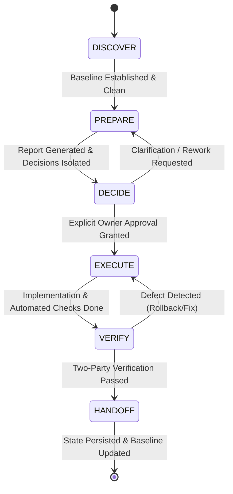
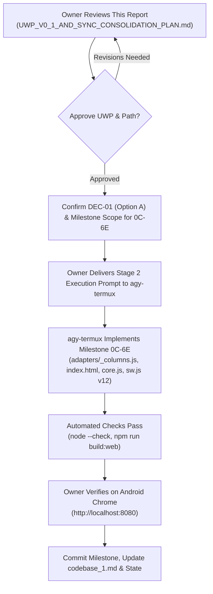

# UNIVERSAL WORKFLOW PROTOCOL (UWP v0.1)
## Discovery, Context Optimization, and Top_Models Integration Specification

**Document Path:** `~/storage/downloads/Sync/UWP_V0_1_AND_SYNC_CONSOLIDATION_PLAN.md`  
**Author:** agy-termux (Executor)  
**Investigation Scope:** Read-Only Discovery, Context Audit, Protocol Specification & Integration Boundary  
**Execution Target Baseline:** Top_Models Baseline `942bb06` / `a31f09d` (Milestone 0C-6D Complete)  
**Planning Baseline:** `anonymous5-coder/sync` (`main`, Commit `3e590d2`)  
**Status:** Proposal and Architecture Specification (Awaiting Owner Review — No Execution/Mutations Performed)  
**Date:** October 26, 2026  

---

## 1. Executive Summary, Verified Baseline & Environment Limitations

### 1.1 Executive Summary
This document delivers an evidence-grounded discovery of the `anonymous5-coder/sync` planning workflow and specifies the **Universal Workflow Protocol (UWP v0.1)**. 

Over sequential development cycles of `Top_Models`, the `Sync` repository has accumulated 7 major Markdown planning documents totaling **4,190 lines and 301,310 bytes (~75,000+ LLM tokens)**. Loading this monolithic planning context for each session causes severe context starvation, elevated API costs, increased latency, and conversational cognitive overload.

This specification:
1. Audits and establishes the role, authority, unique information, and overlaps of all 7 documents.
2. Constructs a **Traceable Disposition Matrix** that guarantees zero loss of material decisions (`DEC-*`), defects (`DEF-*`), architectural invariants, or verification protocols.
3. Formulates the **Universal Workflow Protocol (UWP v0.1)**: a portable, model-agnostic, 6-stage lifecycle (`DISCOVER` $\rightarrow$ `PREPARE` $\rightarrow$ `DECIDE` $\rightarrow$ `EXECUTE` $\rightarrow$ `VERIFY` $\rightarrow$ `HANDOFF`) applicable to software engineering, reverse engineering, research, infrastructure, and non-git workflows.
4. Outlines a **Layered Context Loading Architecture** that reduces active session context by **75% to 85%** (~57,000 to ~65,000 tokens saved per turn).
5. Defines a strict, decoupled boundary between UWP, the future optional **Universal Workflow Application (UWA)**, and the independent **`Top_Models`** model-routing engine via a versioned contract (`TopModelsModelContract_v0.1`).
6. Maps out a **Safe Path Back to Milestone `0C-6E`**, resolving existing blockers and ensuring seamless continuation of application development.

---

### 1.2 Verified Repository Baselines

Physical inspection of the local environment confirms the following baseline facts:

| Dimension | Application Repository (`~/Top_Models/`) | Planning Repository (`~/storage/downloads/Sync/`) |
| :--- | :--- | :--- |
| **Local Path** | `/data/data/com.termux/files/home/Top_Models` | `/storage/emulated/0/Download/Sync` (symlinked at `~/storage/downloads/Sync`) |
| **Git Remote** | `git@github.com:anonymous5-coder/Top_Models.git` | `git@github.com:anonymous5-coder/sync.git` |
| **Local Branch** | `main` | `main` |
| **Remote Tracking** | Local is 7 commits ahead of `origin/main` | Synchronized with `origin/main` |
| **HEAD Commit** | `a31f09d` (`docs: add GEMINI.md agent directives and context`) | `3e590d2` (`docs: revalidate and correct global matrix preparation report`) |
| **Preceding Commit** | `942bb06` (`Milestone 0C-6D: Implement in-memory filter UI...`) | `056b816` (`docs: add operating instructions and preparation report...`) |
| **Working Tree State** | **Clean** (`git status --porcelain` is empty) | **Clean** (`git status --porcelain` is empty) |
| **Runtime Identifiers** | `core.js?v=0I` in `index.html` (line 452) | N/A (Documentation repository) |
| **SW Cache Container** | `matrix-cache-v11` in `sw.js` (line 3) | N/A |
| **Baseline Verdict** | **VERIFIED MATCH** for Milestone 0C-6D baseline | **VERIFIED MATCH** with upstream repository |

---

### 1.3 Environmental Limitations & Discovered Quirk Workarounds

1. **Android FUSE Filesystem Git Working Directory Quirk:**
   - *Evidence:* Running `git status` inside `/storage/emulated/0/Download/Sync` throws:
     `fatal: unable to get current working directory: No such file or directory`.
   - *Root Cause:* Android's sdcardfs/FUSE emulation restricts standard POSIX `getcwd()` resolution in certain child process execution contexts under Termux when cross-boundary ownership (`u0_a259 media_rw` vs `u0_a366`) is involved.
   - *Verified Workaround:* Passing explicit Git pointers resolves the issue completely:
     `git --git-dir=/storage/emulated/0/Download/Sync/.git --work-tree=/storage/emulated/0/Download/Sync <command>` executes cleanly without error.
2. **`devx` CLI Shebang Execution Limitation:**
   - *Evidence:* Executing `/data/data/com.termux/files/usr/bin/devx --help` fails with:
     `bash: /data/data/com.termux/files/usr/bin/devx: /usr/bin/env: bad interpreter: No such file or directory`.
   - *Root Cause:* `/usr/bin/env` does not exist in standard Android rootless filesystem without `termux-exec` preload hooks.
   - *Verified Workaround:* Invoking via Node explicitly (`node /data/data/com.termux/files/usr/bin/devx --help`) works reliably, confirming `devx` version **1.6.0** is operational.
3. **Hardware & Termux Constraints:**
   - Device: realme 11 5G (MediaTek Dimensity 6100+, 8GB RAM).
   - Storage: Android browser `localStorage` enforces a strict ~5MB quota. All multi-provider caching must use `try/catch` quota guards.
   - Network / CORS: Upstream provider endpoints (NVIDIA, SambaNova, LLM7) enforce browser CORS; local Python proxy on port 8081 (`proxy.py`) remains mandatory for browser testing.

---

## 2. Workflow and Document Audit

### 2.1 Planning Documents Inventory & Quantitative Metrics

The planning repository contains 7 Markdown files. Quantitative measurements taken via `wc` on October 26, 2026:

| Document | Lines | Words | Bytes | Estimated Tokens (~4 chars/token) | Primary Role & Audience |
| :--- | :---: | :---: | :---: | :---: | :--- |
| **`INSTRUCTIONS.md`** | 222 | 1,908 | 14,552 | ~3,600 | Operating guide for planning AIs & session rules |
| **`MASTER_PLAN.md`** | 1,614 | 10,968 | 91,398 | ~22,800 | Authoritative roadmap, 12 execution specs & version ledger |
| **`PREPARATION_PROMPT_TEMPLATE.md`** | 371 | 3,563 | 30,191 | ~7,500 | Canonical procedure governing Stage 1 milestone audit |
| **`codebase_1.md`** | 600 | 5,710 | 46,397 | ~11,600 | Canonical technical baseline & architecture handover |
| **`execution_readiness.md`** | 485 | 5,533 | 44,097 | ~11,000 | Historical readiness audit snapshot (Oct 2026, baseline `942bb06`) |
| **`PREPARATION_REPORT_ARGON_4_DECISIONS.md`** | 340 | 3,064 | 24,212 | ~6,000 | Audit report verifying Argon decisions `DEC-01` to `DEC-04` |
| **`PREPARATION_REPORT_GLOBAL_MATRIX_ROUTING.md`** | 558 | 6,443 | 50,463 | ~12,600 | Audit report on dynamic columns, global view & routing |
| **TOTAL** | **4,190** | **37,189** | **301,310** | **~75,100 tokens** | **Monolithic context footprint** |

---

### 2.2 Traceable Disposition Matrix

This matrix maps every document, its authority, material items (`DEC-*`, `DEF-*`), overlaps, and recommended future disposition:

| Document | Document Role & Authority Level | Material Items Preserved (`DEC-*`, `DEF-*`, Invariants) | Redundancies & Conflicts | Recommended Future Disposition | Context Impact |
| :--- | :--- | :--- | :--- | :--- | :--- |
| **`INSTRUCTIONS.md`** | **Operational Governance** (High). Governs AI conduct and session initialization. | - Multi-agent roles (Owner, Strategic AI, Auditor, `agy-termux`, ChatGPT).<br>- Decision state machine (`Idea` $\rightarrow$ `Verified`).<br>- Read-only safety boundaries. | Overlaps with `PREPARATION_PROMPT_TEMPLATE.md` Sec 1.1 and `GEMINI.md`. | **Retain as compact governance core.** Modularize or condense into concise operating protocol. Load only at session start. | Saves ~2,000 tokens if condensed. |
| **`MASTER_PLAN.md`** | **Canonical Forward Authority** (Highest). Defines forward milestones and invariants. | - Specifications 2.1 through 2.12.<br>- Version Ledger (Part 1, Sec 7): version bumps (`0I` $\rightarrow$ `0J`...), cache names (`v11` $\rightarrow$ `v12`...).<br>- Core UI Parity Invariant.<br>- Composite ID `<providerId>:<modelId>`.<br>- Minimum 1 visible column rule. | Part 1 (roadmap narratives, provider debt, telemetry) repeats content present in `codebase_1.md` and historical reports. | **Retain as Canonical Authority.** Modularize into roadmap index + individual milestone spec files (`specs/0C-6E.md`, etc.). | Saves ~18,000 tokens during single-milestone runs. |
| **`PREPARATION_PROMPT_TEMPLATE.md`** | **Procedural Blueprint** (High). Reusable template for Stage 1. | - 5-Phase audit procedure (Phases A–E).<br>- Stop-and-report baseline gate.<br>- Standard `DEC-XX` decision schema.<br>- 11-section report structure. | Template text duplicated conceptually in derived preparation prompts. | **Retain as offline reference template.** Never load into execution context. Read only when generating a new milestone prompt. | Saves ~7,500 tokens in active execution. |
| **`codebase_1.md`** | **Canonical Current State Truth** (Highest for verified code). | - Architecture baseline (`942bb06`).<br>- 15-field NormalizedModel schema.<br>- Quota guards & proxy mechanics.<br>- 9 Group A provider quirks.<br>- Invariant safeguards (Sec 23). | Minor narrative duplication with `MASTER_PLAN.md` Part 1. | **Retain as Single Living Architectural Record.** Update strictly post-milestone upon user verification. | Essential baseline context (~11,600 tokens retained). |
| **`execution_readiness.md`** | **Historical Snapshot** (Informational). Predecessor audit. | - First identification of `DEF-01`, `DEF-02`, `DEF-03`.<br>- Initial proposals for `DEC-01` through `DEC-04`. | Superseded by `ARGON_4_DECISIONS` and `GLOBAL_MATRIX_ROUTING` reports. | **Archive to `archive/` upon owner approval.** All material findings are preserved in canonical specs and reports. | **Saves ~11,000 tokens completely.** |
| **`PREPARATION_REPORT_ARGON_4_DECISIONS.md`** | **Historical Preparation Report** (Stage 1 Output). | - Analysis of `DEC-01` (Option A recommended).<br>- `DEC-02` (settled by Spec 2.2).<br>- `DEC-03` (defect in `_normalize.js:30–31` coercing null to 0).<br>- `DEC-04` (settled by Spec 2.5). | Overlaps with `execution_readiness.md` and `GLOBAL_MATRIX_ROUTING`. | **Archive upon completion of Milestone 0C-6E.** Keep as milestone historical audit record. | **Saves ~6,000 tokens.** |
| **`PREPARATION_REPORT_GLOBAL_MATRIX_ROUTING.md`** | **Current Active Preparation Report** (Stage 1 Output). | - Attribute-centric matrix proof (`index.html:895–920`).<br>- Dynamic header controls (replace, remove, insert L/R).<br>- Reassessment of `DEF-02` (prospective contract mismatch vs active crash).<br>- Browser JSON export belongs in 0C-6E.<br>- Task Fit vs Routing_Rank lifecycle.<br>- Provider capacity & rate-limit header research. | Overlaps with `ARGON_4_DECISIONS` regarding `DEC-01`. | **Retain during 0C-6E and 0C-6F execution.** Reference specific sections as needed; do not auto-load. Archive after Phase 0C. | **Saves ~12,600 tokens from default context.** |

---

### 2.3 Synthesis of Material Defects and Decisions

To ensure absolute preservation during any future consolidation, the table below consolidates all tracked defect and decision identifiers:

```
+---------------------------------------------------------------------------------------------------+
| TRACKED DEFECTS & ARCHITECTURAL INVARIANTS                                                        |
+---------------------------------------------------------------------------------------------------+
| DEF-01: Spec 2.1 string key vs numerical index mismatch in appState.expanded.                    |
|         Resolution: Option A — Maintain array-aligned appState.rankedColumnsDynamic with           |
|         getColumnIndex(colKey) resolver function. Prevents TypeError: col.findIndex crash.        |
| DEF-02: Spec 2.2 missing 'all' provider entry in PROVIDER_REGISTRY causing drawer click rejection |
|         and line 772 hiding refusal button in Global View.                                        |
|         Resolution: Register 'all' in PROVIDER_REGISTRY; branch runGlobalPipeline(); override CSS. |
| DEF-03: Spec 2.3 hardcoded applyModelFilters() loop ignoring has_tools, has_files, modalities,   |
|         coupled with _normalize.js:30-31 coercing nulls to 0.                                     |
|         Resolution: Preserve null in _normalize.js; dynamically iterate FILTER_DEFINITIONS.       |
|                                                                                                   |
| TRACKED ARCHITECTURAL DECISIONS                                                                   |
| DEC-01: Dynamic Column Indexing & Expansion State Architecture (Milestone 0C-6E).                |
|         Status: GENUINE OPEN DECISION -> Recommended: Option A (Array-Aligned + Resolver).       |
| DEC-02: Global View Model Identity & Deduplication Policy (Milestone 0C-6F).                     |
|         Status: CANONICALLY SETTLED -> Option A (Multi-Endpoint Listing with Composite IDs).       |
| DEC-03: Capability Tri-State Behavior on Unknown Data (Milestone 0C-6G).                         |
|         Status: TECHNICAL CORRECTION REQUIRED -> Preserve nulls; treat null as unknown in filters. |
| DEC-04: Refusal Estimation Fallback Strategy & Scope (Milestone 0C-7).                           |
|         Status: CANONICALLY SETTLED -> Option A (Live openrouter/free with bundled JSON fallback).|
+---------------------------------------------------------------------------------------------------+
```

---

### 2.4 Existing Tooling & Instruction Capabilities Audit

| Environment / Tool | Verified Capabilities | Gaps Addressable by Config/Docs | Genuine Protocol Gaps (Requires UWP) | Capabilities Justifying Standalone App (UWA) |
| :--- | :--- | :--- | :--- | :--- |
| **`agy-termux` (Antigravity CLI)** | - Native Linux shell execution.<br>- Direct file reading/writing/diffing.<br>- Subagent invocation & task management.<br>- Strict safety directives (`GEMINI.md`). | - Documenting FUSE git working directory workaround.<br>- Enforcing compact context loading. | - Formal state machine for stage transitions.<br>- Scoped, cryptographically verifiable approval token.<br>- Stale state invalidation. | - Automated multi-session state persistence across process restarts.<br>- Visual approval gate UI. |
| **ChatGPT** | - Deep strategic reasoning.<br>- Complex trade-off comparison.<br>- Multi-perspective architectural audit. | - Providing structured prompt templates (`PREPARATION_PROMPT_TEMPLATE.md`). | - Zero environment visibility.<br>- Cannot verify git state or file existence.<br>- Relying on human copy-paste. | - Direct bidirectional API connector to executor state store. |
| **`devx` (v1.6.0)** | - Terminal-native AI coding assistant.<br>- Headless mode (`-p`).<br>- Architect/planner mode (`--plan`).<br>- Model override (`-m`). | - Fixing execution path via `node /.../devx` to overcome missing `/usr/bin/env`. | - Unbounded `--yolo` flag risks uncontrolled mutations without scoped approval gates. | - Orchestration engine capable of switching between planning and execution agents. |
| **Project Owner (Human)** | - Absolute authority on decisions, trade-offs, and approval.<br>- Physical device interaction on Android Chrome (`http://localhost:8080`). | - Streamlined review via concise decision checklists rather than 50KB reports. | - Manual burden of context transfer between ChatGPT and Termux. | - Mobile dashboard showing pending decisions, approvals, and one-tap approval actions. |

---

## 3. Universal Workflow Protocol (UWP v0.1) Specification

### 3.1 Design Principles & Portability Scope
UWP v0.1 is designed to be **lightweight, model-agnostic, and environment-independent**. It applies equally to:
- Conventional Git software repositories (e.g. `Top_Models`).
- Research, data analysis, and literature review workflows.
- Infrastructure and system configuration tasks (e.g. Termux setup, cloud edge deployments).
- Reverse engineering and binary modding workflows.
- Projects without version control or operating in air-gapped/sandbox environments.

---

### 3.2 The 6-Stage Workflow Lifecycle



#### Detailed Stage Contracts:

| Stage | Name | Preconditions | Permitted Actions | Prohibited Actions | Required Output Artifact | Transition Gate |
| :---: | :--- | :--- | :--- | :--- | :--- | :--- |
| **S1** | **DISCOVER** | Target workspace defined; agent access initialized. | Read-only inspection of files, git status/remotes, tool checks, environment capabilities. | No file writes, edits, builds, installs, or git mutations. | Environment & Baseline Verification Record. | Working tree clean and baseline verified against expected target. |
| **S2** | **PREPARE** | S1 baseline verified. Expected specs accessible. | Read-only analysis, diff modeling, defect identification, option formulation. | No changes to source code or planning documents. No interactive terminal interruptions. | Preparation Report containing isolated `DEC-XX` blocks and implementation plan. | Preparation report generated without filename collisions; zero unverified assumptions. |
| **S3** | **DECIDE** | S2 report available for human review. | Human review, discussion of trade-offs, selection of options, specification refinement. | Agents cannot self-approve. Recommendations are NOT approvals. | Finalized Execution Instruction with explicit **Approval Signature**. | Explicit, unambiguous human approval for execution of the specific task scope. |
| **S4** | **EXECUTE** | Explicit S3 approval token valid and baseline unchanged. | Targeted modification of declared files, cache version bumps, automated builds. | Modifying undeclared files; pushing to remotes; installing unapproved packages. | Modified source files, build logs, and automated check results. | All declared automated checks pass cleanly (`node --check`, build sync). |
| **S5** | **VERIFY** | S4 execution completed. | Stage 1 automated checks run by agent; Stage 2 physical interactive checks run by human. | Masking test failures; claiming verification without empirical evidence. | Two-Party Verification Matrix (Automated + Human). | Both automated checks and physical human verification pass. |
| **S6** | **HANDOFF** | S5 verification complete. | Updating canonical baseline record (`codebase_1.md`), dedicated git commit (if approved), state capture. | Modifying roadmap specs without authorization; leaving uncommitted drift. | Updated architecture record, clean git status, and next-task pointer. | Workspace clean; state saved; ready for next task iteration. |

---

### 3.3 Approval and Safety Model

1. **Mandatory Human-in-the-Loop Gate:**
   - Autonomous execution across consequential boundaries is strictly prohibited.
   - Consequential boundaries include:
     - Mutating source code or configuration files.
     - Altering canonical requirements or architectural invariants.
     - Touching API keys, tokens, or credential storage.
     - Running package installations (`npm install`, `pip install`).
     - Executing Git commits, pushes, merges, or branch checkouts.
     - Consuming paid API quotas or deploying public edge services.
2. **Approval Scoping & Freshness Invariant:**
   - Every approval must be scoped to:
     - Target task / milestone ID (e.g. `0C-6E`).
     - Declared target files (`adapters/_columns.js`, `index.html`, `core.js`, `sw.js`).
     - Baseline commit hash or working tree state hash.
   - **Stale Approval Invalidation:** If the underlying workspace changes (e.g. file modified externally, git branch switched, unexpected drift detected), any previously granted approval is automatically invalidated. The agent must halt and re-enter `DISCOVER`.
3. **Safe Degradation (Defense in Depth):**
   - In environments where technical hard-sandboxing is absent (e.g. rootless Termux), the protocol enforces **Fail-Closed Behavioral Safeguards**:
     - The agent verifies its own pre-execution checklist.
     - If approval is absent, ambiguous, or lacks explicit file scope, the agent halts with a `STOP_CONDITION_UNAUTHORIZED` notice.

---

### 3.4 Handling Ambiguity, Failures, and Recovery

- **Missing Inputs:** If an expected specification or source file is absent, do not guess or fabricate content. Halt with `MISSING_DEPENDENCY` and record the missing path.
- **Unresolved Decisions:** If a decision has multiple viable technical paths and no approved choice exists, do not pick a default silently. Keep the decision open in `DECIDE`.
- **Invalid Transitions:** An agent attempting to jump directly from `DISCOVER` to `EXECUTE` without an explicit `DECIDE` approval token triggers an immediate workflow fault.
- **Execution Failures & Rollback:**
  - If automated checks (`node --check`, build sync) fail during `EXECUTE`:
    - The agent immediately inspects the failure.
    - If uncorrectable within declared scope, revert modified files using clean local git working-tree restoration (`git checkout -- <declared_files>`).
    - Record defect and halt for human review.

---

## 4. Context Loading, State, and Adapters

### 4.1 The Layered Context Loading Architecture

To prevent context window exhaustion and maintain strict prompt economy, context is structured into four distinct operational layers:

```
+---------------------------------------------------------------------------------------------------+
| LAYER 0: GLOBAL OPERATING PROTOCOL (~1,000 tokens)                                                |
| Portable rules: 6 stages, safety boundaries, no fake metrics, no unauthorized commits.            |
+---------------------------------------------------------------------------------------------------+
| LAYER 1: ARCHITECTURAL BASELINE RECORD (~8,000–10,000 tokens)                                     |
| Single living document: codebase_1.md (current schema, adapters, baseline commit, ports).         |
+---------------------------------------------------------------------------------------------------+
| LAYER 2: COMPACT WORKFLOW STATE (STATE.json / STATE.md) (~500 tokens)                            |
| Active milestone, current stage, baseline commit, approval token, next permitted action.          |
+---------------------------------------------------------------------------------------------------+
| LAYER 3: TASK-SPECIFIC SPECIFICATION (~2,500–4,000 tokens)                                        |
| ONLY the active milestone spec extracted from MASTER_PLAN.md (e.g. Spec 2.1 for 0C-6E).           |
+---------------------------------------------------------------------------------------------------+
| [OPTIONAL] LAYER 4: TARGETED EVIDENCE (On-Demand Read-Only Queries via Tools)                     |
| provider_research/*.json, specific line ranges, git diffs. Never preloaded into prompt.          |
+---------------------------------------------------------------------------------------------------+
```

#### Context Savings Projection:
- **Prior Monolithic Load:** All 7 files loaded = **~75,100 tokens**.
- **UWP Layered Load (for Milestone 0C-6E):**
  - Layer 0 (Global Rules): ~1,000 tokens
  - Layer 1 (`codebase_1.md`): ~11,600 tokens
  - Layer 2 (`STATE.json`): ~500 tokens
  - Layer 3 (`Spec 2.1`): ~3,500 tokens
  - **Total Active Context:** **~16,600 tokens**.
- **Net Context Reduction:** **58,500 tokens saved per turn (~78% reduction)**!

---

### 4.2 Compact Persistent State Schema (`STATE.json`)

To allow instant session resumption without reloading conversational transcripts, a lightweight state file is maintained:

```json
{
  "uwp_version": "0.1",
  "project_id": "Top_Models",
  "active_task": {
    "task_id": "0C-6E",
    "title": "Dynamic Column UI (KG_column)",
    "current_stage": "DECIDE",
    "target_spec": "MASTER_PLAN.md#spec-2.1"
  },
  "baseline": {
    "expected_commit": "a31f09d",
    "expected_core_import": "core.js?v=0I",
    "expected_sw_cache": "matrix-cache-v11",
    "working_tree_clean": true
  },
  "authorization": {
    "status": "AWAITING_OWNER_APPROVAL",
    "approved_scope": null,
    "approval_timestamp": null
  },
  "blockers": [
    "DEC-01 (Dynamic Column Indexing Contract — Option A Recommended)"
  ],
  "next_permitted_action": "Owner review of DEC-01 and issuance of Execution Approval Prompt"
}
```

---

### 4.3 Environment Adapters

UWP core contracts are mapped to specific environments via thin adapters:

1. **`agy-termux` Adapter:**
   - Translates UWP stages to bash tool calls, read/edit tools, and artifact generations.
   - Enforces read-only safety during `DISCOVER` and `PREPARE`.
   - Generates standardized artifact reports in `~/storage/downloads/Sync/`.
   - Incorporates FUSE Git pointer flags (`--git-dir`, `--work-tree`).
2. **ChatGPT Strategic Planning Adapter:**
   - Consumes Layer 2 state and Layer 3 specifications.
   - Provides focused decision prompts (`DEC-XX`) for owner discussion.
   - Emits finalized, copy-pasteable execution instructions containing explicit approval signatures.
3. **`devx` (v1.6.0) Adapter:**
   - Maps UWP `PREPARE` stage to `node /.../devx --plan -p "<task>"`.
   - Maps UWP `EXECUTE` stage to `node /.../devx -p "<approved_execution_prompt>"` with strict tool approval constraints (disallowing `--yolo` on consequential files).
4. **Manual Terminal Adapter:**
   - Simple shell script wrappers (`uwp status`, `uwp verify`) reading `STATE.json` for human operators.

---

## 5. Top_Models Integration Boundary and Model Contract

### 5.1 Strict Decoupling and Responsibilities
To ensure clean architectural separation:
- **`Top_Models` is strictly an independent information and intelligence provider.** It indexes model catalogs, measures benchmarks, computes refusal rates, estimates capacities, and computes client-side Pareto rankings.
- **`Top_Models` MUST NOT own workflow management, task dispatch, credential injection, or agent execution.**
- **`UWP` / `UWA` is a consumer of `Top_Models`.** When a workflow requires an AI model for a task, it queries `Top_Models` for ranked candidates based on task requirements, then independently handles execution and credentials.

---

### 5.2 Verified Existing vs. Proposed Interfaces

| Component | Verified Existing Baseline (`~/Top_Models/`) | Proposed Forward Interface |
| :--- | :--- | :--- |
| **Public API Facade** | `core.js` exports: `runProviderPipeline`, `fetchData`, `refreshRefusalRates`, `sortModelsForColumn`, `createNormalizedModel`, `PROVIDER_REGISTRY`, `applyModelFilters`. | Add `queryRecommendedModels(contractRequest)` returning Pareto-ranked model candidates. |
| **CLI Capabilities** | `cli.js` subcommands: `keys <key>`, `refresh`, `estimate`, `fetch` (copies raw matrix to clipboard). Locked to OpenRouter. | Milestone 0E-1: universal multi-provider CLI with `--json`, `--task`, and clipboard sharing. |
| **Model Normalization** | 15-property `NormalizedModel` in `adapters/_normalize.js`. Note: lines 30-31 coerce null to 0 for `has_tools` and `has_files`. | Milestone 0D-1: 2-Layer Normalization preserving lossless source data + semantic mapping. |
| **Model Routing** | Independent column sorting in `adapters/_sorting.js` (sorts models within each column 0..5). | Milestone 0D-2: Multi-criteria Pareto routing engine (`adapters/_router.js`) + Task Fit (Mode 2). |

---

### 5.3 Versioned Model Selection Contract (`TopModelsModelContract_v0.1`)

A minimal, versioned contract allows any consumer (UWP, UWA, CLI script) to query Top_Models:

#### Request Contract:
```typescript
interface ModelSelectionRequest_v0_1 {
  version: "0.1";
  taskContext: {
    category: "coding" | "reasoning" | "agentic" | "summarization" | "general";
    estimatedInputTokens: number;
    requiredOutputTokens: number;
    requiredModalities?: ("text" | "image" | "audio")[];
    requiresTools?: boolean;
    requiresFiles?: boolean;
  };
  constraints: {
    costPreference: "free_only" | "lowest_cost" | "any";
    maxRefusalRate?: number; // 0..100 threshold
    preferredProviders?: string[];
    excludedProviders?: string[];
  };
  limit?: number; // default 3
}
```

#### Response Contract:
```typescript
interface ModelSelectionResponse_v0_1 {
  version: "0.1";
  timestamp: string; // ISO 8601
  candidates: Array<{
    compositeId: string;    // e.g. "groq:llama-3.3-70b-versatile"
    providerId: string;     // e.g. "groq"
    modelId: string;        // e.g. "llama-3.3-70b-versatile"
    name: string;
    free: boolean | null;
    contextLength: number | null;
    maxOutputTokens: number | null;
    scores: {
      intelligence: number | null;
      coding: number | null;
      agentic: number | null;
      refusalRate: number | null;
    };
    routingRank: number;     // 1 = top recommendation
    routingConfidence: number; // 0.0 .. 1.0
  }>;
  telemetryFreshness: {
    cachedAt: string;
    source: "local_cache" | "live_refresh";
  };
}
```

---

### 5.4 Credential & Secret Isolation
- **Rule 1:** API keys remain strictly quarantined in `localStorage` (browser) or `config.json` (CLI).
- **Rule 2:** The model selection query interface never accepts, requires, or returns API keys.
- **Rule 3:** The consumer agent or application manages its own API credentials when making inference calls; Top_Models only supplies model selection intelligence.
- **Rule 4:** No automatic rewriting of `.env` files.

---

### 5.5 Failure Classification and Fallback Matrix

When an agent executes an inference task using candidate models recommended by Top_Models, failures must be handled according to this bounded matrix:

| Failure Category | Concrete Symptom | Responsible Party | Permitted Fallback Action | Bound / Safeguard |
| :--- | :--- | :--- | :--- | :--- |
| **Transient Network Error** | HTTP 500, 502, 503, 504, TCP timeout | Consumer Agent | Retry same model with exponential backoff (e.g. 1s, 2s). | Maximum 2 retries. |
| **Rate Limit / Quota Exceeded** | HTTP 429 (`x-ratelimit-*` exhausted) | Consumer Agent | Switch to next candidate in `candidates` array from alternative provider. | Maximum 2 provider fallbacks. Record switch in telemetry. |
| **Authentication Failure** | HTTP 401, 403 (Invalid API key) | Consumer Agent / Human | **DO NOT RETRY.** Flag provider credential as invalid in UI/state. Escalate to human. | Immediate halt on that provider; never spray invalid keys. |
| **Context Window Overflow** | Model rejects prompt as too long | Consumer Agent | Re-query Top_Models with larger `estimatedInputTokens` constraint. | Escalate to human if no free/eligible model fits context. |
| **Unsupported Capability** | API returns "tools not supported" | Top_Models / Consumer | Filter candidate pool strictly for `has_tools === 1`. | Update provider capability metadata debt. |
| **Malformed Output** | Output violates expected JSON schema | Consumer Agent | Single retry with explicit JSON schema system instruction. | Max 1 retry before flagging task verification failure. |
| **Verification Failure** | Output fails tests or syntax checks | Consumer Agent / Human | **DO NOT repeat destructive side effects.** Revert code; escalate to human in `VERIFY`. | Protects working tree integrity. |

> [!CAUTION]
> **Fallback Safety Invariant:** Fallback to a secondary model must **NEVER bypass workflow permission boundaries, authorization scopes, data privacy rules, or verification gates**. An automated fallback cannot authorize actions that were not approved for the primary model.

---

## 6. Universal Workflow Application (UWA) Outline

### 6.1 Purpose & Essential Responsibilities
The **Universal Workflow Application (UWA)** is an optional, lightweight orchestration system designed to coordinate UWP workflows.

- **Primary Purpose:** Provide an automated, deterministic runtime that enforces UWP stage transitions, manages layered context loading, securely stores `STATE.json`, and coordinates model queries with `Top_Models`.
- **Core Responsibilities:**
  1. **Stage Controller:** Enforces preconditions and valid transitions between S1–S6.
  2. **Approval Gatekeeper:** Manages approval tokens and checks freshness invariants.
  3. **Context Optimizer:** Automatically extracts only the active milestone specification for injection into agent prompts.
  4. **State Store:** Manages `STATE.json` and records verification logs.
  5. **Model Broker:** Translates workflow task requirements into `ModelSelectionRequest_v0_1` queries against Top_Models.

---

### 6.2 Protocol vs. Application Boundaries (Non-Goals)
To keep UWP completely portable, UWA strictly adheres to these non-goals:

- **Non-Goal 1: UWA is NOT an AI model or LLM agent.** It coordinates external agents (`agy-termux`, ChatGPT, `devx`, Anthropic, etc.).
- **Non-Goal 2: UWA is NOT an IDE or Code Editor.** It operates alongside existing tools and terminals.
- **Non-Goal 3: UWA is NOT a replacement for Git.** It coordinates Git actions but does not replace standard version control.
- **Non-Goal 4: Technology Stack Independence.** UWP does not mandate whether UWA is written in TypeScript, Python, Go, or shell scripts. Concrete UI, database, and framework decisions are deferred.

---

## 7. Decision Register, Roadblock Analysis & Next-Step Plan

### 7.1 Decision Register

The following material decisions govern the path forward:

```markdown
### Decision DEC-UWP-01: Adoption of Universal Workflow Protocol (UWP v0.1)
- **Question:** Should the project adopt UWP v0.1 as the standard operating protocol for Top_Models development and planning?
- **Options:**
  - Option A [Adopt UWP v0.1]: Formally adopt the 6-stage lifecycle and layered context loading architecture.
  - Option B [Status Quo]: Continue using current ad-hoc, monolithic prompt loading.
- **Recommendation:** Option A. Drastically reduces token overhead (~78%), prevents drift, and formalizes safety gates.
- **Status:** PROPOSED (Awaiting Owner Review).
- **Classification:** Strategic Planning Decision.

### Decision DEC-UWP-02: Phased Planning Documentation Consolidation
- **Question:** When and how should the 7 Markdown documents in `Sync` be consolidated?
- **Options:**
  - Option A [Consolidate Post-0C-6E]: Proceed immediately to Milestone 0C-6E; execute consolidation after 0C-6E verification when the new baseline is settled.
  - Option B [Consolidate Immediately]: Modularize `MASTER_PLAN.md` and archive historical reports before starting 0C-6E.
  - Option C [Retain All Intact]: Keep all files unchanged; use layered context reading selectively.
- **Recommendation:** Option A (or Option C interim). Do NOT disrupt immediate momentum toward 0C-6E. Retain existing files during 0C-6E preparation, applying layered loading operationally. Once 0C-6E is completed, perform an owner-approved archival of historical snapshots (`execution_readiness.md`).
- **Status:** PROPOSED (Awaiting Owner Review).
- **Classification:** Workflow Sequencing Decision.

### Decision DEC-01: Dynamic Column Indexing & Expansion State (Carried Forward from 0C-6E)
- **Question:** How should `appState.expanded` and `rankedColumnsDynamic` resolve column keys to prevent prospective runtime crashes (`DEF-01`)?
- **Options:**
  - Option A [Array-Aligned + Resolver]: `appState.rankedColumnsDynamic` remains an array of arrays matching `activeColumns`; add `getColumnIndex(colKey)` helper.
  - Option B [Object/Map Conversion]: Rewrite `rankedColumns` to a keyed Object (`rankedColumns[colKey]`).
- **Recommendation:** Option A. Preserves existing indexing loops, minimizes code churn in `index.html`, and handles hidden columns cleanly.
- **Status:** OWNER-CONFIRMED / SETTLED IN SPEC 2.1 (Awaiting Execution).
- **Classification:** Mandatory Blocker for Milestone 0C-6E.
```

---

### 7.2 Roadblock Analysis & Safe Path Back to Milestone `0C-6E`

The path back to implementing Milestone `0C-6E` is completely unblocked provided the two-stage protocol is observed:



#### Step-by-Step Action Plan:
1. **Phase 1: Owner Review (Immediate):**
   - Owner reviews this discovery report and confirms alignment on UWP v0.1 and DEC-01.
2. **Phase 2: Milestone 0C-6E Stage 2 Authorization:**
   - Owner issues the explicit Milestone Execution Prompt for `0C-6E` incorporating Decision 1 (Option A).
   - *Note: `PREPARATION_REPORT_GLOBAL_MATRIX_ROUTING.md` and `PREPARATION_REPORT_ARGON_4_DECISIONS.md` have already completed the Stage 1 analytical audit for 0C-6E. No redundant preparation run is needed.*
3. **Phase 3: Authorized Implementation of 0C-6E:**
   - `agy-termux` creates `adapters/_columns.js`.
   - Modifies `index.html`, `core.js`, and `sw.js` (bumping to `matrix-cache-v12` and `core.js?v=0J`).
   - Runs `npm run build:web` to mirror assets to `www/`.
4. **Phase 4: Two-Party Verification:**
   - Agent runs automated syntax checks.
   - Owner performs physical verification on Android browser (`http://localhost:8080`).
5. **Phase 5: Post-Milestone Consolidation:**
   - Commit milestone implementation to `main`.
   - Update `codebase_1.md` with verified Version State and Git HEAD.
   - Archive historical readiness audit documents per Decision DEC-UWP-02.

---

## 8. Completion Check, Handover Integrity & Verification Statement

### 8.1 Protocol Boundary Compliance Checklist
- [x] **Preserved strict separation:** UWP (portable rules), UWA (future coordinator), and Top_Models (independent model intelligence) are decoupled.
- [x] **Portability verified:** Protocol applies to general research, software, and non-git tasks.
- [x] **Stages distinguished:** Workflow selection, authorization, execution, and verification remain strictly separate.
- [x] **Approval model defined:** Scoped approvals, consequential boundaries, and stale state invalidation fully specified.
- [x] **Traceable disposition matrix created:** All `DEC-*`, `DEF-*`, and architectural invariants are traced to surviving canonical sources.
- [x] **Interface separation:** Verified existing interfaces (`core.js`, `cli.js`) clearly separated from proposed forward interfaces (`_router.js`, `queryRecommendedModels`).
- [x] **Secrets protected:** Secrets remain quarantined in `localStorage`/`config.json`; no credentials in routing queries or repository.
- [x] **Bounded fallback:** Rate limit, quota, and error fallbacks bounded with anti-bypass safeguards.
- [x] **Strict read-only discipline maintained:** Zero source code changes, zero package installations, zero git commits or pushes executed during this discovery task.

---

### 8.2 Accurate Integrity & Verification Declaration

1. **Application Source Code (`~/Top_Models/`):**
   - **Status:** **UNMODIFIED.**
   - Verified via `git status --porcelain` (clean, 0 modified files).
2. **Planning Documents (`~/storage/downloads/Sync/`):**
   - **Status:** **EXISTING FILES UNMODIFIED.**
   - Existing files (`INSTRUCTIONS.md`, `MASTER_PLAN.md`, `PREPARATION_PROMPT_TEMPLATE.md`, `codebase_1.md`, `execution_readiness.md`, `PREPARATION_REPORT_ARGON_4_DECISIONS.md`, `PREPARATION_REPORT_GLOBAL_MATRIX_ROUTING.md`) were read strictly and remain unaltered.
3. **Report Creation:**
   - Exactly ONE authorized report created at:  
     `~/storage/downloads/Sync/UWP_V0_1_AND_SYNC_CONSOLIDATION_PLAN.md`.
   - Pre-creation check verified that this file did not previously exist.
4. **Inspection Commands Actually Executed:**
   - Filesystem verification (`ls -la`, `wc -l -w -c`).
   - Git repository inspections (`git status`, `git remote -v`, `git log --oneline`).
   - Node and tool checks (`node /.../devx -V`).
5. **Unverified Items:**
   - Physical interactive browser rendering at `http://localhost:8080` was not executed, as this task was strictly read-only discovery and specification.
6. **Mandatory Gate Confirmation:**
   - *This document is a reviewable proposal and specification. Stage 2 implementation of Milestone 0C-6E or any document consolidation is strictly prohibited until the project owner explicitly approves the finalized execution instructions.*
