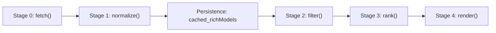
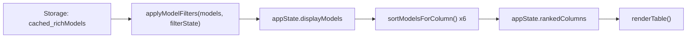

# Top_Models: Complete Architecture and State Specification

**Document Version:** 1.0.0  
**Target File:** `~/storage/downloads/codebase_1.md`  
**Audience:** Incoming AI Pair Programmer / Autonomous Agent  
**Context:** Technical handover document for the `Top_Models` project. Complete standalone reference; reading this document eliminates the need to inspect raw source code for project orientation.

---

## 1. Project Overview

`Top_Models` is a single-user, Bring-Your-Own-Key (BYOK) AI model intelligence dashboard and CLI tool. It retrieves live model catalogs from multiple AI inference providers, filters for chat-capable and zero-cost/developer-tier models, normalizes heterogeneous vendor payloads into a canonical schema, and renders an interactive multi-column ranked matrix.

- **Purpose:** Provide a unified interface comparing available free-tier models across multiple providers, ranking them across six performance dimensions (Context Length, Intelligence, Coding, Agentic, Max Output, and Refusal Rates).
- **Target User:** Solo developer / power user running entirely on personal hardware with personal API keys. There is no central server, no remote database, and no telemetry collection.
- **Tech Stack:**
  - **Core Logic:** Vanilla ECMAScript Modules (ESM), JavaScript (ES2022+).
  - **Frontend:** Single-page application (`index.html`) using semantic HTML5, CSS custom properties, and native DOM manipulation (zero external UI framework dependencies like React or Vue).
  - **CLI:** Node.js executable script (`cli.js`) interacting with system clipboard via Termux API.
  - **Local Proxy:** Lightweight Python 3 HTTP server (`proxy.py`) resolving Cross-Origin Resource Sharing (CORS) preflights for restricted provider endpoints.
  - **Packaging:** Progressive Web App (Service Worker cache) and Capacitor Android wrapper (`@capacitor/core`, `@capacitor/android`).
- **Execution Environment:** Runs locally on an Android smartphone:
  - **Device:** realme 11 5G
  - **SoC:** MediaTek Dimensity 6100+ (8 cores: 2x Arm Cortex-A76 @ 2.2 GHz, 6x Arm Cortex-A55 @ 2.0 GHz)
  - **Memory:** 8 GB LPDDR4X RAM
  - **Shell / Terminal:** Termux (Android Linux userland)

---

## 2. Glossary

- **BYOK (Bring Your Own Key):** Architectural model where the client directly uses the user's personal API credentials stored locally (`localStorage` or `config.json`). No shared server backend stores or proxies credentials.
- **Adapter:** A provider-specific module located in `adapters/<provider>/index.js` exporting three standard functions: `fetch(apiKey, storageAdapter)`, `normalize(rawData, storageAdapter)`, and `filter(normalizedModels)`.
- **Provider:** An external AI service provider (e.g., OpenRouter, Groq, Google Gemini, SambaNova) that hosts and exposes AI models via HTTP REST APIs.
- **NormalizedModel:** The standard 15-property JavaScript object produced by `createNormalizedModel()` in `adapters/_normalize.js`, serving as the universal schema for all downstream ranking, filtering, and UI rendering.
- **CORS Proxy:** A Python server (`proxy.py`) listening exclusively on `127.0.0.1:8081` that relays browser fetch requests to upstream provider APIs while injecting permissive CORS headers (`Access-Control-Allow-Origin: *`, `Authorization` passthrough).
- **IS_BROWSER Check:** Runtime check (`typeof window !== 'undefined' && typeof window.document !== 'undefined'`) used in adapters to determine whether to route requests through the local CORS proxy (browser) or execute direct HTTPS requests (CLI/Node.js).
- **KG_filter (key Group Filter):** Conceptual declarative filter rules for future milestone 0C-6D, defining criteria for filtering normalized models (e.g., chat vs non-chat, free vs paid, modalities).
- **KG_column (key Group Column):** Conceptual schema for future milestone 0C-6E, allowing dynamic columns derived from model data keys rather than hardcoded 6 static columns.
- **Tri-State Field:** A field with three valid states: `true`, `false`, and `null`. Specifically applied to `free`: `true` = model-level free confirmed; `false` = model-level paid/metered confirmed; `null` = no pricing signal available; free access assumed at account level.
- **Cache-Bust Version:** Query string attached to module imports in `index.html` (e.g., `./core.js?v=0F`) forcing browsers to bypass HTTP caches when core scripts are modified.
- **SW (Service Worker):** Client-side worker script (`sw.js`) managing PWA offline asset caching via the Cache API using a versioned container (`CACHE_NAME`).

---

## 3. Environment & Setup

The project runs directly inside the Termux environment on Android. Two local ports are used:
- **Port 8080:** Static web server serving dashboard assets.
- **Port 8081:** Python CORS proxy handling browser-restricted upstream APIs.

### Exact Dev Session Command Sequence:
1. Open Termux on the phone.
2. Navigate to project root:
   ```bash
   cd ~/Top_Models
   ```
3. Start the static HTTP server on port 8080:
   ```bash
   python3 -m http.server 8080
   ```
4. Open a second Termux terminal session (swipe from left drawer $\to$ "New Session"), and navigate to project root:
   ```bash
   cd ~/Top_Models
   ```
5. Start the local CORS proxy on port 8081:
   ```bash
   python3 proxy.py
   ```
6. Open any browser on the device and navigate to:
   ```text
   http://localhost:8080
   ```

---

## 4. Directory Layout

```text
Top_Models/
├── adapters/                  # Modular provider adapter subsystem
│   ├── _filter.js             # Pure in-memory filtering engine & declarative filter definitions
│   ├── _normalize.js          # Canonical factory producing NormalizedModel schema instances
│   ├── _pipeline.js           # Universal coordinator: fetch -> normalize -> filter -> rank
│   ├── _registry.js           # Provider registry dictionary, metadata, and dynamic resolver
│   ├── _sorting.js            # Hierarchical multi-column sorting engine and fallback values
│   ├── cohere/index.js        # Cohere API adapter (fetch, normalize, filter)
│   ├── gemini/index.js        # Google Gemini API adapter (fetch, normalize, filter)
│   ├── groq/index.js          # Groq API adapter (fetch, normalize, filter)
│   ├── llm7/index.js          # LLM7.io API adapter (fetch, normalize, filter)
│   ├── mistral/index.js       # Mistral AI API adapter (fetch, normalize, filter)
│   ├── modelscope/index.js    # Alibaba ModelScope API adapter (fetch, normalize, filter)
│   ├── nvidia/index.js        # NVIDIA NIM API adapter (fetch, normalize, filter)
│   ├── openrouter/index.js    # OpenRouter API adapter (3-tier fetch, benchmarks, endpoints)
│   └── sambanova/index.js     # SambaNova Cloud API adapter (fetch, normalize, filter)
├── benchmarks/                # [Planned Phase 0C-2; directory not yet created] External AA benchmark snapshots
├── www/                       # Capacitor build output directory mirrored by sync-www.js
│   ├── adapters/              # Recursive mirror of adapters/ for native app packaging
│   ├── core.js                # Mirrored core bundle
│   ├── icon.svg               # Mirrored vector app icon
│   ├── index.html             # Mirrored dashboard UI
│   ├── manifest.json          # Mirrored web app manifest
│   └── refusal_rates.json     # Mirrored cached refusal rates
├── capacitor.config.json      # Capacitor native runtime configuration
├── cli.js                     # Node.js CLI binary executable (`models` command)
├── config.json                # Local JSON database for CLI state, API keys, and cached matrices
├── core.js                    # Public facade re-exporting registry, pipeline, sorting, filter engine, and refusal hooks
├── icon.svg                   # Vector application icon
├── index.html                 # Dashboard SPA: layout, CSS styling, table renderer, app state
├── manifest.json              # PWA manifest defining web app display and theme colors
├── model_stats.json           # Historical benchmark seed metrics
├── package.json               # Node.js project manifest, CLI bin declaration, and Capacitor dependencies
├── package-lock.json          # Pinned dependency lockfile
├── proxy.py                   # Local loopback Python CORS proxy (127.0.0.1:8081)
├── README.md                  # Project overview and installation documentation
├── refusal_rates.json         # Static baseline refusal rate evaluations
├── sw.js                      # Service Worker script managing offline asset caching
└── sync-www.js                # Build utility synchronizing root files into www/ for Capacitor
```
*Note: `node_modules/` and `.git/` are excluded from this inventory.*

---

## 5. Pipeline Architecture

The data pipeline processes models through five sequential stages:



### 1. Stage Specifications & Signatures

| Stage | Function Signature | Input | Output | Description |
| :--- | :--- | :--- | :--- | :--- |
| **0. Fetch** | `adapter.fetch(apiKey, storageAdapter)` | API Key (string), Storage Adapter (obj) | Raw Provider Payload (`rawData`) | Retrieves raw catalog from provider API. OpenRouter also retrieves AA benchmarks and endpoint latencies. |
| **1. Normalize** | `adapter.normalize(rawData, storageAdapter)` | Raw Payload, Storage Adapter | `NormalizedModel[]` (`normalizedModels`) | Maps **all** models into the 15-field `NormalizedModel` schema. Populates `is_chat` and `free` tri-state. Drops zero models. |
| **Persistence** | Pipeline Coordinator | `normalizedModels` | Saved to Storage | Writes `cached_richModels_<providerId>` to `localStorage` (browser) or `config.json` (CLI). |
| **2. Filter** | `adapter.filter(normalizedModels)` | `NormalizedModel[]` | `NormalizedModel[]` (`filteredModels`) | Evaluates normalized fields only (`m.is_chat === true && m.free !== false`). Discards non-chat/paid models for default baseline display. In the browser UI, dynamic presentation filtering across the full rich normalized dataset is managed in-memory by `applyModelFilters()` in `adapters/_filter.js`. |
| **3. Rank** | `sortModelsForColumn(filteredModels, colIndex)` | Filtered Models, Column Index (0..5) | `Array[6]` (`rankedColumns`) | Generates a 2D matrix where each column 0..5 is independently sorted according to `sortHierarchy`. |
| **4. Render** | `renderTable()` (in `index.html`) | `appState.rankedColumns` | DOM Mutation | Injects rows into `<tbody>`. Handles primary cells and 3-column extendable drawers. |

### 2. In-Memory Filter Engine (`adapters/_filter.js`)

While `adapter.filter()` defines the default baseline pipeline filter, the interactive browser dashboard utilizes `adapters/_filter.js` to perform zero-latency, in-memory filtering directly over `cached_richModels_<provider>`.

#### Exported Symbols:
- `DEFAULT_FILTER_STATE`: Default configuration `{ free: 'default', is_chat: 'chat_only' }`.
- `FILTER_DEFINITIONS`: Declarative dictionary configuring filter groups (e.g. `free`, `is_chat`), display labels, and corresponding model evaluation predicates.
- `applyModelFilters(models, filterState)`: Pure function evaluating all active predicate rules against the rich model list and returning matching models without mutating input data.

#### Client Presentation Data Flow:


### 3. Pipeline Coordinator Signature
```javascript
export async function runProviderPipeline(providerId, apiKey, storageAdapter)
// Returns: { parsedModels: filteredModels, rankedColumns, refusalRates }
```

### 4. Rationale for Running `normalize()` Before `filter()` (Two-Phase Refactor)
In earlier versions, `filter()` ran on raw API data before `normalize()`. This caused a critical architectural limitation: any model dropped by the filter never reached the schema. Consequently, models with `free: false` could never exist in the system, and toggling a UI filter to display paid models or embeddings required a complete network re-fetch.  
In the current two-phase architecture:
- **Stage 1 (Ingestion):** Normalizes the entire catalog, capturing every model with appropriate metadata (`free: true|false|null`, `is_chat: true|false`).
- **Stage 2 (Presentation):** Applies display predicates in-memory against the rich normalized array via `applyModelFilters()`. UI toggles re-filter instantaneously without network calls.

### 5. Cache Persistence Points
- **Browser (`localStorage`):**
  - `cached_richModels_<provider>`: Full normalized catalog (pre-filter snapshot).
  - `cached_parsedModels_<provider>` & `cached_parsedModels`: Baseline filtered models array.
  - `cached_rankedColumns_<provider>` & `cached_rankedColumns`: 2D ranked matrix.
  - `benchmarks_snapshot`: Raw OpenRouter Artificial Analysis benchmark JSON.
  - `cached_refusalRates`: Map of model ID $\to$ estimated refusal score.
- **CLI (`config.json`):**
  - `openRouterApiKey`: Saved OpenRouter credentials.
  - `cached_richModels_<provider>`: Full normalized catalog.
  - `cached_parsedModels`: Filtered display models.
  - `cached_rankedColumns`: 2D ranked matrix.
  - `cached_refusalRates`: Refusal rate estimates.

---

## 6. Adapter Interface Contract

Every adapter in `adapters/<provider>/index.js` must adhere strictly to the following contract:

### Required Exports
```javascript
export async function fetch(apiKey, storageAdapter)
export function normalize(rawData, storageAdapter)
export function filter(normalizedModels)
```

### Canonical `NormalizedModel` Schema
Created exclusively via `createNormalizedModel()` in `adapters/_normalize.js`:

| Field Name | Type | Allowed Values / Defaults | Description |
| :--- | :--- | :--- | :--- |
| `id` | `string` | Unique model ID (e.g. `"groq/llama-3.3-70b-versatile"`) | Canonical identifier used for lookups and refusal mapping. |
| `name` | `string` | Display name (defaults to `id`) | Human-readable model title. |
| `context_length` | `number \| null` | Integer tokens (e.g. `131072`) or `null` | Maximum context window capacity in tokens. |
| `max_completion_tokens`| `number \| null` | Integer tokens (e.g. `8192`) or `null` | Maximum generation / output token limit. |
| `intelligence_index` | `number \| null` | Float (0–100) or `null` | Benchmark score from Artificial Analysis Quality Index. |
| `coding_index` | `number \| null` | Float (0–100) or `null` | Benchmark score from HumanEval / coding benchmarks. |
| `agentic_index` | `number \| null` | Float (0–100) or `null` | Benchmark score for tool use and agent workflows. |
| `refusal_rate` | `number \| null` | Float (0–100) or `null` | Estimated refusal percentage for sensitive prompts. |
| `has_files` | `number` | `1` or `0` | Binary indicator for vision/file ingestion capability. |
| `has_tools` | `number` | `1` or `0` | Binary indicator for function calling / tool use capability. |
| `uptime` | `number \| null` | Float percentage (e.g. `99.8`) or `null` | 30-minute endpoint availability rate. |
| `latency` | `number \| null` | Float milliseconds (e.g. `340`) or `null` | Median (p50) response time. |
| `raw_modalities` | `string` | Comma-separated lowercase (e.g. `"text"`, `"text, image"`) | Input modalities accepted by the model. |
| `free` | `boolean \| null` | `true`, `false`, or `null` | **Tri-State Free Tier Status** (detailed below). |
| `is_chat` | `boolean` | `true` or `false` | Indicates whether model supports chat completion. |

### The `free` Tri-State Definition
`free` is **not** a simple boolean. It enforces strict tri-state semantics:
- **`true`:** The provider API explicitly reports zero cost at the model level (e.g., OpenRouter `pricing.prompt === "0"` or LLM7 `usage_based_only === false`).
- **`false`:** The provider API explicitly confirms that usage is metered or paid (e.g., OpenRouter non-zero pricing or LLM7 `usage_based_only === true`).
- **`null`:** The provider API exposes no model-level pricing metadata (Groq, Gemini, Mistral, Cohere, ModelScope, NVIDIA NIM). Free access is an account-level entitlement governed by developer console rate limits or trial credits.

#### Pricing vs. Rate Limiting Orthogonality
Financial pricing ($/token) and infrastructural rate limiting (RPM/RPD/TPM) are completely orthogonal dimensions. `free` strictly represents financial cost per token; it does not indicate whether an API key has remaining rate limit quotas, trial credits, or tier access. Future rate limit metrics are managed separately via telemetry ingestion.

---

## 7. The 9 Providers

| Provider Name | Folder Key | Endpoint URL | Auth Method | Chat Filter Rule | Free-Tier Detection | Known Quirks | CORS Proxy Required? |
| :--- | :--- | :--- | :--- | :--- | :--- | :--- | :--- |
| **OpenRouter** | `openrouter` | `https://openrouter.ai/api/v1/models` | `Authorization: Bearer <key>` | All catalog models are chat-capable (`is_chat = true`) | `pricing.prompt === "0"` $\to$ `true`, else `false` | 3-tier fetch: queries `/benchmarks`, `/models`, and parallel `/endpoints`. Pre-filters endpoints probes to free models only. | **No** |
| **Groq** | `groq` | `https://api.groq.com/openai/v1/models` | `Authorization: Bearer <key>` | `active !== false` & text output; excludes `whisper-`, `prompt-guard`, `safeguard`, `orpheus` | No model pricing (`free = null`) | Tools capability derived dynamically from `supported_features.includes('tools')`. | **No** |
| **Google Gemini** | `gemini` | `https://generativelanguage.googleapis.com/v1beta/models` | `x-goog-api-key: <key>` | `supportedGenerationMethods.includes('generateContent')` | No model pricing (`free = null`) | ID stripped of `models/` prefix. Multimodal files set for `gemini-*`, text-only for `gemma-*`. | **No** |
| **SambaNova** | `sambanova` | `https://api.sambanova.ai/v1/models` | `Authorization: Bearer <key>` | All 6 models are chat LLMs (`is_chat = true`) | No model pricing used (`free = null`) | Returns 6 models. Non-zero token pricing in payload is ignored (covered by cloud free tier). | **Yes** (No CORS headers) |
| **Mistral AI** | `mistral` | `https://api.mistral.ai/v1/models` | `Authorization: Bearer <key>` | `capabilities.completion_chat === true` | No model pricing (`free = null`) | Vision and function calling extracted from `capabilities` dictionary. | **No** |
| **Cohere** | `cohere` | `https://api.cohere.com/v2/models` | `Authorization: Bearer <key>` | `endpoints` contains `'chat'` or `'generate'` | No model pricing (`free = null`) | Uses `name` as identifier (no `id` property in response). | **No** |
| **LLM7.io** | `llm7` | `https://api.llm7.io/v1/models` | `Authorization: Bearer <key>` | `model_type === 'chat'` | `usage_based_only === false` $\to$ `true`, `true` $\to$ `false` | 41 of 49 chat models are paid metered models; filter strictly isolates the 8 `free === true` models. | **Yes** (Authorization header forbidden in preflight) |
| **ModelScope** | `modelscope` | `https://api-inference.modelscope.cn/v1/models` | `Authorization: Bearer <key>` | Excludes `image-edit` in ID | No model pricing (`free = null`) | Bare OpenAI schema. Context length and max output are unavailable (`null`). | **No** |
| **NVIDIA NIM** | `nvidia` | `https://integrate.api.nvidia.com/v1/models` | `Authorization: Bearer <key>` | Excludes `embed`, `guard`, `rerank`, `deplot`, `retriever` in ID | No model pricing (`free = null`) | Bare schema. Vision derived from ID heuristics (`vision`, `vlm`, `fuyu`). Tools derived from `instruct`/`chat`. | **Yes** (No CORS headers) |

---

## 8. Provider Implementation Status

- **Status:** All 9 provider adapters are fully implemented, verified, and operational in both CLI and browser contexts.
- **CORS Dependency (Browser Mode):**
  - **Direct Access (No Proxy Needed):** OpenRouter, Groq, Gemini, Mistral, Cohere, ModelScope.
  - **Proxy Required:** NVIDIA NIM (missing upstream CORS headers), SambaNova (missing upstream CORS headers), LLM7.io (browser preflight fails due to upstream header restrictions).
- **CLI Mode:** All 9 providers connect directly without the CORS proxy because Node.js does not enforce CORS.

---

## 9. Sorting Engine

Located in `adapters/_sorting.js`. Operates identically across browser and CLI.

### Exported Symbols
- **`S`:** Dictionary mapping metric keys:
  ```javascript
  export const S = {
      ctx: 'context_length',
      out: 'max_completion_tokens',
      intel: 'intelligence_index',
      code: 'coding_index',
      agent: 'agentic_index',
      refuse: 'refusal_rate',
      file: 'has_files',
      tool: 'has_tools',
      up: 'uptime'
  };
  ```
- **`sortHierarchy`:** Mapping of column index (0..5) to an ordered array of tie-breaker rules `{ k: key, d: descending_boolean }`:
  - **Column 0 (Context Window):** Primary: `context_length` (desc). Secondary tie-breakers: `has_files`, `context_length`, `max_completion_tokens`, `intelligence_index`, `agentic_index`, `uptime`.
  - **Column 1 (Thinking / Intelligence):** Primary: `intelligence_index` (desc). Tie-breakers: `context_length`, `max_completion_tokens`, `has_tools`, `uptime`.
  - **Column 2 (Coding):** Primary: `coding_index` (desc). Tie-breakers: `agentic_index`, `has_tools`, `max_completion_tokens`, `context_length`, `intelligence_index`.
  - **Column 3 (Agentic):** Primary: `agentic_index` (desc). Tie-breakers: `has_tools`, `coding_index`, `max_completion_tokens`, `context_length`, `intelligence_index`, `uptime`.
  - **Column 4 (Summarizer / Output Limit):** Primary: `max_completion_tokens` (desc). Tie-breakers: `context_length`, `intelligence_index`, `coding_index`, `agentic_index`, `uptime`.
  - **Column 5 (Refusal Rate):** Primary: `refusal_rate` (**asc** — lower refusal is better). Tie-breakers: `coding_index`, `agentic_index`, `intelligence_index`, `context_length`, `max_completion_tokens`, `uptime`.
- **`val(obj, key, fallback)`:** Numeric extractor converting `undefined`, `null`, or `NaN` into a numeric sentinel value.
- **`sortModelsForColumn(models, colIndex)`:** Implements stable hierarchical multi-key sorting.
- **Column 5 Fallback Sentinel Fix:** For columns 0–4, missing values receive fallback `-999999` (sorting missing data to the bottom). For Column 5 (Refusal Rate, sorted ascending), missing values receive fallback `+999999` so models with unknown refusal rates sort to the bottom rather than falsely appearing as 0% refusal.

---

## 10. CORS Proxy

Implemented in `proxy.py`.

- **Purpose:** Upstream APIs for NVIDIA NIM and SambaNova do not emit CORS response headers (`Access-Control-Allow-Origin`), causing browsers to drop responses. LLM7 disallows the `Authorization` header in CORS preflight. The local proxy resolves these issues for local development.
- **Network Binding:** Binds exclusively to `127.0.0.1` on port `8081`. It rejects any target URL not beginning with `https://`.
- **Header Handling:**
  - Upstream request forwards incoming `Authorization` headers.
  - Proxy injects permissive headers:
    ```http
    Access-Control-Allow-Origin: *
    Access-Control-Allow-Headers: Authorization, Content-Type
    Access-Control-Allow-Methods: GET, OPTIONS
    Access-Control-Max-Age: 86400
    ```
  - Forwards upstream HTTP status codes, error bodies, and `Content-Type` headers verbatim.
- **`IS_BROWSER` Detection Pattern:**
  Used inside `adapters/nvidia/index.js`, `adapters/sambanova/index.js`, and `adapters/llm7/index.js`:
  ```javascript
  const IS_BROWSER = typeof window !== 'undefined' && typeof window.document !== 'undefined';
  const PROXY_BASE = 'http://localhost:8081/proxy?url=';

  const targetUrl = IS_BROWSER
      ? PROXY_BASE + encodeURIComponent('https://api.sambanova.ai/v1/models')
      : 'https://api.sambanova.ai/v1/models';
  ```

---

## 11. CLI

The CLI is a standalone Node.js tool exposed via the `models` binary link defined in `package.json` (`./cli.js`).

### CLI Commands
- `models keys <key>`: Persists the OpenRouter API key into `config.json`.
- `models refresh`: Fetches dashboard data via `runProviderPipeline('openrouter', key, storageAdapter)`, updates `cached_parsedModels`, `cached_rankedColumns`, and `cached_richModels_openrouter` in `config.json`.
- `models estimate`: Runs LLM-based refusal rate estimation via `refreshRefusalRates()` using `openrouter/free` and updates cached ranks.
- `models fetch`: Reads `cached_rankedColumns` from `config.json` and copies formatted JSON to the Android system clipboard via `termux-clipboard-set`.

### Storage Interface
The CLI defines a synchronous file-backed storage adapter interfacing with `config.json` in the project root:
```javascript
const storageAdapter = {
    getItem: (key) => JSON.parse(fs.readFileSync(configPath, 'utf-8'))[key] || null,
    setItem: (key, val) => {
        const config = JSON.parse(fs.readFileSync(configPath, 'utf-8'));
        config[key] = val;
        fs.writeFileSync(configPath, JSON.stringify(config, null, 2), 'utf-8');
    }
};
```

---

## 12. UI Structure

`index.html` is structured into four primary visual and functional zones:

1. **Header Zone:**
   - Provider switcher trigger (`#hamburger-btn`).
   - Active provider badge (`#active-provider-badge`).
   - Password input field for API credentials (`#api-key`) with direct helper link to provider key generation consoles (`#api-key-link`).
   - Action controls: `Refresh` (`#refresh-btn`), `Refresh Refusal Rates` (`#refresh-refusal-btn`), and `Export Data` (`#export-btn`).
   - Status log banner (`#status`).
2. **Sidebar Drawer (`.side-panel`):**
   - Modal drawer triggered by the hamburger icon.
   - Categorized into **Group A (OpenAI-Compatible)** and **Group B (Custom API)**.
   - Dynamic status badges: Shows green checkmark if API key is stored, or "Ready" / "Coming soon" badge based on `PROVIDER_REGISTRY[p].implemented`.
3. **Table Container (`.table-wrapper`):**
   - Renders 6 base column headers: Context Window, Thinking, Coding, Agentic, Summarizer, Refusal Rates.
   - Dynamic rows generated by `renderTable()`. Each cell displays the model name, primary metric value, and an `Extend` / `Collapse` toggle.
   - **Model-Bound Extended Row Lifecycle:** Expansion state is tracked by canonical model identity (`appState.expanded = { modelId, colIndex }`) rather than an unstable row index. During `renderTable()`, `appState.expanded` dynamically reconciles against current `rankedColumns`; if the expanded model has been filtered out, it automatically collapses (`appState.expanded = null`). Expanding a row dynamically appends 3 extended header columns (`Modalities`, `Uptime (%)`, `Latency (ms)`) to `thead` and injects an `.extended-row` displaying full multi-column metrics across the table.
   - **Table-Body Event Delegation:** Cell interaction uses delegated click handling attached directly to `<tbody id="table-body">`. The listener captures clicks on `.extend-btn` elements via `data-row` and `data-col` attributes, eliminating all legacy `window.toggleExtend` global functions and inline `onclick` attributes.
   - **Empty-State Table Card:** When active filters exclude all cached models ($M \ge 1, N = 0$), `renderTable()` renders a centered empty-state card across all columns with message *"No models match the current filter criteria"* and an embedded reset button (`#empty-state-reset-btn`) wired to `handleFilterReset()`.
4. **Action Bar Below Table (`.table-actions-bar`):**
   - Sits directly below `.table-wrapper` in normal document flow (`position: relative`).
   - Contains:
     - `#desktop-toggle-fab`: Desktop view toggle button (`🖥️`).
     - `.filter-btn-container`: Relative positioning container anchoring the filter controls and popover.
     - `#filter-btn`: Active filter toggle button displaying `#filter-active-dot` (amber visual dot shown when active filters diverge from default state) and `#model-count-indicator` badge.
     - **Descriptive Counter States:** `#model-count-indicator` renders three distinct operational states computed at runtime:
       1. `"No models cached"` (when total cached models $M = 0$, filter button disabled).
       2. `"0 of 0 models"` (transient state if cached array is empty).
       3. `"Showing N of M models"` (active state indicating filtered count $N$ out of total cached models $M$).
     - `#filter-popover`: Anchored floating dialog (`role="region"`), positioned above the action bar (`bottom: calc(100% + 8px)`), dynamically rendering filter controls from `FILTER_DEFINITIONS` with radio groups and reset actions.
     - **Dismissal Lifecycle:** Popover closes on 7 distinct interaction triggers: Outside Click, `Escape` key, Filter Button Toggle, Provider Switch (`switchProvider`), Refresh Data click, Refresh Refusal click, or Export Data click.
     - **Atomic 8-Step Reset:** `handleFilterReset()` cleanly restores `DEFAULT_FILTER_STATE`, updates radio DOM checked states, writes to `localStorage`, recalculates `displayModels` and `rankedColumns`, resets `appState.expanded = null`, invokes `renderTable()`, and updates the counter indicator.

---

## 13. Service Worker & Cache Strategy

- **File:** `sw.js`
- **Current Cache Identifier:** `const CACHE_NAME = 'matrix-cache-v11';`
- **Cached Assets:** Full 19-entry precache list:
  - Base: `./`, `./index.html`, `./core.js`, `./manifest.json`, `./icon.svg`
  - Scaffolding: `./adapters/_filter.js`, `./adapters/_sorting.js`, `./adapters/_normalize.js`, `./adapters/_pipeline.js`, `./adapters/_registry.js`
  - Provider Modules: `./adapters/openrouter/index.js`, `./adapters/groq/index.js`, `./adapters/gemini/index.js`, `./adapters/sambanova/index.js`, `./adapters/mistral/index.js`, `./adapters/cohere/index.js`, `./adapters/llm7/index.js`, `./adapters/modelscope/index.js`, `./adapters/nvidia/index.js`
- **Cache Strategy:**
  - **Asset Requests:** Cache-first with network fallback. During installation, it pre-caches core assets. On activation, it deletes old cache buckets whose names do not match `CACHE_NAME`.
  - **Navigation Route:** Network-first caching strategy for navigation and HTML requests (`event.request.mode === 'navigate' || url.pathname.endsWith('.html')`). Ensures browsers receive fresh dashboard shells upon reload while retaining seamless offline fallback if the network is unavailable.
- **Cache Busting Pattern:** In `index.html`, the ES module import references `./core.js?v=0I`. Every modification to core JavaScript requires bumping this query parameter and matching `CACHE_NAME` in `sw.js` to force browser reloading.

---

## 14. Build Process

- **Script:** `sync-www.js` executed via `npm run build:web`.
- **Function:** Synchronizes the root web source files into the `www/` directory for Capacitor native Android builds:
  - Deletes and recreates `www/`.
  - Copies `index.html`, `core.js`, `manifest.json`, and `icon.svg`.
  - Copies `refusal_rates.json` only if the file exists.
  - Recursively mirrors `adapters/` $\to$ `www/adapters/` using `fs.cpSync(..., { recursive: true })`.
  - **Exclusion:** Intentionally omits `sw.js` from `www/` because Service Workers are known to fail or conflict with Capacitor's local webview server (`http://localhost`).

---

## 15. Version State

*(Verified via read-only audit of repository files on 2026-10-17)*

- **`index.html` Module Import Version:** `core.js?v=0I`
- **`sw.js` Cache Version:** `matrix-cache-v11`
- **Next Version Targets:** `core.js?v=0J` and `matrix-cache-v12`.

---

## 16. Verification Workflow

Development on `Top_Models` operates under a strict **two-party verification protocol**:
- **Agent Role:** Read-only inspection, file modifications, automated syntax checks (`node --check <file>`), CLI validation (`models refresh`), and web build synchronization (`npm run build:web`).
- **User Role:** Physical interaction and verification on the Android smartphone: reloading the browser (`http://localhost:8080`), switching provider tabs, verifying table rendering, and testing interactive UI controls.
- **Constraint:** The AI agent does **not** have browser access and cannot inspect rendered DOM elements. The agent must never claim UI features are visually verified without explicit user test confirmation.

---

## 17. Milestone Roadmap

### Completed Milestones
- **0C-6A (Schema Extension):** Added `free: null` and `is_chat: true` to `createNormalizedModel()`.
- **0C-6B (Pipeline Reorder & Audit Fixes):** Inverted pipeline execution so `normalize()` processes all models before `filter()` runs. Fixed LLM7 paid model exclusion, Groq dynamic tool derivation, Gemini/SambaNova capability cleanups, and standardized modality syntax.
- **0C-6C (UI Foundation & Rich Model Persistence):** Relocated floating desktop toggle into a static `.table-actions-bar` below the table; added disabled `Filter` placeholder; added `cached_richModels_<provider>` persistence in `_pipeline.js`.
- **0C-6D (Dynamic Filter UI & Extended Row Event Delegation):** Implemented in-memory filtering engine (`adapters/_filter.js`), anchored popover UI with dynamic predicate evaluation, descriptive counter states, atomic reset handler, empty-state card, model-bound extended-row lifecycle, and `tbody` event delegation. (Commit `942bb06`).

### Upcoming Milestones
- **0C-6E (Dynamic Column UI — `KG_column`):** Replace fixed 6-column `thead` with dynamic, schema-driven column selection; column visibility toggle popover/drawer; user-selected sort hierarchies across any numeric/comparable schema property; persistent layout per provider (`columnState_<providerId>`).
- **0C-6F (Multi-Provider Home Page & Global View):** Aggregate multi-cloud discovery root view across all enabled providers. Core UI Parity Invariant: Top controls (Refresh, Estimate Refusal Rates, Export) and bottom controls (Filter, Zoom) maintain exact physical positions as individual provider pages; global cascade (multi-provider refresh, nested JSON export, global filter via `filterState_global`).
- **0C-6G (Advanced Capability & Modality Filters):** Declarative tri-state toggles (`has_tools`, `has_files`) and input modality toggles (`text`, `image`, `audio`) in `_filter.js` without HTML churn.
- **0C-2 (Multi-Source Benchmark Enrichment):** Comprehensive multi-source benchmark ingestion spanning Artificial Analysis, LiveBench (Free, coding/reasoning), HuggingFace Open LLM Leaderboard (Free), BenchLM (Free tier), BenchGecko (Free tier), and LMArena (Web only); cross-provider slug normalization.
- **0C-7 (Cross-Provider Refusal Rates):** Extend `refreshRefusalRates` estimation logic to normalize model slugs across all providers, populating refusal rates across all non-OpenRouter models.
- **0C-8 (Group B Provider Adapters — Custom APIs):** Implement remaining 4 registry providers (Cloudflare Workers AI, Ollama, OVHcloud, IBM watsonx.ai).
- **0C-9 (Telemetry & Rate Limit Ingestion):** Ingest model-level and account-level rate limits (RPM, RPD, TPM) and latency/TTFT via headers/endpoints with documented static fallback.
- **0D-1 (2-Layer Normalization Architecture — Heavy Lift):** Layer 1 lossless dynamic ingestion capturing upstream vendor properties, endpoints, quotas, and all 6 multi-source benchmark evaluation fields; Layer 2 interactive semantic mapping projecting Layer 1 attributes into dynamic matrix columns (`KG_column`) and filter criteria (`KG_filter`).
- **0D-2 (Model Routing & Recommendation Engine):** Autonomous client-side model router evaluating user task constraints (free tier, context window, latency, benchmark thresholds, rate limits, modalities) with Pareto-optimal scoring and API snippet generation.
- **0E-1 (CLI Parity & Metadata Export Modernization):** Upgrade `cli.js` to universal 13-provider pipeline support with CLI filtering (`--free-only`, `--chat-only`); modernize `Export Data` payload with provenance, timestamps, active filters, and schema version.
- **0E-2 (Production Edge CORS Proxy Deployment):** Deploy lightweight Cloudflare Worker / Vercel Edge function to resolve Mixed Content blocking on live HTTPS origins (GitHub Pages).
- **0E-3 (Production Release — GitHub Pages & Native APK):** Final push to `origin/main`, live GitHub Pages PWA deployment, signed Capacitor Android APK build, and v1.0.0 release tagging.

---

## 18. Git State

- **Local Branch:** `main`
- **Remote Tracking:** `origin/main` is at commit `41c7ed7` (Phase 0A).
- **Verified Local Commits (Ahead of Origin by 6 commits at audit time):**
  - `942bb06`: Milestone 0C-6D: Implement in-memory filter UI, model-bound extended rows, and event delegation
  - `cbfd90d`: Phase 0C-6A/6B/6C + Maintenance: Schema, Pipeline, UI, SW precache, and doc corrections
  - `f2b0dcc`: Feat: Add local CORS proxy and configure NVIDIA, SambaNova, and LLM7 adapters
  - `d9b1aa7`: Phase 0C-1: Implement 8 provider adapters (Groq, Gemini, SambaNova, Mistral, Cohere, LLM7, ModelScope, NVIDIA NIM)
  - `d864b44`: Phase 0C-1 Milestone 2: OpenRouter adapter migration, sidebar reconciliation, and SW v4 cache bump
  - `3f78235`: Phase 0C-1 Milestone 1: Shared adapter scaffolding, sorting engine extraction, and sync-www update
- **Commit Hash Verification:** Confirmed that `942bb06` is the exact 7-character git short hash for Milestone 0C-6D.
- **Working Tree State:** Clean; working tree is fully committed and synchronized with `www/`.
- **Policy:** Exactly one clean local commit per verified milestone. No amends. No push to origin without explicit user direction.

---

## 19. Known Issues & Deferred Work

1. **Live GitHub Pages CORS:** GitHub Pages serves over HTTPS (`https://<user>.github.io`). Browsers block requests to `http://localhost:8081` from HTTPS origins due to Mixed Content security rules. Supporting NVIDIA, SambaNova, and LLM7 on the live site will require a cloud-hosted edge proxy (e.g. Cloudflare Worker).
2. **Account-Level Free Assumptions:** 6 of the 9 providers (Groq, Gemini, Mistral, Cohere, ModelScope, NVIDIA NIM) provide no per-model pricing in their `/models` endpoints. Models are assumed free based on developer account tier quotas.
3. **Artificial Analysis Enrichment:** Benchmark metrics (`intelligence_index`, `coding_index`, `agentic_index`) are currently populated exclusively for OpenRouter. Non-OpenRouter adapters return `null` pending Phase 0C-2 fuzzy matching.
4. **Refusal Rates for Other Providers:** Non-OpenRouter models default refusal rates to `null`. Running `refreshRefusalRates` currently queries `openrouter/free` using model IDs; matching non-OpenRouter model IDs requires cross-provider slug normalization.

---

## 20. Config File Shapes

### 1. `config.json` (CLI Configuration & Local Storage)
*(Illustrative schema. Some fields, e.g., `cached_richModels_openrouter`, populate only after `models refresh` has run at least once post-0C-6C).*
```json
{
  "openRouterApiKey": "YOUR_API_KEY_HERE",
  "benchmarks_snapshot": {
    "data": [
      {
        "model_permaslug": "meta-llama/llama-3.3-70b-instruct",
        "intelligence_index": 72.4,
        "coding_index": 68.1,
        "agentic_index": 65.0
      }
    ]
  },
  "cached_richModels_openrouter": "[{\"id\":\"model-id\",\"name\":\"Model Name\",\"free\":true,\"is_chat\":true}]",
  "cached_parsedModels": "[{\"id\":\"model-id\",\"name\":\"Model Name\",\"free\":true}]",
  "cached_rankedColumns": "[[],[],[],[],[],[]]",
  "cached_refusalRates": "{\"meta-llama/llama-3.3-70b-instruct:free\":3.8}"
}
```

### 2. `refusal_rates.json` (Baseline Refusal Cache)
```json
{
  "last_updated": "2026-10-02T04:49:42.249033Z",
  "rates": {
    "meta-llama/llama-3-8b-instruct:free": 4.2,
    "google/gemma-2-9b-it:free": 2.1,
    "mistralai/mistral-nemo:free": 6.8,
    "meta-llama/llama-3.1-8b-instruct:free": 3.9,
    "microsoft/phi-3-mini-128k-instruct:free": 5.5,
    "microsoft/phi-3-medium-128k-instruct:free": 4.8,
    "qwen/qwen3.8-27b:free": 1.5,
    "default": 5.0
  }
}
```

### 3. Browser `localStorage` Keys
- `cached_richModels_<providerId>`: Full normalized catalog snapshot (`NormalizedModel[]`).
- `cached_parsedModels_<providerId>` & `cached_parsedModels`: Baseline filtered models array.
- `cached_rankedColumns_<providerId>` & `cached_rankedColumns`: 2D ranked matrix array.
- `cached_refusalRates`: Map of model ID $\to$ estimated refusal score.
- `benchmarks_snapshot`: Raw OpenRouter Artificial Analysis benchmark JSON.
- `filterState_<providerId>`: JSON object storing active filter criteria for the provider:
  ```json
  {
    "free": "default",
    "is_chat": "chat_only"
  }
  ```
  *(Written via quota-safe helper `safeSetItem(key, val)` to gracefully absorb quota exceeded errors).*
- `activeProvider`: Currently selected provider ID string (e.g. `"openrouter"`, `"groq"`).
- `apiKey_<providerId>`: Saved API key for the corresponding provider.

---

## 21. Dependencies

From `package.json`:

### Runtime Dependencies
Zero external npm production dependencies for the web or CLI runtime. The dashboard and CLI use native Node.js ESM and standard Web APIs (`fetch`, `localStorage`, `caches`).

### Capacitor Android Packaging Dependencies
- `@capacitor/core`: `^8.5.2` (Capacitor runtime bridge)
- `@capacitor/cli`: `^8.5.2` (Build tooling and sync runner)
- `@capacitor/android`: `^8.5.2` (Native Android platform container)
- `@capacitor/filesystem`: `^8.1.4` (Native filesystem plugin)
- `@capacitor/share`: `^8.0.3` (Native Android system share sheet plugin)

---

## 22. Design Decisions & Rationale

1. **Option A' (Dedicated Folder Per Provider) vs. Declarative JSON Config:**  
   While declarative JSON configs work for standard OpenAI clones, providers routinely introduce structural deviations: Gemini uses `x-goog-api-key` and `v1beta/models`; Cohere uses `name` instead of `id` and requires `v2/models`; OpenRouter requires 3-tier parallel telemetry and benchmark merging; LLM7 uses custom `usage_based_only` booleans. Dedicated ES modules (`adapters/<provider>/index.js`) encapsulate vendor quirks with zero leaky abstractions.
2. **KG_filter vs. KG_column Conceptual Split (0C-6D & 0C-6E):**  
   Filtering and column rendering address orthogonal concerns:
   - `KG_filter` controls **which rows exist** in the candidate matrix (e.g. Chat vs Vision vs Paid).
   - `KG_column` controls **which vertical attributes are visualized** (e.g. Context vs Coding vs Latency). Decoupling them prevents filter states from mutating column schemas.
3. **Why `free` is a Filter Field, Not a Table Column:**  
   `free` is an eligibility prerequisite, not a comparable performance metric. Users do not sort models by "how free" they are; they want to restrict the matrix to zero-cost models or inspect paid models. Modeling `free` as a tri-state filter attribute rather than a ranked column keeps the matrix focused on technical capability.
4. **Why `normalize()` Precedes `filter()`:**  
   Ensures data acquisition produces a complete, loss-free canonical representation (`NormalizedModel[]`). Discarding models during ingestion permanently deprives client state of those records. Pre-filter normalization allows the UI to switch between "Free Only" and "Show All" instantaneously without re-contacting upstream APIs.
5. **Runtime `IS_BROWSER` Check vs. Build-Time Bundler:**  
   The codebase intentionally avoids a Webpack/Vite build step, preserving rapid Termux iteration where file edits are immediately live upon browser refresh. Using `typeof window !== 'undefined'` allows identical adapter source files to run in both Node.js (`cli.js`) and modern mobile browsers.

---

## 23. Critical Safeguards for Future Work

Incoming agents must adhere to the following strict operational rules:
1. **DO NOT modify `adapters/_sorting.js`:** The multi-tier hierarchy and column 5 sentinel values are delicately balanced. Do not alter sorting logic without an explicit test plan.
2. **DO NOT modify `adapters/_normalize.js` without schema agreement:** `createNormalizedModel()` defines the contract for all 9 adapters. Adding or removing fields requires updating all adapters and renderers.
3. **DO NOT push to `origin`:** Remote pushes are strictly reserved for user-approved milestone releases. All development commits remain local.
4. **DO NOT hardcode column names in table renderers:** Anticipate milestone 0C-6E by keeping cell rendering data-driven.
5. **DO NOT invent fake capability metrics:** Missing data must remain `null` so the table accurately displays `-`. Never supply fake token counts or capability flags.
6. **DO NOT fire unmetered bulk endpoint requests:** OpenRouter contains 300+ models. Never loop over all catalog models with `/endpoints` probes; only probe verified candidate models.

---

## 24. Reference Material

- `~/storage/downloads/provider_research/`: Directory containing raw, unaltered JSON API responses for all 9 providers:
  - `groq_models.json`
  - `gemini_models.json`
  - `sambanova_models.json`
  - `mistral_models.json`
  - `cohere_models.json`
  - `llm7_models.json`
  - `modelscope_models.json`
  - `nvidia_nim_models.json`
- `~/storage/downloads/two_phase_normalization_plan.md`: Comprehensive architectural plan specifying the transition from single-pass filtering to two-phase normalization.
- `~/storage/downloads/provider_audit_report.md`: Audit report identifying unutilized pricing fields (LLM7 `usage_based_only`), hardcoded tool flags, and syntax discrepancies across adapters.
